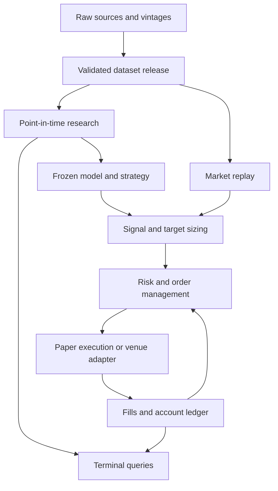

# MOSAIC | Terminal and quantitative research handbook

**Research edition · 28 November 2026 · main system design, with a college web client**

**Decision.** Build the exchange clock, dataset manifest, replay engine and ledger first. Use them to deliver a single believable terminal action: load an instrument, inspect the information available at that instant, submit a paper order, advance the clock and reconcile the fill. Then put research models through the same decision clock. Keep all twenty Fincept screen families in scope. Each becomes usable when its inputs and acceptance test exist.

**What the evidence covers.** The Fincept inventory below is exhaustive for application screenshots in the pinned directory. I examined the images, source tree, architecture document and selected implementation files. For the wider field, this is a curated, expandable survey of public implementations, primary papers, financial data documentation and Hugging Face artifacts. Public code shows how its authors approached a problem. It rarely supplies an audited live return stream, data rights or controlled evidence of transferable edge. Findings from three reproducible experiments are included towards the end. The rest of the experiments are specified for execution. No claim of market-wide coverage or tradable NSE performance is implied.

**How to navigate.** Read §§1–3 for product scope and system boundaries, §§4–7 for strategy and model development, §§8–10 for validation and deployment, §11 for measured results, §12 for a source-by-source engineering index, and §§13–14 for the learning sequence and handover. Links beside individual topics identify evidence. Numerical configurations called “proposed” are MOSAIC starting points.

## 1. What the terminal must do

### The reference and the product

Bloomberg's public introduction teaches the operator to load a security and select a function. Use that interaction literally in MOSAIC. A proposed command such as `MOS-50 TRADE` should resolve the instrument, switch function, restore its selected session and place focus on the workspace. `HELP TRADE` should list eligible order types, keyboard actions and the simulator's fill convention. Keep a visible function menu and autocomplete so faculty can discover the same path using a mouse. Set independent link groups for panes so investigating a second symbol never silently retargets an open ticket. Include venue, currency, replay time, mode, source freshness and unit wherever a mistaken reading would alter a decision. [Bloomberg Terminal Essentials](https://professional.content.cirrus.bloomberg.com/professional2023/insights/technology/bloomberg-terminal-essentials-getting-started/)

Use a near-black canvas, rectangular docked panes, tight aligned rows, tabular digits, amber editable values and recognizable textual statuses. Make the active input and keyboard focus distinguishable from a warning. Reserve red and green for signed moves or explicitly labeled state. Limit animation to changed observations and mode transitions. A failed subscription freezes the last timestamp and marks the pane stale. A paused replay remains healthy. Keyboard navigation must work at 125% zoom. In the college web client a narrow viewport can switch between chart, ticket and journal; in the native client the same IDs and contracts can drive dockable windows. All quotations in a replay come from that replay's clock.

**Fincept source snapshot** `914134de5fd227fe66969c4591ac9ca7e461cdf4`. Directory enumeration returned 20 PNGs and one Windows download SVG. All 20 PNGs were visually inspected. Links in the matrix point to that revision. Acceptance criteria, prerequisites and proposed functions are MOSAIC design decisions. Fincept marketing, enterprise offerings and open-source code are separate evidence. Its architecture guide explicitly distinguishes current from target design. [Image directory](https://github.com/Fincept-Corporation/FinceptTerminal/tree/914134de5fd227fe66969c4591ac9ca7e461cdf4/images) · [Architecture](https://github.com/Fincept-Corporation/FinceptTerminal/blob/914134de5fd227fe66969c4591ac9ca7e461cdf4/docs/ARCHITECTURE.md)

### Feature-to-evidence matrix

| Screen and reference | Composition to reproduce | Data and computation to build | Operator acceptance test |
|---|---|---|---|
| [Dashboard](https://github.com/Fincept-Corporation/FinceptTerminal/blob/914134de5fd227fe66969c4591ac9ca7e461cdf4/images/Dashboard.png) · `HOME` | Tiled monitor, sector heatmap, gauge, headlines and movers | Join clock-aligned returns to effective sector membership. Define and expose every gauge denominator; unknown coverage stays visible. | Select a sector and reproduce its weight and change from constituent rows at the logged time. |
| [Markets](https://github.com/Fincept-Corporation/FinceptTerminal/blob/914134de5fd227fe66969c4591ac9ca7e461cdf4/images/Markets.png) · `MON` | Grouped quote boards, change columns, sparklines and symbol detail | Per-venue calendars, close convention, FX conversion and quote age. Label closed and stale independently. | An NSE holiday and an active crypto session coexist without inventing an NSE move. |
| [EquityResearch](https://github.com/Fincept-Corporation/FinceptTerminal/blob/914134de5fd227fe66969c4591ac9ca7e461cdf4/images/EquityResearch.png) · `EQ` | Instrument header, historical financial bars, peer factors and projections | Versioned filings, restatements, units, share counts and as-filed peers. Store modeled projections as separate series. | Scrub to the day before a filing; its figures disappear. Reconcile one ratio to the filing. |
| [EquityTrading](https://github.com/Fincept-Corporation/FinceptTerminal/blob/914134de5fd227fe66969c4591ac9ca7e461cdf4/images/EquityTrading.png) · `TRADE` | Watchlist, price canvas, right-hand ticket and bottom blotter | Session-visible market data, lot rules, balances, fees, order and execution IDs. Provide staged buy/sell, limit, cancel and inspect. | Submit 25 shares. See accepted with zero fills; step, inspect fee and changed cash; refresh, then match the ledger. |
| [Portfolio](https://github.com/Fincept-Corporation/FinceptTerminal/blob/914134de5fd227fe66969c4591ac9ca7e461cdf4/images/Portfolio.png) · `PORT` | NAV curve, allocation treemap, exposures, positions and transactions | Position lots, cash flows, base FX, marks, accruals and corporate actions. Compute time-weighted return across external flows. | Deposit cash and verify it increases NAV without appearing as investment return. |
| [News](https://github.com/Fincept-Corporation/FinceptTerminal/blob/914134de5fd227fe66969c4591ac9ca7e461cdf4/images/News.png) · `NEWS` | Timestamped searchable headline wire with source detail | Store rights, original URL, first-seen and updated time, language, issuer mapping and duplicate cluster. | Two syndications of the same story count once; links expose both sources. Delayed ingest appears only after arrival. |
| [AIChat](https://github.com/Fincept-Corporation/FinceptTerminal/blob/914134de5fd227fe66969c4591ac9ca7e461cdf4/images/AIChat.png) · `ASK` | Conversation list, evidence pane and contextual assistant controls | As-of retrieval, model revision, document spans, tool receipts, latency, abstention and cost ledger. | Ask what changed in a filing; open both cited passages, then repeat at an earlier time and inspect the evidence change. |
| [Economics](https://github.com/Fincept-Corporation/FinceptTerminal/blob/914134de5fd227fe66969c4591ac9ca7e461cdf4/images/Economics.png) · `ECON` | Series navigator, chart and observation table | Units, seasonal treatment, release calendar, observation date and release vintage. Define change, year-over-year and rebasing transforms. | Switch between first-release and latest vintage; export the observations behind each curve. |
| [Backtesting](https://github.com/Fincept-Corporation/FinceptTerminal/blob/914134de5fd227fe66969c4591ac9ca7e461cdf4/images/Backtesting.png) · `BT` | Parameter pane, equity versus benchmark, drawdown, calendar heatmap, trades and metrics | Immutable strategy, costs, benchmark, universe version, evaluation folds and fills. | Inspect the worst day and reconcile it to positions and fees; rerun the frozen configuration. |
| [AlgoTrading](https://github.com/Fincept-Corporation/FinceptTerminal/blob/914134de5fd227fe66969c4591ac9ca7e461cdf4/images/AlgoTrading.png) · `ALGO` | Strategy builder, parameter controls, deployment state and results | Typed rule schema, scheduler, paper activation, strategy ownership, versioning and kill controls. | Activate a frozen paper strategy; show signal, order and rejection chain; pause stops new intents. |
| [NodeEditor](https://github.com/Fincept-Corporation/FinceptTerminal/blob/914134de5fd227fe66969c4591ac9ca7e461cdf4/images/NodeEditor.png) · `FLOW` | Palette, typed graph canvas, execution inspector and overview map | Versioned DAG with explicit dependencies, type and unit checks, deterministic order, per-node input hashes. | Reject an ordinary cycle; rerun a valid graph twice and compare output hashes. Model stateful delays explicitly. |
| [CodeEditor](https://github.com/Fincept-Corporation/FinceptTerminal/blob/914134de5fd227fe66969c4591ac9ca7e461cdf4/images/CodeEditor.png) · `CODE` | Notebook/file tree and editable compute surface | Bounded research worker, pinned environment, read-only dataset snapshot, saved outputs and reproducible job manifest. | Restart the worker and reproduce an exported table from a clean kernel; cancel releases resources. |
| [QuantLab](https://github.com/Fincept-Corporation/FinceptTerminal/blob/914134de5fd227fe66969c4591ac9ca7e461cdf4/images/QuantLab.png) · `QLAB` | Module navigation, parameters, run action and result grid | Registry of factor, ML, RL, QML and numerical experiments. Each carries input requirements and diagnostics. | Compare two models on identical folds and costs; click through to trial failures and the benchmark. |
| [QuantLib](https://github.com/Fincept-Corporation/FinceptTerminal/blob/914134de5fd227fe66969c4591ac9ca7e461cdf4/images/QuantLib.png) · `PRICE` | Instrument calculator, valuation settings and numerical outputs | Dated conventions, schedules, calendars, curves, day count, engine ID and perturbations. | Price a vanilla option analytically and by a converging tree; reconcile a Greek against a finite difference. |
| [Screener](https://github.com/Fincept-Corporation/FinceptTerminal/blob/914134de5fd227fe66969c4591ac9ca7e461cdf4/images/Screener.png) · `SCAN` | Filter rail, universe count and sortable security rows | Point-in-time universe, typed filter expressions, missingness policy and stable pagination. | Save a screen and rerun at an earlier date; verify delisted constituents are eligible when appropriate. |
| [RelationshipMap](https://github.com/Fincept-Corporation/FinceptTerminal/blob/914134de5fd227fe66969c4591ac9ca7e461cdf4/images/RelationshipMap.png) · `GRAPH` | Interactive entity links with a facts panel and exposure breakdown | Typed issuer, owner, supplier and instrument edges, effective dates, evidence and confidence. | Choose an exposure path; inspect its source and date. Ambiguous vendor matches remain unresolved. |
| [Derivatives](https://github.com/Fincept-Corporation/FinceptTerminal/blob/914134de5fd227fe66969c4591ac9ca7e461cdf4/images/Derivatives.png) · `OPT` | Expiry and strike grid, quote detail, Greeks and payoff plot | Raw chain quotes with timestamps and stale flags, exercise conventions, rates, dividends and contract multipliers. | Select a leg and recompute payoff from the contract spec; show why IV is unavailable for a crossed market. |
| [SurfaceAnalytics](https://github.com/Fincept-Corporation/FinceptTerminal/blob/914134de5fd227fe66969c4591ac9ca7e461cdf4/images/SurfaceAnalytics.png) · `SURF` | Parameter rail, interactive surface and slice selector | Forward-consistent moneyness, maturity, observed bid/ask IV, separate fitted surface and fit residuals. | Click a fitted point, show contributing quotes and residual; flag extrapolated wings and static arbitrage. |
| [Geopolitics](https://github.com/Fincept-Corporation/FinceptTerminal/blob/914134de5fd227fe66969c4591ac9ca7e461cdf4/images/Geopolitics.png) · `GEO` | Map layers, categorized events, filter rail and event table | Geocoded event feed with location precision, source language, first-seen time and asset-exposure links. | Select a map point and recover the same record from the timeline; distinguish event location from publisher location. |
| [MAAnalytics](https://github.com/Fincept-Corporation/FinceptTerminal/blob/914134de5fd227fe66969c4591ac9ca7e461cdf4/images/MAAnalytics.png) · `DEAL` | Deal/model menu, assumption worksheet and contextual guidance | Dated terms, target/acquirer IDs, cash/stock mix, exchange ratio, financing and scenario assumptions. | Change the exchange ratio and recompute implied consideration with dated acquirer price; retain the old scenario. |

### Reverse engineering and the gap from MOSAIC-College

Fincept's public desktop is C++20 and Qt6 with Python analytics. Its DataHub header exposes subscriptions bound to an owner, an immediately deliverable fresh cached value, and unsubscription by owner or topic. A watchlist and a chart can therefore request the same fact without each owning a fetch loop. Its paper-trading implementation contains a fill mutex and a transaction guard with commit handling. These are two different consistency problems. A missed chart repaint can recover from a snapshot. A duplicate cash posting changes the account. Give these paths different delivery and persistence semantics. [DataHub source](https://github.com/Fincept-Corporation/FinceptTerminal/blob/914134de5fd227fe66969c4591ac9ca7e461cdf4/fincept-qt/src/datahub/DataHub.h) · [PaperTrading implementation](https://github.com/Fincept-Corporation/FinceptTerminal/blob/914134de5fd227fe66969c4591ac9ca7e461cdf4/fincept-qt/src/trading/PaperTrading.cpp)

The source tree extends beyond the images. It includes watchlists, launchpad, calendars, data sources and mapping, portfolio monitoring, crypto trading, futures/options, maritime, government data, report builder, notes, alternative investments, agent configuration and recovery. Track those as a second inventory. A directory proves implementation effort and helps locate source. Its existence does not establish operational data access, correctness or parity with a private edition. Before importing any component record its commit, dependencies, license, input rights and test coverage. Prefer independent implementation of behavior where the full product will have different distribution requirements. [Screen tree](https://github.com/Fincept-Corporation/FinceptTerminal/tree/914134de5fd227fe66969c4591ac9ca7e461cdf4/fincept-qt/src/screens) · [License at review](https://github.com/Fincept-Corporation/FinceptTerminal/blob/914134de5fd227fe66969c4591ac9ca7e461cdf4/LICENSE)

| Existing MOSAIC evidence | Reuse in the main research system | Missing evidence or engineering work |
|---|---|---|
| College session replay, simulated orders, checks and ledger | Contract fixture and UI interaction benchmark | Durable client order keys across reconnect, broker reconciliation, exchange-specific partial-fill and queue behavior |
| College research labs, backtest runs and derivatives calculations | Baseline calculations and regression examples | Independent cross-checks with real historical inputs, model registry, calibrated friction, timestamped contracts and curves |
| College Data Operations and local fixtures | Local-first workflow and visible provenance | Actual provider inventory, rights, versioned coverage, point-in-time identity and revisions |
| Friend's offline showcase | Pane placement and immediate feedback | Replace browser-generated ticks and immediate fills with the shared clock and engine responses |
| Fincept's integrated shell | Keyboard function routing, linked selections, docked native desktop | Build a browser shell now and stable contracts for a future desktop. The web presentation need not duplicate Qt implementation choices. |

Baseline references: [College API](https://github.com/KushalJain-00/MOSAIC-College/tree/main/apps/api) · [College quant package](https://github.com/KushalJain-00/MOSAIC-College/tree/main/packages/quant) · [College terminal contract](https://github.com/KushalJain-00/MOSAIC-College/blob/main/docs/03-web-technology/terminal-redesign.md).

## 2. Data engineering and market reality

**A timestamp with no meaning is a leakage bug waiting to happen.** For each fact store event time, source publication time where available, reception time, parser version, source revision and precision. For corrections preserve the original. The trade decision clock can see only versions knowable by then. If you backfill a 2018 file today, reception in 2026 proves acquisition today. It cannot prove historical intraday availability. Record documented historical dissemination time separately and use a conservative delay or mark timing unknown. Economic data provide a concrete example: the St. Louis Fed documents real-time periods representing information available at a historical date. [FRED real-time periods](https://fred.stlouisfed.org/docs/api/fred/realtime_period.html)

| Market / level | Pilot acquisition and identity | Failure that changes a conclusion |
|---|---|---|
| Indian cash and indices | Begin with documented daily reports, symbol/series and historical master. Maintain exchange instrument IDs, ISIN where applicable, effective aliases, calendar and benchmark methodology. Indices are reference series. | Current index members imposed on older years bias the universe. A price index benchmark and a total-return strategy do not share a dividend convention. |
| Indian stock/index F&O | Store underlying ID, instrument type, expiry, strike integer and scale, settlement method, multiplier and effective lot/tick size. Resolve by trade date. Preserve expired contracts. | Splicing futures by ticker creates fictitious P&L at rolls. A missing option bar can mean no trade, expired listing, a report convention or ingestion failure. Inspect contract eligibility, source spec and neighboring reports before classification. |
| Trades/quotes/depth | Keep sequence, event type, side, price scale, size and snapshot boundary. Save recovery records and detect dropped sequences. Level 2 aggregated depth and level 3 order events support different queue assumptions. | A quote is not a fill. Summaries cannot recover queue priority or historical bid/ask spreads. NSE distinguishes daily summaries from order/trade specifications and separately offers paid products. |
| Crypto spot and perpetuals | Binance public archives for a reproducible subset; capture exchange, product, quote currency, timestamps, funding settlement, contract size and source checksums. CCXT helps normalize operations. | A spot price and a perpetual mark differ. Funding is a discrete cash flow. Sequence gaps, exchange outages and timestamp unit changes corrupt joins. |
| FX, metals and foreign equities | Specify venue, spot versus future/CFD, base and quote currencies, holidays, financing and contract roll. Begin each adapter with one documented product and benchmark. | A vendor's FX volume can measure ticks. An OTC quote from one source cannot establish consolidated depth. A USD gold future differs from INR gold after currency and contract effects. |
| Filings, text and macro | In the US, EDGAR submissions and XBRL company facts anchor a documented example. For India, verify exchange announcement rights, issuer mapping and release time. For macro store release vintages and units. | Fiscal period end precedes publication. Restated accounts and revised GDP in a past simulation leak knowledge. Duplicated wires make sentiment counts appear stronger. |

Sources: [NSE historical data classes](https://nsearchives.nseindia.com/content/press/Data_details_CM.pdf) · [NSE order/trade format](https://nsearchives.nseindia.com/web/mediaattachment/2026-05/NSE_Hist_Order_Trade_Data_1.18_20260518122214.pdf) · [NSE research-data list](https://nsearchives.nseindia.com/web/sites/default/files/inline-files/Data%20list%20under%20NSE%20Data%20Sharing%20Policy%20for%20Research%20and%20Analysis_20250728.pdf) · [NSE derivatives contracts](https://betanseapi.nseindia.com/static/products-services/equity-derivatives-contract-information) · [Binance archive](https://github.com/binance/binance-public-data) · [SEC API](https://www.sec.gov/search-filings/edgar-application-programming-interfaces) · [India factor library](https://faculty.iima.ac.in/iffm/Indian-Fama-French-Momentum/).

### Proposed data contracts

| Entity and key | Required fields beyond identity | Write and replay rule |
|---|---|---|
| Instrument, alias, specification | Venue MIC/code, asset type, currency, scale, lifecycle, mapping evidence; validity interval and recorded-at | Preserve previous mapping. Resolve effective spec on each event. Multiply price by quantity and lot multiplier exactly once. |
| Session and availability | Exchange-local trading date, UTC open/close, segment, auction, interruptions, expected source granularity | Build expected partitions from calendar, listing interval and actual source scope. Distinguish unknown from confirmed zero. |
| Raw object and acquisition | URI or source identity, retrieved-at, content hash, byte count, rights tag, retrieval job and response metadata | Stage bytes, verify hash, persist immutable object, atomically register. Retry same bytes idempotently. |
| Canonical observation | Dataset version, instrument, event time, source sequence or equivalent, values, flags, transformer version | Reject conflicting duplicates into quarantine. Deterministically order equal timestamps using documented venue ordering or label ambiguity. |
| Corporate action and derived series | Announcement and effective time, factor, payout, rights/split type, source and revision | Keep raw tradeable prices. Rebuild analytical adjusted series per vintage. Check split conservation and dividend cash without double counting. |
| Dataset release | Ordered partition hashes, code revision, schema, coverage and validation report | Stage Parquet, publish manifest pointer transactionally. A failed publish leaves the prior release queryable. Retain orphan candidates for recovery. |
| Research run and signal | Manifest IDs, split boundaries, features, labels, seeds, dependencies, model digest, as-of, forecasts and uncertainty | Lock inputs at creation. Reproduction reads the same release; corrections create a new run. Persist every attempted trial. |
| Order, fill, posting | Client intent ID, strategy, account, instrument, decision/arrival/fill time, venue IDs, units, fees and reason | Append immutable transitions. Deduplicate at ingestion. Atomically persist fill and ledger postings; derive balances via replay. |

**SQLite, Parquet and the laptop.** Start with one SQLite writer for metadata, transactions and pointers. Put bars and events in versioned Parquet files. DuckDB scans selected partitions for research. Partition first by market, level and coarse date, sort by instrument and time, measure compression and file counts before choosing finer partitions. Export per instrument to CSV on demand. Model storage as instruments × observed sessions × rows per session × measured bytes per row × retained versions, plus raw bytes, temp space and backups. Example assumption: 50 instruments × 245 sessions × 375 one-minute slots = 4,593,750 potential rows. At a *measured or assumed* 40 bytes per row, that is about 184 MB decimal before extra copies. This is a planning example; exchange schedules, sparse trading and row sizes must be measured. Treat depth storage as events per second × active seconds. [DuckDB](https://github.com/duckdb/duckdb) · [NSE source specification](https://nsearchives.nseindia.com/web/mediaattachment/2026-05/NSE_Hist_Order_Trade_Data_1.18_20260518122214.pdf)

**Recovery exercise.** Kill the importer after the raw write, after parsing, and after the canonical write before publication. Resume with the same job key. Count exactly one published version and compare its hash with the uninterrupted run. Inject a changed source for the same date, a new column, a missing date and a historical symbol change. Show job outcome, coverage, validation and publication as four independent fields. Parallelize network fetches under source limits, stream parsing and use a bounded writer queue. Use processes only for measured CPU bottlenecks. Keep independent service entry points, share contracts, and run heavy services on demand within 8 GB.

## 3. System boundaries from research to execution



Give ingestion, catalog, research, replay, risk/OMS, execution, ledger and terminal gateway independent interfaces. Local-first deployment can start these as separate processes when needed. Share immutable event schemas, inject clocks and use explicit IDs. Replay and historical research must use separate query policies: a full-history matrix is valid for training folds after masking, while a replay process can read only records visible to its current clock. Align paper and live strategy logic at the event interface. A real broker remains an adapter with order acknowledgements, disconnects and reconciliation specific to that venue. [LEAN algorithm interface](https://github.com/QuantConnect/Lean/blob/master/Algorithm/QCAlgorithm.cs) · [NautilusTrader](https://github.com/nautechsystems/nautilus_trader) · [Fincept architecture](https://github.com/Fincept-Corporation/FinceptTerminal/blob/914134de5fd227fe66969c4591ac9ca7e461cdf4/docs/ARCHITECTURE.md).

**Proposed message example.** A daily expert emits `(model_id, training_release, instrument_id, decision_time, earliest_entry, horizon, predicted_excess_return, q10, q50, q90, valid_until, quality_flags)`. A portfolio service converts compatible forecasts to a target quantity. OMS reconciles target against position *and outstanding orders*. A stale forecast cannot silently create a replacement order. A fill arriving after cancel request still posts. An unknown acknowledgement enters reconciliation before any retry. Persist account currency, venue quantity units and time convention in each contract. Test two simultaneous target changes and replay their acknowledged sequence.

**Edge accounting.** A private strategy can benefit from selection, timing, sizing, cheaper execution or superior data hygiene. Attribute each separately by holding the others fixed. For one period with beginning weights, net return can be decomposed into weighted asset returns, financing/funding, borrow and execution costs. If fill prices already include spread and impact, avoid deducting those components again. Always state whether the result is excess return relative to cash, market, factor benchmark or another implementation. The terminal should show contribution by instrument, strategy, horizon, fee class and regime. [Trading costs of anomalies](https://www.aqr.com/Insights/Research/Working-Paper/Trading-Costs-of-Asset-Pricing-Anomalies) · [Multi-period trading](https://web.stanford.edu/~boyd/papers/cvx_portfolio.html)

## 4. Strategies and how to combine them

An algorithm can predict a quantity, decide a target, or execute a target. Record which job each component does. A stronger volatility forecast can reduce drawdown while adding zero directional predictive power. A faster execution policy can improve realized P&L with unchanged target positions. Start with cash, matched buy-and-hold, equal weight and a simple price rule. Keep gross exposure, trade eligibility, costs and timing identical when comparing challengers.

| Family | Hypothesis, estimation and decision | Controls that could disprove it | Primary lead |
|---|---|---|---|
| Time-series trend | Slow information diffusion or persistent risk exposures may create directional persistence. Calculate trailing excess return excluding unavailable close, scale exposure by lagged volatility, trade next eligible event. | Change horizon before opening holdout; compare long-only and market-beta-matched portfolios. Sideways turnover and gap risk matter. | [Moskowitz, Ooi and Pedersen](https://fairmodel.econ.yale.edu/ec439/mosk.pdf) |
| Cross-sectional factors | Rank eligible names on momentum, value, profitability or investment using as-filed data. Neutralize sector and size if testing a residual premium. Rebalance on a fixed schedule. | Compare raw and neutralized ranks, equal and cap weight, tradable large-cap subset, with delisted names and realistic report lag. | [India factor data](https://faculty.iima.ac.in/iffm/Indian-Fama-French-Momentum/) · [Gu, Kelly and Xiu](https://www.nber.org/papers/w25398) |
| Pairs and residual reversion | Fit hedge ratios within the formation window. Trade deviation from a spread model only after crossing a cost threshold. Bound holding time and leg exposure. | Correlation can coexist with a drifting spread. Freeze pairs and coefficients out of sample; charge borrow, legging and forced termination. | [Gatev et al.](https://www.nber.org/papers/w7032) |
| Carry and basis | Compare futures and spot using expected financing, dividends, expiry and tradable leg prices. For perpetuals record funding at the actual settlement instants. | Replay asynchronous quotes, margin, roll, settlement and capital tied up. A theoretical spread can be smaller than paying both legs. | [NSE contracts](https://betanseapi.nseindia.com/static/products-services/equity-derivatives-contract-information) · [Binance public data](https://github.com/binance/binance-public-data) |
| Event-driven | Define surprise relative to the information set before publication. Estimate expected return on a prior window, then abnormal return within a specified event window. | Delay first tradable time, deduplicate common news, remove overlapping events, match by sector and exposure, cluster uncertainty by date/issuer. | [MacKinlay event studies](https://www.bu.edu/econ/files/2011/01/MacKinlay-1996-Event-Studies-in-Economics-and-Finance.pdf) |
| Order flow / short-horizon execution | Compare best-level size imbalance, signed order-flow changes and depth-normalized imbalance to next midprice move or execution cost. Evaluate on event time and clock time. | Log full feed sequence, latency, spread and queue. Predicting a midprice uptick may still lose money crossing the spread. | [Cont, Kukanov and Stoikov](https://arxiv.org/abs/1011.6402) · [DeepLOB](https://arxiv.org/abs/1808.03668) |
| Market making | Place two-sided quotes, skew relative to inventory and risk budget, compare spread captured to adverse moves after fills. Estimate conditional fill and markout at multiple horizons. | Queue priority, toxic flow, partial fills, fees, inventory liquidation and latency. OHLC bars cannot validate this experiment. | [Kearns and Nevmyvaka](https://www.cis.upenn.edu/~mkearns/papers/KearnsNevmyvakaHFTRiskBooks.pdf) · [HftBacktest](https://github.com/nkaz001/hftbacktest) |
| Volatility and hedging | Compare implied and forecast realized volatility with settlement, exercise and hedge rules. Measure hedged P&L and turnover separately from directional beta. | Bid/ask on both option and hedge, discrete hedging, jumps and skew. Stress the cost of exiting the position at width. | [Deep Hedging](https://arxiv.org/abs/1802.03042) · [QuantLib](https://github.com/lballabio/QuantLib) |
| Regime-conditioned allocation | Fit a two-state volatility or liquidity filter using training data. Weight experts using state probabilities available *now*. Compare with static risk parity. | A smoothed state uses future data. Use forward filtering, test switching cost, report per-state sample size, compare to simple lagged-vol buckets. | [Multi-period portfolio choice](https://web.stanford.edu/~boyd/papers/cvx_portfolio.html) · [Qlib](https://github.com/microsoft/qlib) |

**Mix algorithms at one explicit layer.** First convert forecasts to common units, horizon and entry convention. A one-minute price direction cannot be averaged with a one-month return. Build sleeves with separate horizons and risk budgets, then sum *target exposures* by instrument before passing the net delta to the order manager. Attribute internal netting to the sleeves. For same-horizon experts, start with a fixed average of standardized scores; compare inverse residual-variance weighting with capped weights. A stacking learner sees only predictions generated by models trained strictly before each meta-training observation. Train the stacker inside the outer training fold. If experts disagree or net forecast falls inside estimated cost plus uncertainty, the policy may hold its current position. [Qlib experiment records](https://github.com/microsoft/qlib/blob/main/qlib/workflow/record_temp.py) · [Portfolio optimization with costs](https://web.stanford.edu/~boyd/papers/cvx_portfolio.html)

**Worked decision, invented numbers.** Suppose a daily expert expects 18 bp gross, an independently fitted event expert expects 6 bp, and their validated blend is 75/25. The combined point estimate is 15 bp. If the modeled round-trip cost is 10 bp, only 5 bp remains before estimation error. A 7 bp uncertainty buffer makes the candidate ineligible. If another sleeve already holds the instrument, compare incremental trading cost against the benefit of moving from the current position. Show which rule caused the hold. A high probability of a small win alone cannot determine expected return.

## 5. Build a set of neural networks that can earn its place

### A concrete first training specification

**Proposed NSE daily experiment.** Select a point-in-time eligible cash-equity panel with sufficient coverage; a five-name pilot verifies code but is inadequate for broad cross-sectional inference. Each sample is a window ending at close on session t. Use features known after that close and target an executable open-to-open return from t+1 to t+1+h for h in {1,5,20} sessions. Define excess return against a dated benchmark over the same entry/exit interval. Include split/dividend treatment consistently and event eligibility for both legs. Log unfilled or delisted outcomes and specify how the portfolio unwinds them; silently dropping such labels creates survivorship bias. Record label end time; an observation with known input and future label cannot enter a training set until the label matures. [Empirical asset pricing](https://www.nber.org/papers/w25398) · [FinTSB](https://arxiv.org/abs/2502.18834)

**Proposed features and shapes.** Use a tensor of batch × 64 sessions × F channels. Candidate channels are lagged log returns, overnight and intraday moves, high/low range, close location in range, realized dispersion, log turnover relative to its trailing median, market/sector residual and availability masks. Separate known-future calendar inputs from observed market inputs. Keep absolute price or cap only when testing an economic hypothesis about level. Winsorize and scale using training data, or trailing estimates ending by the decision time. Apply the same transformation to validation and test. Shuffle independent training windows within the training block only. Log exactly how zero volume, halts and zero range are represented. Group splits by calendar date across all names. [TFT](https://arxiv.org/abs/1912.09363) · [Qlib](https://github.com/microsoft/qlib)

| Candidate and first configuration | What the model learns | Matched baseline and rejection test |
|---|---|---|
| Ridge or elastic net; boosted trees | Linear factor exposures or nonlinear interactions from identical tabular features. Standardize for ridge. Tune tree depth and learning rate inside each training period. | Compare to training mean, trailing rank and industry-neutral price momentum. Inspect feature permutation by blocks; test stability across dates and sizes. [Gu et al.](https://www.nber.org/papers/w25398) |
| Small MLP | Flatten a small set of lagged summaries; two hidden layers proposed at 32 and 16, ReLU, weight decay and early stopping. Predict return plus a separate volatility output if useful. | Compare parameter-matched linear and shallow tree models, holding feature set and trial budget fixed. Discard when nonlinear gain disappears after costs. [Autoencoder asset pricing](https://doi.org/10.1016/j.jeconom.2020.07.009) |
| Causal temporal convolution | Sequence model using left padding and dilations 1,2,4,8; width 16–32. With four single kernel-3 layers the receptive field is 31 observations. Read the last valid state. | Verify changing a later input cannot change an earlier output. Compare to lagged linear filters, equalize context length, measure gain over static summaries. [NeuralForecast architectures](https://github.com/Nixtla/neuralforecast) |
| GRU/LSTM | Sequential hidden state, proposed one layer with 32 units. Use independent instrument state or reset at session boundaries according to horizon. | Compare to causal convolution with equal context. Replay missing bars and resets explicitly. Measure inference latency and variation across seeds. [PyTorch Forecasting](https://github.com/sktime/pytorch-forecasting) |
| Patch transformer / TFT | Patch historical samples to reduce sequence length, or separate static, observed and known-future covariates. Select only if the extra context improves target metrics. | Include DLinear and simple lag baseline, identical split and window. Compare attention with ablation of the same inputs; attention weights alone cannot establish causality. [PatchTST](https://arxiv.org/abs/2211.14730) · [DLinear study](https://arxiv.org/abs/2205.13504) |
| Cross-sectional latent factors | Estimate exposures jointly with common factors via a conditional model; compare residual forecasts or factor covariance. | Split by date, avoid fitting future factor realizations in prediction, compare to static PCA and conventional factor exposures. [Conditional autoencoders](https://doi.org/10.1016/j.jeconom.2020.07.009) |
| Book model | DeepLOB-style architecture consumes a sequence of bid/ask price and size levels. Start with normalized distance from mid in ticks and relative depth. Train a move classifier with an explicitly defined event horizon. | Compare to simple imbalance and logistic regression. Hold out stocks and days, stratify by spread/tick regime, assess markout and usable fills. [DeepLOB](https://arxiv.org/abs/1808.03668) · [Microstructural evaluation](https://discovery.ucl.ac.uk/id/eprint/10218102/1/Deep%20limit%20order%20book%20forecasting%20a%20microstructural%20guide.pdf) |

**Loss and diagnostics.** A proposed shared encoder emits expected excess return, conditional return quantiles and log variance or volatility. Fit return with Huber loss, quantiles with pinball loss and volatility against a defined realized measure. For a quantile q, pinball loss is max(q·e,(q−1)·e) with e = y−forecast. For volatility predictions v>0 and realized variance x, one QLIKE scoring convention is x/v + log(v). Separate scale from return direction in reporting. Enforce ordered quantiles, for example with positive increments. Start with single-task networks; normalize loss magnitudes and compare to joint training. A variance target computed from intraday returns and one squared daily return have different noise properties. HAR with daily/weekly/monthly components provides a cheap benchmark for the volatility head. [HAR-RV](https://doi.org/10.1093/jjfinec/nbp001) · [Multi-task loss weighting](https://openaccess.thecvf.com/content_cvpr_2018/html/Kendall_Multi-Task_Learning_Using_CVPR_2018_paper.html)

**Training recipe.** Begin on CPU with batch 32, one network at a time, a fixed 3-seed list and modest early-stop patience. These are proposed engineering limits. Stream instrument partitions and generate windows lazily. Fit preprocessing on training dates; fit thresholds and calibration on validation; freeze every setting and open outer test once. Save model weights, config, seed, schema, data hashes and environment. Test batch inference against one-step streaming predictions for the same timestamps. Track per-horizon MAE, rank IC per date, sign calibration and post-cost utility. Quantile coverage alone rewards excessively wide intervals; report width and proper score together. Forecasts should carry an abstention reason when inputs are stale or outside trained ranges. [Adaptive calibration under shift](https://arxiv.org/abs/2106.00170) · [Experiment records](https://github.com/microsoft/qlib/blob/main/qlib/workflow/record_temp.py)

### Hugging Face model and dataset cards

| Artifact | Why spend time on it | First admissible MOSAIC experiment |
|---|---|---|
| [ProsusAI/finbert](https://huggingface.co/ProsusAI/finbert) | Finance sentiment encoder with labeled outputs. Tone, entity exposure and price surprise are distinct targets. | Human-label a time-stratified, issuer-linked Indian English headline sample; measure macro-F1, neutral calibration and later incremental event return. Audit code-switching separately. |
| [amazon/chronos-2](https://huggingface.co/amazon/chronos-2) | General time-series probabilistic forecast reference. | Frozen zero-shot volatility or volume forecasts versus seasonal naïve and HAR. Measure quantile coverage, elapsed CPU time and peak memory. |
| [google/timesfm-2.5-200m-pytorch](https://huggingface.co/google/timesfm-2.5-200m-pytorch) | Alternative pretrained forecasting family for matched tests. | Use the same contexts, transforms, information cutoff and horizons as Chronos. Compare scoring on returns and log volume separately. |
| [Salesforce/moirai-1.0-R-small](https://huggingface.co/Salesforce/moirai-1.0-R-small) | Smaller general forecasting checkpoint for a resource-constrained comparison. | Checkpoint-specific requirements matter. Vary context length and missingness while holding evaluation dates fixed. |
| [NeoQuasar/Kronos-small](https://huggingface.co/NeoQuasar/Kronos-small) | Financial candlestick-specific model with a separate tokenizer. The paper reports benchmark improvements on its own protocol. | Pin model and tokenizer together, sample with logged seeds, compare to last-price, ridge and tree. Check candle validity, rank IC, net costs and pretraining overlap. [Paper](https://arxiv.org/abs/2508.02739) · [Tokenizer implementation](https://github.com/shiyu-coder/Kronos/blob/master/model/kronos.py) |
| [IBM Research FinQA](https://huggingface.co/datasets/ibm-research/finqa) | Financial-report arithmetic benchmark. | Score both retrieved evidence and numerical answer against a calculator; add local statements for currency, units and fiscal-period tests. |
| [FinBen and PIXIU collection](https://huggingface.co/collections/TheFinAI/finben-and-pixiu-english-financial-evaluation-658f515911f68f12ea193194) | Multi-task evaluation source for financial language capabilities. | Pick task subsets matching the terminal. Keep parsing, extraction, forecasting and portfolio utility as different scorecards. [FinBen paper](https://arxiv.org/abs/2402.12659) |

Before running a downloaded model record exact revision, license for intended use, advertised training cutoff, disclosure gaps, tokenizer version and permitted data retention. If pretraining dates or market coverage are unknown, retrospective gains remain exploratory. Run a forward-recorded evaluation beginning after the model revision is frozen. On the 8 GB laptop, quantization, small batches or smaller checkpoints are experiments with their own accuracy and memory measurements; the research plan assumes no salaried feed or paid GPU.

## 6. LLMs, reinforcement learning and quantum ML

### LLMs as evidence processors and testable forecasters

Implement two independent services. **Document extraction** produces structured, auditable observations. **Research assistance** answers questions about observations, models and ledgers. A third, optional experiment takes frozen text-derived features into the slower strategy pipeline. A 1-minute or 5-minute engine reads only previously computed, still-valid features; unbounded model latency has no place on the order acknowledgement path. FinGPT illustrates a data-centric financial language pipeline, BloombergGPT illustrates domain pretraining, and TradingAgents illustrates role-based orchestration. They answer different design questions. None supplies evidence that this exact integration yields an NSE edge. [FinGPT](https://arxiv.org/abs/2306.06031) · [BloombergGPT](https://arxiv.org/abs/2303.17564) · [TradingAgents](https://arxiv.org/abs/2412.20138)

1. **Capture** the issuer announcement and content hash, original timestamp, first seen, rights and corrections. Split by section and table. Keep units, column headers, period ends, page and byte/character ranges. Document updates create versions.
2. **Retrieve as of time T.** Filter by eligible timestamp and permissions *before* nearest-neighbor or keyword ranking. Combine literal ticker/filing searches with semantic retrieval. Deduplicate syndicated sources. Benchmark evidence recall@k using annotated questions. An unrestricted search index can leak future documents even if the prompt says “as of”.
3. **Extract an event.** Proposed fields: issuer ID, event class, normalized value and unit, old guidance, new guidance, affected horizon, excerpt, contradiction flag, confidence calibration bin, publication time and earliest usable time. A phrase such as “profits doubled” requires a comparison base before it becomes a quantitative input.
4. **Verify.** Run arithmetic in a deterministic calculator. Require citations to stored spans, verify units and sign, retain abstentions and conflict cases. Treat documents as evidence, keep tool permissions controlled and make the assistant read-only against the live ledger. Save model revision, prompt and retrieved IDs. [FinQA](https://huggingface.co/datasets/ibm-research/finqa)
5. **Evaluate.** Compare dictionary rules, FinBERT, one instructed model and multi-agent debate given the same context, deadline and token budget. Score field-level precision/recall, citation entailment, numeric tolerance, abstention accuracy, p95 latency and tokens per correct event. Only then test incremental net strategy value over price-only, headline-count and time-shuffled controls. [FinBen](https://arxiv.org/abs/2402.12659)
6. **Control model memory.** A model trained later can know the outcome even when retrieval is perfectly filtered. Test entity masking, counterfactual swaps, a checkpoint predating evaluation where known, and a prospectively frozen stream. Anonymizing company names can also destroy real contextual meaning; report both versions. [Look-Ahead-Bench](https://arxiv.org/abs/2601.13770)

**Role orchestration proposal.** Give one extractor the filing, one verifier the claimed spans and arithmetic, and a deterministic coordinator the schema and budget. Compare to one pass plus calculator. Add debate only if it improves a blinded score enough to justify latency and correlated model errors. Log individual answers before agents see each other. The long-horizon forecaster consumes a feature such as signed guidance revision with timestamp and uncertainty. Missing documents get a missingness flag rather than a fabricated neutral event.

### RL where the action can be evaluated

**Start with execution of a fixed parent order.** The state contains remaining quantity and time, observed spread/depth, recent volume, inventory and last action. Actions are constrained child sizes, aggressiveness or wait. Define reward as negative signed implementation shortfall less fees and a terminal inventory penalty. For a parent buy, shortfall in currency is sum of filled quantity × (fill price − arrival benchmark) plus fees and explicit opportunity cost of residual quantity. Reverse the price sign for sells. Freeze benchmark, scheduling horizon and handling of residual inventory. Compare to immediate, TWAP, historical-profile VWAP and participation-of-volume schedules at identical parent sizes. [Optimal execution](https://doi.org/10.21314/JOR.2001.041) · [Execution generalization benchmark](https://ijcai.org/proceedings/2023/553)

Historical replay cannot reveal how the recorded market would have reacted to a large counterfactual order. Test low participation and explicit latency/impact sensitivities; use interactive simulation to measure sensitivity to participant assumptions. ABIDES supplies an agent-based environment with messaging latency. HftBacktest explicitly addresses queues and feed/order latencies. A FinRL-style stock environment is a useful place to inspect the relation between action discretization, holdings, cost and reward. Read the environment before comparing PPO, SAC or offline policies. A trained agent can exploit impossible fills, future volume or free end-of-episode liquidation. [ABIDES paper](https://arxiv.org/abs/1904.12066) · [HftBacktest](https://github.com/nkaz001/hftbacktest) · [FinRL environment source](https://github.com/AI4Finance-Foundation/FinRL/blob/master/finrl/meta/env_stock_trading/env_stocktrading.py)

**Proposed progression.** Reimplement a deterministic schedule and hand-check its reward. Train a small behavior-cloning policy on feasible actions, then try RL under the same action constraints. In an offline logged dataset estimate the support of actions under the behavior policy. Extreme importance weights or unsupported actions make off-policy evaluation unreliable. Report outcome under simulator perturbations and subsequent paper shadow runs. Use independent episodes by trade date/instrument. Log reward decomposition, tail shortfall, completion percentage, inventory trajectory and action saturation. Delay end-to-end portfolio RL until it beats the same forecasts plus a transparent constrained allocator. [FinRL-Meta benchmark](https://papers.neurips.cc/paper_files/paper/2022/hash/0bf54b80686d2c4dc0808c2e98d430f7-Abstract-Datasets_and_Benchmarks.html) · [Portfolio RL reference implementation](https://github.com/ZhengyaoJiang/PGPortfolio)

### Quantum machine learning as a falsifiable research track

Keep four questions separate. **Quantum features** map classical data into a kernel or expectation vector. **Variational circuits** fit parameterized gates. **Quantum optimization** encodes a constrained portfolio decision. **Amplitude estimation** targets an expectation such as a derivative price under a specified stochastic model. Beating a baseline in one task gives no evidence for any of the other three. The hardware and data-loading assumptions matter even when an asymptotic speedup exists. [QML benchmarking](https://arxiv.org/abs/2403.07059) · [Power of data in QML](https://arxiv.org/abs/2011.01938) · [Derivative pricing resource estimates](https://arxiv.org/abs/2012.03819)

**Experiment Q1, a kernel you can verify on paper.** Map four standardized trailing features to angles x. Prepare a product of single-qubit RY(x_j) rotations on zero states. Fidelity between two prepared states is the product over coordinates of cos²((x_j−z_j)/2). Evaluate it analytically, fit kernel ridge, and compare to linear ridge, an RBF kernel and an MLP. §11 actually does this. The kernel is efficiently classically computable. Its performance demonstrates the effect of feature geometry and regularization, not a hardware advantage. With n training observations a dense Gram matrix has n² entries; 10,000 observations at float64 cost about 800 MB for that matrix before factorization. Subsample within training folds or test a rank-limited approximation. [Xanadu benchmark code](https://github.com/XanaduAI/qml-benchmarks)

**Experiment Q2, entangled feature map.** Reduce to 4–8 dimensions using train-only PCA or a fixed economic feature list. Define two layers of rotations and pair interactions; place input-dependent gates after entanglement. A data-independent unitary applied only at the end of *both* feature maps cancels in their fidelity. Compare zero entanglement, identical rotations plus entanglement, random Fourier features, and classical nonlinear kernels. Match hyperparameter budgets, training examples and hardware accounting. Run noiseless simulation, then finite-shot (proposed 128, 512, 2048) and device-noise sensitivity. Report prediction variance, PSD violations in estimated Gram matrices, diagonal normalization and any regularization needed to solve the system. [Benchmark analysis](https://arxiv.org/abs/2403.07059) · [PennyLane](https://github.com/PennyLaneAI/pennylane)

**Experiment Q3, hybrid neural head.** Freeze the classical encoder from §5, project to four bounded coordinates, feed a shallow trainable circuit and return measured Z expectations. Concatenate with the classical embedding and train a small linear prediction head. Controls are encoder alone, equal-size classical sinusoidal head, frozen random circuit and trainable circuit. Track gradient variance over seeds, gate depth, parameter count and total circuit evaluations. For a standard applicable two-shift derivative, a single parameter derivative requires two shifted evaluations per measured setting; batching and measurement grouping change actual cost. Measure end-to-end latency including shots and data movement. Keep this path offline until it earns incremental value after cost and uncertainty. [PennyLane](https://github.com/PennyLaneAI/pennylane) · [Classical comparisons](https://github.com/XanaduAI/qml-benchmarks)

**Experiment Q4, optimization and pricing.** For a tiny long-only cardinality-constrained portfolio, enumerate binary selections and record the exact optimum. Compare heuristic search and a proposed QAOA solver on identical penalties. Report feasible fraction, optimality gap and total time, including encoding; a low energy can conceal a constraint violation. For pricing, compare analytic Black–Scholes, antithetic/quasi-Monte Carlo and quantum amplitude-estimation resource estimates with a matched payoff, stochastic model and error tolerance. Count state preparation, payoff arithmetic, confidence estimation and hardware assumptions. An emulator run is a numerical test. A hardware speedup requires a measured or credibly costed end-to-end comparison. [Resource estimation study](https://arxiv.org/abs/2012.03819) · [Classical pricing reference](https://github.com/lballabio/QuantLib)

### Where the four modalities meet

| Component | Emits | Integration rule | If unavailable |
|---|---|---|---|
| Rules / classical ML / neural time-series model | Horizon-specific return, risk or cost estimates | Register model, units and version; stack only out-of-fold eligible signals | Fall back to an explicitly approved baseline, or abstain |
| Text expert | Timestamped verified event with uncertainty | Join by instrument and earliest availability; age features and test surprise vs consensus | Carry news-coverage missingness |
| QML research head | Alternative forecast on the same target | Enter shadow model registry; compare incremental out-of-fold information after classical experts | Omit its contribution; retain evaluation record |
| RL execution policy | Proposed child instruction for approved parent | Bound by quantity, time, risk and exchange state; same controls as deterministic schedule | Use prevalidated schedule or suspend parent |
| Risk engine | Eligibility, size cap and reason | Owns final constraints, exposure and kill state; models cannot override them | Block new risk until reconciliation |

## 7. Portfolio, risk and the pricing laboratory

**Portfolio construction.** With weights w, current weights w₀, expected returns μ and covariance Σ on a consistent horizon, one proposed objective is maximize μᵀw − λwᵀΣw − C(w−w₀), subject to cash, gross, net, sector, currency, per-name and liquidity bounds. Add contract integrality, margin and borrow availability before making orders. Shrink covariance, cap unstable forecasts and compare equal weight, inverse volatility, constrained minimum variance and the optimizer under identical costs. Record unavailable borrow and infeasible optimizations. Use rounded target quantities to recompute cash and exposures. A covariance estimated from stale or asynchronous closes needs explicit alignment. [Boyd et al.](https://web.stanford.edu/~boyd/papers/cvx_portfolio.html) · [Cvxportfolio](https://github.com/cvxgrp/cvxportfolio)

**Risk decomposition.** Report drawdown from the running wealth peak, expected shortfall at a declared tail probability, realized volatility, concentration, beta, factor/sector exposure and liquidity days. Report sample count behind tail estimates. Stress discrete shocks (index gap, rates shift, volatility skew steepening, INR move, widening spreads) and combinations. Full-reprice nonlinear derivatives; a first-order delta-only report misses curvature. Separate scenario P&L from historical realized P&L. Group accounts by shared underlying exposure across spot, futures and options. Record per-instrument margin convention and available collateral. [GS Quant](https://github.com/goldmansachs/gs-quant) · [QuantLib](https://github.com/lballabio/QuantLib)

**Derivatives workbook.** For a European call with continuous dividend yield q, C = S·exp(−qT)·N(d₁) − K·exp(−rT)·N(d₂), with d₁ = [ln(S/K)+(r−q+σ²/2)T]/(σ√T), d₂ = d₁−σ√T. Define annualization, day count, rates convention and settlement. Check put–call parity for the same inputs. At expiry use intrinsic value; handle vanishing volatility with the deterministic limit. Compare delta and gamma to centered finite differences at multiple bump sizes. Make vega per one vol point or per unit volatility explicit. For IV, validate bounds then bracket and solve; missing or crossed quotes produce a reason. Use forward moneyness k=log(K/F) and total variance w=σ²T for surfaces, inspect bid/ask residuals, calendar inconsistencies and butterfly arbitrage. Retain actual market marks separately. [QuantLib](https://github.com/lballabio/QuantLib) · [Gatheral and Jacquier](https://doi.org/10.1080/14697688.2013.819986)

**Monte Carlo.** Begin with risk-neutral GBM and discount terminal payoffs for pricing. For risk scenarios under historical dynamics choose and label a physical-measure process separately. Use antithetic paths, common random numbers for scenario differences and a control variate with known expectation. Estimate uncertainty across independent samples or independent randomized batches, not correlated antithetic observations treated as independent. Compare a vanilla price to the analytic result within sampling error. Vary time discretization for path-dependent payoffs. Stress correlation and tail assumptions; inspect which errors shrink with more paths and which persist because the model is wrong. Deep hedging can be benchmarked against discrete delta hedging under the same transaction costs and risk measure. [QuantLib](https://github.com/lballabio/QuantLib) · [Deep Hedging](https://arxiv.org/abs/1802.03042)

## 8. Backtesting and standards of evidence

**Specify the tradable label before selecting the model.** For a signal observed at close t, the first available transaction might be the following auction or continuous session. A close-to-close research label and a next-open entry rule measure different exposure. Label the decision time, order eligibility, first executable event, exit rule, financing and fees. If both a stop and a target cross inside a daily candle, the path is ambiguous. Branch into pessimistic/optimistic bounds, skip with a reason, or acquire finer data. Do not infer the path from candle color. [College execution contract](https://github.com/KushalJain-00/MOSAIC-College/blob/main/docs/03-web-technology/terminal-redesign.md) · [HftBacktest](https://github.com/nkaz001/hftbacktest)

**Proposed split design.** Reserve one outer test block before model selection. Within the remaining history, fit on consecutive earlier dates, tune on the next interval, and roll forward. Drop any training observation whose target interval overlaps validation or test. Under a strictly expanding design, a post-test embargo matters when those dates later enter fitting or in non-contiguous split methods. Set the gap to actual information/label overlap; a fixed one-day gap cannot purge a 20-day target. Include all symbols at a given timestamp in the same fold. Refit transforms, feature selection, class weights and thresholds independently. Group repeats by date when estimating uncertainty to retain marketwide dependence. Log one final lockbox access; if you modify the design afterwards, designate a new future holdout. [Backtest overfitting](https://escholarship.org/uc/item/4w1110bb) · [Factor discovery and multiple testing](https://www.nber.org/papers/w20592)

**Compare like with like.** Benchmark excess returns on the same calendar, corporate-action convention, rebalancing, exposure and capital base. Distinguish equal-weight universe, index total return and cash. For intraday policies compare to an identically timed long-only exposure and same-close flatten, not only buy-and-hold. Include capital blocked by outstanding positions, lot rounding and cash drag. For intervals with no trades publish zero coverage or inactivity separately from missing feed.

| Question | Measurement | Common failure to test |
|---|---|---|
| Does the model forecast? | MAE/RMSE on target units, pinball/coverage for quantiles, Brier score for probabilities, per-date Spearman rank IC and IC decay | Pooling observations can let high-volatility securities dominate. Compute by instrument, date and horizon; handle ties and tiny groups explicitly. |
| Does the policy monetize the forecast? | Net and gross returns, benchmark-relative P&L, turnover, holding time, drawdown, downside tail, capacity curve | Strong rank IC with turnover or no short availability can have negative net utility. Sweep spread, fees, slippage and execution delay. |
| Is the result statistically credible? | Paired fold differences, time-block bootstrap intervals and trial count; Sharpe with stated frequency, risk-free and autocorrelation assumptions | Row-wise bootstrap understates shared shocks; tuning many rules inflates the winner. Deflated Sharpe or PBO is diagnostic and needs justified assumptions. |
| Can the desk act on it? | Age at decision, p50/p95 latency, missed events, rejected orders, fill ratio, reconciliation drift and stale-source rate | Accuracy on dates with perfect data ignores live missingness, slow inference and rejected trades. |
| Does it survive deployment change? | Shadow versus expected features, forecast drift, cost residuals, order acknowledgement uncertainty, realized calibration and regime slices | Measuring realized labels before their horizon completes contaminates monitoring. Missing delayed labels need an explicit state. |

[Deflated Sharpe](https://doi.org/10.2139/ssrn.2460551) · [Stationary bootstrap](https://doi.org/10.1080/01621459.1994.10476870) · [Trading cost study](https://www.aqr.com/Insights/Research/Working-Paper/Trading-Costs-of-Asset-Pricing-Anomalies) · [FinTSB](https://arxiv.org/abs/2502.18834).

**Cost model implementation.** Version explicit fee components by venue, date, instrument and side. Capture spread/impact explicitly in execution prices or as modeled slippage. Measure implementation shortfall using arrival midpoint when observed, compare effective spread and signed markout after fills. Calibrate per liquidity bucket and parent participation with historical orders once available. When only bars exist, sweep costs including adverse doubled cost, execution delayed one bar, and participation limits. Plot notional versus net return. A positive return under a zero-cost scenario cannot give a capacity estimate. India-specific live deployment requires checking current SEBI/exchange notices, broker onboarding, current fee schedules and venue/data permissions at deployment; keep a dated evidence record. [Execution theory](https://doi.org/10.21314/JOR.2001.041) · [SEBI implementation timeline notice](https://www.sebi.gov.in/legal/circulars/sep-2025/extension-of-timeline-for-implementation-of-sebi-circular-dated-february-04-2025-on-safer-participation-of-retail-investors-in-algorithmic-trading-_96979.html)

## 9. Experiment register and promotion rules

**Proposed common protocol.** Register the hypothesis, data manifest, one primary metric, smallest economically meaningful improvement, eligible universe, splits, trial budget, costs and cancellation rule before evaluating the outer test. Define the effect threshold relative to measured costs/uncertainty for the specific market. Do not select a new primary metric after viewing test results. Report failed trials and paired uncertainty. Run with fixed seeds and a naive implementation first. The table gives a distinct falsification test per research question; §§4–8 provide model details.

| ID | Hypothesis and minimum inputs | Baseline → challenger | Evidence required or reason to stop |
|---|---|---|---|
| E01 | NSE daily cash momentum persists in a point-in-time tradable universe | Matched market exposure → trailing rank with fixed rebalance interval | Positive net incremental return under adverse costs; repeat by size and sector and remove microcaps |
| E02 | Nonlinearity improves return ranking beyond raw factors | Ridge → boosted trees → small MLP | Higher held-out rank IC **and** useful net portfolio change; matched trial budget and calendar |
| E03 | Longer context adds useful risk information | HAR/lag → TCN or GRU → patch model | Primary QLIKE with coverage and secondary MAE; ablate distant history |
| E04 | Order-flow features predict future executable markout | Logistic imbalance → sequence book model | Advantage after latency/fees and conditional fill; requires sequenced depth and held-out days |
| E05 | Text adds to priced-in market information | Price-only and news counts → verified event features | Incremental paired net return; lag news, shuffle entity identity and inspect high-impact dates |
| E06 | Debate improves analyst reliability | One model plus calculator → two independent agents and verifier | More correct source-grounded answers per fixed token budget; evaluate contradictions and abstentions |
| E07 | Pretrained forecasting transfers to Indian equities | Seasonal/linear → Chronos, TimesFM, Moirai, Kronos | Evaluate same target, cutoff, budget and costs; repeat forward after checkpoint freeze |
| E08 | A quantum feature map improves sample efficiency | Ridge/RBF/random Fourier → product then entangled map | Same input dimensions, tuning budget and wall time; compare learning curves and shot noise |
| E09 | Dynamic weighting helps across market states | Fixed blend → shrinking constrained stack → regime gate | Out-of-fold meta predictions only; include extra turnover and regime transition cost |
| E10 | RL reduces parent execution shortfall | TWAP/POV → constrained learned schedule | Equal completion, size and deadline; test liquidity shocks, worse queues and distribution shift |
| E11 | Risk forecast improves sizing without stronger direction | Fixed size → volatility target → conditional risk target | Match ex ante risk; compare tails, leverage, financing and margin calls |
| E12 | Relative-value spread survives both legs | Static hedge → rolling hedge or factor residual | Availability of borrow and both legs; quantify execution delay and broken pair behavior |
| E13 | Option skew contains incremental information | Flat-vol model → constrained surface → residual signal | Hold out strikes/expiries, flag arbitrage, evaluate inside bid/ask and realistic hedging cost |
| E14 | Cleaner event first-seen timestamps alter results | Publication-only → actual reception time or conservative lag | Quantify opportunity count lost, latency distribution and change in effect under delay |
| E15 | Portfolio optimizer improves implementation | Equal/inverse-vol → constrained cost-aware portfolio | Post-rounding feasibility, net utility, stability to covariance and return perturbations |
| E16 | Realistic fees/queue remove overstated simulated profits | Vectorized prototype → event replay → paper shadow | Reconcile position paths. Explain differences by fill, fee, latency and missed orders |
| E17 | Transfer between markets works | Train on NSE only → pretrain elsewhere then fine-tune | Freeze target test, audit trading hours/FX/contract differences and compare per target sample budget |
| E18 | Event/relationship graph adds information | Sector tags → dated supplier/ownership links | Edge-source coverage, entity resolution precision and out-of-time incremental risk explanation |
| E19 | Deep hedging improves hedge distribution | Discrete delta hedge → constrained learned hedge | Same instruments and transaction costs, full tail loss and sensitivity to model misspecification |
| E20 | Geopolitical alerts help manage exposure | Region/sector baseline → dated issuer-exposure mapping | Blinded event mapping accuracy, coverage and stale links first; subsequent event-study test |
| E21 | Execution can exploit internal netting | Independent sleeves → jointly netted targets | Same mandates and risk limits, lower turnover/shortfall and accurate sleeve attribution |
| E22 | QML pricing/optimization has practical utility | Analytic/MC or exact tiny solver → quantum methods | Equal accuracy and feasibility, resource accounting; report cases where classical method dominates |

**Promotion ladder.** A notebook result becomes a research candidate only after reproducible data and timing checks. A candidate becomes a shadow model after evaluation versus the strongest relevant baseline and explicit stress tests. A paper strategy needs the real order gateway, persisted IDs, risk limits, readiness checks and replay parity. Any later capital deployment needs separate venue access, documented operating approval and reconciliation. Do not let a research assistant or a self-improvement loop change active model weights: candidate comparisons, release review and rollback preserve accountability. Version the rejected model and why it failed.

## 10. Build order, failure recovery and deliverables

| Milestone | Build | Evidence that closes it |
|---|---|---|
| A · Data foundation | NSE pilot registry, raw preservation, versioned reports, Parquet catalog, SQLite job state, CLI and Python API | Interrupt and retry, amend one source, replay old and new versions, report unknown coverage |
| B · One terminal workflow | Bloomberg-style command line, instrument context, Trade, Markets, Portfolio and Risk functions | Complete the next-bar fill and rejection path with keyboard; rerun after restart and reconcile at the cent/paise precision appropriate to the contract |
| C · Research baseline | Point-in-time splits, causal features, transaction costs, benchmark portfolio and experiment records | Reproduce a frozen baseline under identical hashes; future-row mutation cannot alter past decisions |
| D · Analytics breadth | Backtest, QLAB, PRICE, OPT, SURF, SCAN, ECON and Equity Research | Each screen passes §1 with observed or explicitly modeled inputs. Derivatives tests include missing/stale legs and dated multiplier changes |
| E · Information and authoring | NEWS, ASK, GRAPH, GEO, DEAL, CODE, FLOW, ALGO, HOME and integrated reporting | Source-to-cell drilldown, unit and as-of checks, replayable DAG and controlled research worker |
| F · New markets and deeper models | Crypto archives, FX/metals adapters, recorded depth, text, neural ensembles, RL and QML experiments | Matched comparisons and market-specific execution models; resource and data-access limits documented |
| G · Native desk and advanced operation | Native client using the same contracts, multiwindow layouts, continuous shadow service and venue-specific adapter | Disconnect recovery, watermarks, ledger reconstitution, position reconciliation and tested rollback |

**Resource and operational budget.** Time one day's ingestion and an expanding-fold training run; record peak resident memory, rows/s, file count, free disk and p95 query response. Tune based on these actual measurements. An 8 GB local machine can start with CPU linear/tree models, compressed partitions and a small neural batch. One scheduled heavy job at a time is a proposed starting configuration. Set a disk watermark based on worst observed staging size plus prior releases and backup. Throttle providers individually. Cache retrieval and model outputs by content, permission and as-of time. Move concurrent metadata writers to PostgreSQL when lock wait and measured multi-process use warrant migration; test restore and compare counts, ID mapping and checksums. [DuckDB](https://github.com/duckdb/duckdb) · [NautilusTrader](https://github.com/nautechsystems/nautilus_trader)

**Failure matrix.** Lost quotes → mark stale and block actions requiring freshness. Lost broker ACK → reconcile by client order ID. Duplicate fill → no second posting. Strategy timeout → expire the intent. Research worker failure → save trial status and preserve previous approved model. Corporate-action correction → create a new version and downstream impact list. Sequence gap → invalidate local book until recovery snapshot and valid deltas. Crash between fill and balance update → recover an atomic ledger transaction. Changing the terminal route must never reset simulation state. Inject these failures in integration tests before attaching capital. [Fincept transactions](https://github.com/Fincept-Corporation/FinceptTerminal/blob/914134de5fd227fe66969c4591ac9ca7e461cdf4/fincept-qt/src/trading/PaperTrading.cpp) · [LEAN](https://github.com/QuantConnect/Lean)

## 11. Experiments actually executed

### 11.1 NIFTY 50 minute bars → next-session realized variance

**Question.** Can a small multi-horizon variance forecaster beat the last observed session? Used a third-party Git snapshot of 2024 one-minute index OHLC. Verified epoch versus timezone-localized timestamps, unique increasing keys and OHLC bounds. Of 92,523 rows over 249 observed dates, 246 matched an exact 375-minute 09:15–15:29 IST grid. The three excluded dates have a documented calendar explanation: 2 March (107 rows) and 18 May (106 rows) were scheduled split-session disaster-recovery exercises, and 1 November (60 rows, 18:00–18:59 IST) was Muhurat trading. The counts on the first two days still need minute-level reconciliation to the final exchange schedules and index dissemination convention. An ordinary 375-bar rule would misclassify these sessions as pipeline failures. [March exchange circular](https://nsearchives.nseindia.com/content/circulars/MSD60677.pdf) · [May exchange circular](https://nsearchives.nseindia.com/content/circulars/MSD61893.pdf) · [Muhurat timetable](https://nsearchives.nseindia.com/content/circulars/CMTR64628.pdf). The “next” target here is the next retained complete session. Independent price-level and minute-level reconciliation to official archives remains outstanding. An index level is a measurement series; there are no executable index fills in this experiment. [Pinned input](https://github.com/technovusin/nifty50-historical-data/blob/5f1d4f53873d499a61614c846e215286a1c09d4e/1min/2024/NIFTY50_1min_2024.csv)

Compute intraday realized variance as the sum of squared log returns from first open through minute closes, excluding overnight. Build 1-, 5-, and 22-session features lagged one retained session. Fit on the first 80 eligible rows, expanding/refitting every 20. The log-HAR variant uses ridge on log variance and exponentiates the fitted log value without a variance-scale bias correction. Tests cover 144 dates, 3 June–31 December 2024. QLIKE here is x/v − log(x/v) − 1 for observed x and forecast v. Volatility MAE is measured on square roots, in daily basis points. Lower is better for both.

| Model | Mean QLIKE | Volatility MAE (bp) |
|---|---:|---:|
| Previous session | **0.3748** | 21.6469 |
| Log-HAR ridge | 0.4434 | **18.3576** |
| Previous five-session average | 0.5586 | 24.7594 |
| Expanding training mean | 0.6420 | 25.3356 |

**Interpretation.** A different scoring rule changes the winner. The log fit targets a different conditional statistic from an unbiased level forecast. Register the primary loss before testing a neural replacement. Next replication: include several market years and exchange-calendar exceptions, compare level regression and train-only retransformation correction, quantify paired block uncertainty and separately score high-volatility sessions. This run has one index and one calendar year.

### 11.2 Matched classical, neural and quantum-feature policies

**Question.** Does adding nonlinear capacity improve a toy equity policy under the same causal features and costs? Input was Plotly's 506-row AAPL OHLCV fixture, Git blob `7b1bab3953bb5cdf47e84de1048ca04b0c991987`. Four previous-session features, expanding fits, 160 initial training observations and 50-row refit blocks. There were 486 usable examples, 326 out-of-sample sessions in seven blocks, 2 November 2015–16 February 2017. Target is contemporaneous open-to-close percentage return predicted from prior information; each active day buys at the assumed opening price and exits at the assumed close. The fixed decision hurdle is 10 bp gross. Cost sweeps revalue identical decisions. The source is a public charting fixture with no execution quotes, capacity estimates or venue-certified lineage. [AAPL fixture](https://github.com/plotly/datasets/blob/master/finance-charts-apple.csv)

| Policy | Active sessions | Compounded gross % | Net at 10 bp round trip % | Net at 20 bp % | Positive 10 bp folds / 7 |
|---|---:|---:|---:|---:|---:|
| Cash | 0 | 0.000 | 0.000 | 0.000 | 0 |
| Always long intraday | 326 | 27.079 | −8.269 | −33.806 | 4 |
| Expanding mean with hurdle | 0 | 0.000 | 0.000 | 0.000 | 0 |
| Ridge | 83 | 23.993 | 14.136 | 5.054 | 4 |
| RBF kernel ridge | 96 | 12.305 | 2.032 | −7.311 | 4 |
| Product-state fidelity kernel | 95 | 16.385 | 5.848 | −3.744 | 4 |
| Eight-hidden-unit MLP | 71 | 14.693 | 6.843 | −0.477 | 4 |

Ridge produced the highest net result in this fixture. Doubling assumed costs changed the sign for the MLP and both nonlinear kernels. Single surviving issuer, short period, unequal active exposure and assumed auction fills materially limit interpretation. There is no cash interest, market impact, historical fee schedule or independent lockbox. This is a research harness check. The product kernel ran analytically on CPU. No quantum hardware was used. The first improvement is a shared multi-issuer point-in-time test with risk/exposure matching and prospective validation.

### 11.3 Negative control for searching too many strategies

In each of 200 simulated worlds, generate 500 independent zero-mean Gaussian daily returns (1% standard deviation). Give 128 independent random sign strategies the same returns. Select the winner on the first 250 observations and evaluate it unchanged on the next 250. With seed 117, mean selected performance across worlds was **+16.560 bp/day in sample and −0.274 bp/day out of sample**, before costs. The known true expected edge is zero. Record all experiments including discarded lookbacks, alternative datasets, prompts and model seeds so that a search over 128 experiments cannot masquerade as a single discovery. [Selection-bias analysis](https://doi.org/10.2139/ssrn.2460551)

### Reproduce the measured examples

Environment used: Python 3.12.14, NumPy 2.3.5, pandas 2.2.3, scikit-learn 1.8.0 and threadpoolctl. Save the following blocks as temporary scripts and pass the matching CSV as the first command-line argument. For the NIFTY file verify SHA-256 `f0a82b04aeb8722c8fae0431daf8507feb70e4c7783c75010f9dfbbbee00951b`. For AAPL verify the Git blob above with `git hash-object`. All benchmark outputs above are from running these procedures, rounded as shown.

**NIFTY variance experiment**

```python
import sys, numpy as np, pandas as pd
from sklearn.linear_model import Ridge
d=pd.read_csv(sys.argv[1])
t=pd.to_datetime(d.Timestamp).dt.tz_localize("Asia/Kolkata")
assert (t.astype("int64")//10**9 == d.Epoch).all()
assert t.is_unique and t.is_monotonic_increasing
assert (d.Low<=d[["Open","Close"]].min(axis=1)).all()
assert (d.High>=d[["Open","Close"]].max(axis=1)).all()
vals={}
for day,g in d.set_index(t).groupby(t.dt.date.to_numpy()):
    grid=pd.date_range(str(day)+" 09:15",periods=375,freq="min",tz=t.dt.tz)
    if not g.index.equals(grid):
        continue
    # First open to first close, then adjacent closes, no overnight move.
    vals[day]=np.square(np.diff(np.log(np.r_[g.Open.iloc[0],g.Close]))).sum()
v=pd.Series(vals,dtype=float)
x=pd.DataFrame({"day":v,"week":v.rolling(5).mean(),"month":v.rolling(22).mean()})
z=x.shift(1).assign(target=v).dropna()
losses=[]
for end in range(80,len(z),20):
    a,b=z.iloc[:end],z.iloc[end:end+20]
    har=Ridge(alpha=1).fit(np.log(a[x.columns]),np.log(a.target))
    for name,p in {"lag":b.day,"weekly":b.week,"trainmean":np.repeat(a.target.mean(),len(b)),
                   "logHAR":np.exp(har.predict(np.log(b[x.columns])))}.items():
        ratio=b.target/p
        losses.extend(zip(b.index,[name]*len(b),ratio-np.log(ratio)-1,abs(np.sqrt(b.target)-np.sqrt(p))*10000))
r=pd.DataFrame(losses,columns=["date","model","QLIKE","vol_MAE_bp"])
print("rows",len(d),"distinct dates",t.dt.date.nunique(),"full",len(v),"scored dates",r.date.nunique(),r.date.min(),r.date.max())
print(r.groupby("model").mean(numeric_only=True).round(4))
```

**Equity model comparison and random-strategy control**

```python
import sys, hashlib
import numpy as np
import pandas as pd
from sklearn.linear_model import Ridge
from sklearn.kernel_ridge import KernelRidge
from sklearn.neural_network import MLPRegressor
from sklearn.preprocessing import StandardScaler
from sklearn.metrics.pairwise import rbf_kernel
from threadpoolctl import threadpool_limits

d = pd.read_csv(sys.argv[1]).dropna(subset=["Date"]).sort_values("Date")
o, c, h, l, v = [d["AAPL."+k] for k in ["Open","Close","High","Low","Volume"]]
f = pd.DataFrame({"gapless_return": c/o-1, "range": h/l-1,
                  "r5": (c/o-1).rolling(5).mean(),
                  "vrel": np.log(v/v.rolling(20).median())})
# Decision after previous close, conditional entry next open, flatten at close.
z = f.shift(1).assign(y=c/o-1, date=d.Date).dropna()
def fidelity(a,b):
    return np.prod(np.cos((a[:,None,:]-b[None,:,:])/2)**2,axis=2)
def evaluate():
    out=[]
    for end in range(160,len(z),50):
        tr,te=z.iloc[:end],z.iloc[end:end+50]
        scale=StandardScaler().fit(tr[f.columns])
        a,b=[np.clip(scale.transform(frame[f.columns]),-3,3) for frame in (tr,te)]
        y=tr.y.to_numpy()*100
        q1,q2=a*np.pi/3,b*np.pi/3
        preds={"cash":np.full(len(te),-np.inf),"long":np.full(len(te),np.inf),
          "mean":np.repeat(y.mean(),len(te)),
          "ridge":Ridge(alpha=10).fit(a,y).predict(b),
          "rbf":KernelRidge(alpha=2,kernel="precomputed").fit(rbf_kernel(a,gamma=0.25),y).predict(rbf_kernel(b,a,gamma=0.25)),
          "product":KernelRidge(alpha=2,kernel="precomputed").fit(fidelity(q1,q1),y).predict(fidelity(q2,q1)),
          "mlp":MLPRegressor(hidden_layer_sizes=(8,),solver="lbfgs",alpha=10,max_iter=1500,random_state=7).fit(a,y).predict(b)}
        for name,p in preds.items():
            # Freeze the trading rule at a 10 bp round-trip hurdle.
            w=p>0.10
            out.append(pd.DataFrame(dict(date=te.date,model=name,w=w,y=te.y,fold=end)))
    t=pd.concat(out)
    for name,g in t.groupby("model",sort=False):
        ret=g.w*(g.y-.001)
        print(name, int(g.w.sum()), *[round(100*np.prod(1+g.w*(g.y-cost))-100,3) for cost in [0,.001,.002]],
              round(10000*ret.mean(),3), int((ret.groupby(g.fold).sum()>0).sum()))
    print("rows",len(d),"usable",len(z),"test dates",t.date.min(),t.date.max(),"n",t.date.nunique(),"folds",t.fold.nunique())
with threadpool_limits(limits=1):
    evaluate()
# Negative control: performance of the luckiest of 128 irrelevant sign rules.
rng=np.random.default_rng(117)
pairs=[]
for j in range(200):
    y=rng.normal(0,.01,500)
    pnl=rng.choice([-1,1],(128,500))*y
    winner=np.argmax(pnl[:,:250].mean(axis=1))
    pairs.append([pnl[winner,:250].mean(),pnl[winner,250:].mean()])
print("null in/out mean bp",np.round(np.mean(pairs,axis=0)*10000,3))
```

## 12. GitHub engineering index

The 54 entries below have a retrieved README or source file. A blob prefix identifies the **file** inspected, not the repository commit. The link opens the inspected path on its upstream branch. Inspection depth varies: source-specific findings are labeled in the body, and the transfer exercises below are proposals. This is a reading and reproduction index, not a recommendation to install every dependency.

| Repository or file | Focus | Concrete investigation for MOSAIC | File blob |
|---|---|---|---|
| [nautechsystems/nautilus_trader](https://github.com/nautechsystems/nautilus_trader/blob/develop/README.md) | Event-driven replay and trading engine | Replay one fixed sequence and compare strategy decisions between historical and paper adapters. Track precision and clock boundaries. | `7ff410eeda` |
| [QuantConnect/Lean](https://github.com/QuantConnect/Lean/blob/master/Algorithm/QCAlgorithm.cs) | Algorithm framework and portfolio-facing interface | Trace a target from strategy logic through sizing, risk and execution. Port the interface boundary before considering engine adoption. | `60fafec540` |
| [microsoft/qlib](https://github.com/microsoft/qlib/blob/main/README.md) | Predictive research workflows | Follow a signal record into IC and portfolio evaluation. Separate forecast quality from implementation cost. | `a6963f6e40` |
| [polakowo/vectorbt](https://github.com/polakowo/vectorbt/blob/master/README.md) | Vectorized research | Use for fast parameter screening. Replay the top and median configurations in the event engine to measure fill-model bias. | `c104129f78` |
| [nkaz001/hftbacktest](https://github.com/nkaz001/hftbacktest/blob/master/README.rst) | Market replay with queues and latency | Perturb latency and queue placement under identical signals. Record how fill rate and adverse markout change. | `8b0fedadb2` |
| [abides-sim/abides](https://github.com/abides-sim/abides/blob/master/README.md) | Agent-based market simulation | Change participant populations and latency distributions. Compare policy rankings across generated worlds. | `d636523eaf` |
| [freqtrade/freqtrade](https://github.com/freqtrade/freqtrade/blob/develop/README.md) | Crypto strategy lifecycle | Study trade management and backtest diagnostics. Run a delayed-entry sensitivity before transferring to MOSAIC. | `3d1a903ce1` |
| [hummingbot/hummingbot](https://github.com/hummingbot/hummingbot/blob/master/README.md) | Market-making strategies and exchange connectors | Compare quote refresh with cancel acknowledgements and inventory exposure; implement a connector capability matrix. | `20dadd4436` |
| [ccxt/ccxt](https://github.com/ccxt/ccxt/blob/master/README.md) | Exchange interface normalization | Record native IDs, precision, amount units and venue-specific response fields. Normalize only the common subset. | `1a62ba32c1` |
| [binance/binance-public-data](https://github.com/binance/binance-public-data/blob/master/README.md) | Bulk crypto source | Reconcile a daily trade archive with its aggregate bars. Capture checksum, timestamp scale and missing intervals. | `e01e34a0b0` |
| [databento/databento-python](https://github.com/databento/databento-python/blob/main/README.md) | Market-data client | Study schema-specific records and instrument mapping. Gate experiments on actual dataset entitlement. | `eac4d124b4` |
| [jugaad-py/jugaad-data](https://github.com/jugaad-py/jugaad-data/blob/master/README.md) | Indian reports and historical retrieval | Contract-test one cash and one F&O report against official layouts. Capture upstream changes and rights. | `d5a281527f` |
| [zerodha/pykiteconnect](https://github.com/zerodha/pykiteconnect/blob/master/README.md) | Indian broker client | Design order-status and instrument mapping tests against documented broker behavior. Keep account-bound activity outside research fixtures. | `c0ea6ec4ae` |
| [ranaroussi/yfinance](https://github.com/ranaroussi/yfinance/blob/main/README.md) | Convenient early data ingestion | Use for exploratory charting with a source label. Verify adjustments, corrections, retention and intended use before promotion. | `1a88866061` |
| [KushalJain-00/MOSAIC-College](https://github.com/KushalJain-00/MOSAIC-College/blob/main/README.md) | Local replay acceptance fixture | Freeze a known next-bar fill, rejection and balance reconciliation across every client rewrite. | `21d24e6ed3` |
| [Fincept-Corporation/FinceptTerminal](https://github.com/Fincept-Corporation/FinceptTerminal/blob/main/README.md) | Desktop composition and data plane | Use the pinned screenshot inventory and source traces in §1 to turn a feature claim into a data-backed acceptance case. | `765996a17a` |
| [duckdb/duckdb](https://github.com/duckdb/duckdb/blob/main/README.md) | Embedded analytical SQL | Benchmark partition pruning for one symbol versus a cross-section, and measure small-file overhead before repartitioning. | `f9cd154ac7` |
| [cvxgrp/cvxportfolio](https://github.com/cvxgrp/cvxportfolio/blob/master/README.rst) | Cost-aware portfolio simulation | Compare unconstrained and constrained targets on identical forecasts and fee assumptions. Recalculate post-rounding exposure. | `5ad5b8e496` |
| [cvxpy/cvxpy](https://github.com/cvxpy/cvxpy/blob/master/README.md) | Convex portfolio solver layer | Test inactive, binding and mutually infeasible constraints. Save solver status and residuals. | `c1b924d0ae` |
| [lballabio/QuantLib](https://github.com/lballabio/QuantLib/blob/master/README.md) | Instrument pricing and conventions | Cross-check vanilla prices, schedules and bump sensitivities from fixed dated fixtures. | `6f6c9ca80d` |
| [goldmansachs/gs-quant](https://github.com/goldmansachs/gs-quant/blob/master/README.md) | Risk/scenario analytics | Model a scenario as identifiable input plus resulting risk. Distinguish calculations that require service access. | `5d54edc151` |
| [bashtage/arch](https://github.com/bashtage/arch/blob/main/README.md) | Volatility modeling and econometrics | Compare GARCH-family forecasts to lag and HAR; score multi-step variance in the intended units. | `69e83d5442` |
| [hudson-and-thames/arbitragelab](https://github.com/hudson-and-thames/arbitragelab/blob/master/README.md) | Relative-value strategy references | Reproduce one formation/selection rule, freeze it and measure costs on held-out instruments. | `70ffde071a` |
| [quantopian/zipline](https://github.com/quantopian/zipline/blob/master/README.rst) | Historical event-driven engine design | Read the example order-target semantics; use as a comparison when market calendar assumptions differ. | `cc84841b42` |
| [stefan-jansen/zipline-reloaded](https://github.com/stefan-jansen/zipline-reloaded/blob/main/README.md) | Maintained-fork candidate to assess | Compare data bundle requirements and corporate-action handling on the same split fixture. | `07b5ee0219` |
| [kernc/backtesting.py](https://github.com/kernc/backtesting.py/blob/master/README.md) | Compact bar-level baseline | Inspect the timeline of a signal and its eligible fill; test same-bar stop/target ambiguity. | `d9b511b02c` |
| [jesse-ai/jesse](https://github.com/jesse-ai/jesse/blob/master/README.md) | Multi-timeframe crypto framework | Test synchronization of a higher-timeframe signal into smaller bars with delayed publication. | `0febd17ca8` |
| [scikit-learn/scikit-learn](https://github.com/scikit-learn/scikit-learn/blob/main/README.rst) | Classical estimation and preprocessing | Train transformations inside each fold. Compare a reproducible ridge pipeline to every complex return model. | `cf30a4b328` |
| [dmlc/xgboost](https://github.com/dmlc/xgboost/blob/master/README.md) | Tree boosting | Tune depth/regularization inside the same trial budget as the MLP and compute per-date rank IC. | `7a0de4c543` |
| [Nixtla/neuralforecast](https://github.com/Nixtla/neuralforecast/blob/main/README.md) | Neural forecast architectures | Train a compact model on the same index variance target as §11.1 and compare multi-horizon losses. | `ec8fc3cdbc` |
| [sktime/pytorch-forecasting](https://github.com/sktime/pytorch-forecasting/blob/main/README.md) | Neural sequence datasets and forecasting | Audit which covariates are known in advance; compare batching, memory and streaming parity. | `0d8e573eef` |
| [unit8co/darts](https://github.com/unit8co/darts/blob/master/README.md) | Classical and neural forecasting interfaces | Use a common forecast origin and horizon to compare simple and complex models. | `b2779b0d63` |
| [google-research/google-research](https://github.com/google-research/google-research/blob/master/tft/README.md) | Original TFT example | Inspect the volatility experiment configuration and reproduce its split before changing the target. | `bb22638a8c` |
| [amazon-science/chronos-forecasting](https://github.com/amazon-science/chronos-forecasting/blob/main/README.md) | Time-series foundation model inference | Benchmark zero-shot latency and probabilistic losses on a CPU pilot. | `1ec146a2e0` |
| [google-research/timesfm](https://github.com/google-research/timesfm/blob/master/README.md) | Pretrained time-series forecast | Compare transformed return/volume inputs to an explicitly matched naïve baseline. | `804951ffd5` |
| [SalesforceAIResearch/uni2ts](https://github.com/SalesforceAIResearch/uni2ts/blob/main/README.md) | Moirai training and inference | Test sensitivity to context length, missing segments and domain transfer. | `833c53a435` |
| [shiyu-coder/Kronos](https://github.com/shiyu-coder/Kronos/blob/master/README.md) | Financial candle tokenizer and predictor | Inspect tokenizer input conventions, sample counts and the extent to which historical test markets overlap pretraining. | `faffa1578c` |
| [AI4Finance-Foundation/FinRL](https://github.com/AI4Finance-Foundation/FinRL/blob/master/README.md) | Financial reinforcement learning environment | Trace state, action scaling, trade costs and reward. Construct a toy case in which fees should make inactivity optimal. | `50e026b2c8` |
| [AI4Finance-Foundation/FinRL-Meta](https://github.com/AI4Finance-Foundation/FinRL-Meta/blob/master/README.md) | Benchmark environments | Vary assumed market impact and environment assumptions independently of policy architecture. | `dbfeac9c6f` |
| [ZhengyaoJiang/PGPortfolio](https://github.com/ZhengyaoJiang/PGPortfolio/blob/master/README.md) | Direct portfolio-policy research | Test end-of-period inventory and weight drift under the same cost model as a deterministic allocator. | `093aaedb9a` |
| [DLR-RM/stable-baselines3](https://github.com/DLR-RM/stable-baselines3/blob/master/README.md) | RL policy implementations | Compare constrained policies on identical environments across seeds and sample budgets. | `66d20f64a0` |
| [Farama-Foundation/Gymnasium](https://github.com/Farama-Foundation/Gymnasium/blob/main/README.md) | Environment interface | Distinguish true termination from time-limit truncation in reward and bootstrap logic. | `de0484cfaa` |
| [AI4Finance-Foundation/FinGPT](https://github.com/AI4Finance-Foundation/FinGPT/blob/master/README.md) | Financial language pipelines | Treat dataset construction and evaluation time as versioned components separate from model weights. | `6210432880` |
| [ProsusAI/finBERT](https://github.com/ProsusAI/finBERT/blob/master/README.md) | Finance sentiment baseline | Use three-way sentiment classification as a structured feature; inspect finance-specific negation and mixed news. | `d40e68650b` |
| [TauricResearch/TradingAgents](https://github.com/TauricResearch/TradingAgents/blob/main/README.md) | Role-based LLM workflow | Measure whether debate beats one agent plus calculator at the same token and data budget. | `a40585ca0a` |
| [AI4Finance-Foundation/FinRobot](https://github.com/AI4Finance-Foundation/FinRobot/blob/master/README.md) | Agent-based financial research workflows | Trace report outputs to filings and numerical tools. Evaluate factual support before portfolio utility. | `65fa262404` |
| [The-FinAI/FinBen](https://github.com/The-FinAI/FinBen/blob/master/README.md) | Financial LLM benchmark | Select benchmark tasks by terminal capability; prevent duplicated examples across development and final tests. | `8fff388f93` |
| [benstaf/lookaheadbench](https://github.com/benstaf/lookaheadbench/blob/main/README.md) | Temporal leakage evaluation | Probe checkpoint knowledge around dated issuer events and record prospective evaluation boundaries. | `94704b5543` |
| [PennyLaneAI/pennylane](https://github.com/PennyLaneAI/pennylane/blob/main/README.md) | Hybrid quantum-classical model experiments | Compare analytic product kernels to circuit outputs on a small fixture, then measure shot variance. | `4a1fcb6227` |
| [XanaduAI/qml-benchmarks](https://github.com/XanaduAI/qml-benchmarks/blob/main/README.md) | Matched QML and classical benchmarks | Reproduce a published benchmark configuration before introducing finance-specific data and costs. | `cbee29f70d` |
| [optuna/optuna](https://github.com/optuna/optuna/blob/master/README.md) | Hyperparameter search | Use inner folds, retain pruned and failed trials and log total search multiplicity. | `26513c6bad` |
| [mlflow/mlflow](https://github.com/mlflow/mlflow/blob/master/README.md) | Experiment tracking | Tie every model to source data hashes, code revision, transforms, parameters and release status. | `2b332a2b76` |
| [finos/legend](https://github.com/finos/legend/blob/master/README.md) | Financial data modeling and semantics | Inspect how units and entity definitions can be shared across analysis and reporting at larger scale. | `5810aa7935` |
| [stefan-jansen/machine-learning-for-trading](https://github.com/stefan-jansen/machine-learning-for-trading/blob/main/README.md) | Worked ML-for-trading materials | Reproduce one chapter experiment, then write down what changes when substituting an NSE calendar and costs. | `7be31866c9` |

### How to use the index instead of installing a stack

For the engine shortlist, implement one identical fixture in the college simulator and a reference engine. Use an order received between two observable bars, a limit order not touched, a volume-limited partial fill and a cancel that races the fill. Compare event traces, units, fee conventions, support for target markets, data dependencies and debugging effort. A documented difference is often more useful than a global “best engine” score. In the forecast shortlist, compare ridge, a tree, a neural net and one pretrained model in that order with the same target, cost assumptions and locked dates.

A separate GitHub discovery pass used ten keyword families: algorithmic-trading backtesting, limit order book backtesting, financial machine learning factor investing, portfolio optimization finance, large language model trading finance, quantum machine learning finance, reinforcement learning trade execution, Indian stock market bhavcopy, financial time series foundation model, and financial terminal open source. Candidate selection favored source ownership, paper-code links, reproducibility and relevance; search rank or star count was not a quality measure. Additional leads surfaced in this pass include [Riskfolio-Lib](https://github.com/dcajasn/Riskfolio-Lib), [PyPortfolioOpt](https://github.com/PyPortfolio/PyPortfolioOpt), [AlphaTrade](https://github.com/KangOxford/AlphaTrade), [PyBroker](https://github.com/edtechre/pybroker), [StockSharp](https://github.com/StockSharp/StockSharp) and [pygrnd](https://github.com/JoSQUANTUM/pygrnd). These leads need implementation-level review before adoption.

### Details hidden behind the Fincept screenshots

| Source observation | Implication for the main system |
|---|---|
| The QuantLib screen declares a catalog of hosted REST endpoints and example request bodies. Entries include dates, day counts, rate and volatility conventions, distributions, discounting, Black–Scholes, Black 76 and cash-flow legs. | A screen with “QuantLib” in its title does not establish offline computation. MOSAIC needs a capability registry with execution location, numerical implementation, reproducibility, supported conventions and per-function fixtures. Compare the locally evaluated endpoints against documented formulas or an independent library. [Endpoint source](https://github.com/Fincept-Corporation/FinceptTerminal/blob/914134de5fd227fe66969c4591ac9ca7e461cdf4/fincept-qt/src/screens/quantlib/QuantLibScreen_Data.cpp) |
| Surface Analytics has code paths for CSV import, table, line and 3-D views, data inspection, provider functions and demo data. | Add import validation for maturity, strike, units and marks. Preserve source and modeling status when the operator switches view. Selecting a surface point must select exactly the same record in its table and slice. [Surface code](https://github.com/Fincept-Corporation/FinceptTerminal/tree/914134de5fd227fe66969c4591ac9ca7e461cdf4/fincept-qt/src/screens/surface_analytics) |
| The M&A tree includes valuation, merger, fairness, comparables, industry, startup, deals, sensitivity and football-field visualization components. The screen advertises copy, CSV, PNG and report output actions. | Add DCF with dated cash flows and discount rates, trading and transaction comparables with explicit peer sets, multiple valuation intervals and assumptions for each interval. Reconcile enterprise to equity value and fully diluted shares. Add merger accretion/dilution and break-even synergy scenarios. Each export should cite the new scenario ID and dated inputs. [M&A code](https://github.com/Fincept-Corporation/FinceptTerminal/tree/914134de5fd227fe66969c4591ac9ca7e461cdf4/fincept-qt/src/screens/ma_analytics) |
| Quant Lab has source modules for factors, deep agents, HFT, RL, backtesting, statistical models and reporting. The screen derives module statistics from a catalog. | Use the same catalog for navigation and capability checks. A missing dataset disables a specific run with its reason. A working factor regression can coexist with a depth experiment awaiting data. [Quant lab source](https://github.com/Fincept-Corporation/FinceptTerminal/tree/914134de5fd227fe66969c4591ac9ca7e461cdf4/fincept-qt/src/screens/ai_quant_lab) |
| The node editor includes node duplication/deletion commands, persisted screen state and workflow synchronization. The backtest screen remembers engine selection and handles run failure. | Add undo/redo across graph edits, explicit unsaved changes, immutable saved workflow versions and deterministic run history. Reopening the desk should restore workflow identity and the exact run being inspected. [Node editor](https://github.com/Fincept-Corporation/FinceptTerminal/blob/914134de5fd227fe66969c4591ac9ca7e461cdf4/fincept-qt/src/screens/node_editor/NodeEditorScreen.cpp) · [Backtesting](https://github.com/Fincept-Corporation/FinceptTerminal/blob/914134de5fd227fe66969c4591ac9ca7e461cdf4/fincept-qt/src/screens/backtesting/BacktestingScreen.cpp) |
| The economics source includes provider-specific panels and a release calendar. The geopolitics screen combines maps and a dated event list. | Add observations, source vintage, units, aggregation and release lags before graph styling. Geocode locations with precision and deduplicate stories into events. For a geopolitical exposure, trace event → region → dated issuer operation → position. Validate geography on known counterexamples. [Economics code](https://github.com/Fincept-Corporation/FinceptTerminal/tree/914134de5fd227fe66969c4591ac9ca7e461cdf4/fincept-qt/src/screens/economics) · [GDELT event codebook](https://data.gdeltproject.org/documentation/GDELT-Event_Codebook-V2.0.pdf) |


### Fincept numerical function coverage

The pinned public Qt catalog enumerates the following endpoint families. Counts below are parsed from its literal module map. These are interface entries. Network availability, contract stability, source rights and numerical correctness require separate verification. Use this as the build checklist underneath the PRICE screen. [Catalog source](https://github.com/Fincept-Corporation/FinceptTerminal/blob/914134de5fd227fe66969c4591ac9ca7e461cdf4/fincept-qt/src/screens/quantlib/QuantLibScreen_Data.cpp)

| Catalog family | Paths found | Example path for tracing |
|---|---:|---|
| core | 51 | `core/distributions/gamma/cdf` |
| pricing | 29 | `pricing/black76/swaption` |
| curves | 31 | `curves/nss/evaluate` |
| volatility | 14 | `volatility/sabr/calibrate` |
| models | 14 | `models/heston/implied-vol` |
| stochastic | 36 | `stochastic/simulation/euler-maruyama` |
| risk | 25 | `risk/evt/gev` |
| portfolio | 15 | `portfolio/risk/inverse-volatility` |
| instruments | 26 | `instruments/cds/value` |
| solver | 25 | `solver/finance/z-spread` |
| economics | 25 | `economics/auctions/simulate` |
| regulatory | 11 | `regulatory/ifrs9/sicr` |
| scheduling | 14 | `scheduling/daycount/year-fraction` |
| numerical | 28 | `numerical/linalg/solve` |
| physics | 24 | `physics/divergence/js` |
| statistics | 52 | `statistics/distributions/poisson/cdf` |
| ml | 48 | `ml/features/lags` |
| analysis | 122 | `analysis/ratios/efficiency/days-sales-outstanding` |

### Pinpoint the source behind each screen

These are direct source-tree inventories at the same commit as the PNGs. The counts are files under each screen directory and exclude shared services and Python backends. Sample filenames locate implementation leads; the matrix in §1 defines the actual operator acceptance test.

| Screen source directory | Files | Examples in that directory |
|---|---:|---|
| [dashboard](https://github.com/Fincept-Corporation/FinceptTerminal/tree/914134de5fd227fe66969c4591ac9ca7e461cdf4/fincept-qt/src/screens/dashboard) | 134 | `DashboardScreen.cpp`, `widgets/DataApiTiles.cpp`, `widgets/PortfolioRiskWidget.cpp`, `widgets/WorldClockWidget.cpp` |
| [markets](https://github.com/Fincept-Corporation/FinceptTerminal/tree/914134de5fd227fe66969c4591ac9ca7e461cdf4/fincept-qt/src/screens/markets) | 30 | `MarketColumns.cpp`, `MarketPanelStore.cpp`, `MarketsPulseRibbon.cpp`, `MarketsSymbolEntry.cpp` |
| [equity_research](https://github.com/Fincept-Corporation/FinceptTerminal/tree/914134de5fd227fe66969c4591ac9ca7e461cdf4/fincept-qt/src/screens/equity_research) | 54 | `EquityAnalysisTab.cpp`, `EquityFinancialsOverview.cpp`, `EquityPeersTab.cpp`, `EquityValuationTab_Dcf.cpp` |
| [equity_trading](https://github.com/Fincept-Corporation/FinceptTerminal/tree/914134de5fd227fe66969c4591ac9ca7e461cdf4/fincept-qt/src/screens/equity_trading) | 47 | `AccountManagementDialog.cpp`, `EquityOrderEntry.cpp`, `EquityTradingScreen_Holdings.cpp`, `PortfolioReplicationDialog.cpp` |
| [portfolio](https://github.com/Fincept-Corporation/FinceptTerminal/tree/914134de5fd227fe66969c4591ac9ca7e461cdf4/fincept-qt/src/screens/portfolio) | 67 | `PortfolioBlotter.cpp`, `PortfolioScreen.cpp`, `views/EconomicsView.cpp`, `views/TaxLotsView.cpp` |
| [news](https://github.com/Fincept-Corporation/FinceptTerminal/tree/914134de5fd227fe66969c4591ac9ca7e461cdf4/fincept-qt/src/screens/news) | 22 | `NewsAnalyticsPanel.cpp`, `NewsFeedDelegate.cpp`, `NewsSidePanel.cpp`, `dialogs/RssFeedManagerDialog.cpp` |
| [ai_chat](https://github.com/Fincept-Corporation/FinceptTerminal/tree/914134de5fd227fe66969c4591ac9ca7e461cdf4/fincept-qt/src/screens/ai_chat) | 25 | `AiChatBubble.cpp`, `AiChatScreen_Messaging.cpp`, `AiChatStyle.cpp`, `ChatBubbleController.cpp` |
| [economics](https://github.com/Fincept-Corporation/FinceptTerminal/tree/914134de5fd227fe66969c4591ac9ca7e461cdf4/fincept-qt/src/screens/economics) | 74 | `EconomicsScreen.cpp`, `panels/EconTableAnalysis.cpp`, `panels/MarketModelsPanel.cpp`, `panels/WtoPanel.cpp` |
| [backtesting](https://github.com/Fincept-Corporation/FinceptTerminal/tree/914134de5fd227fe66969c4591ac9ca7e461cdf4/fincept-qt/src/screens/backtesting) | 32 | `BacktestCharts.cpp`, `BtCostsView.cpp`, `BtRiskView.cpp`, `BtWalkForwardView.cpp` |
| [algo_trading](https://github.com/Fincept-Corporation/FinceptTerminal/tree/914134de5fd227fe66969c4591ac9ca7e461cdf4/fincept-qt/src/screens/algo_trading) | 32 | `AlertsPanel.cpp`, `DeploymentDashboard.cpp`, `StrategyBuilderPanel.cpp`, `UniverseView.cpp` |
| [node_editor](https://github.com/Fincept-Corporation/FinceptTerminal/tree/914134de5fd227fe66969c4591ac9ca7e461cdf4/fincept-qt/src/screens/node_editor) | 30 | `NodeEditorScreen.cpp`, `canvas/NodeItem.cpp`, `properties/ExecutionResultsPanel.cpp`, `toolbar/NodeEditorToolbar.cpp` |
| [code_editor](https://github.com/Fincept-Corporation/FinceptTerminal/tree/914134de5fd227fe66969c4591ac9ca7e461cdf4/fincept-qt/src/screens/code_editor) | 17 | `CodeEditorScreen.cpp`, `CodeEditorScreen_Library.cpp`, `NotebookDocument.cpp`, `NotebookOutputs.cpp` |
| [ai_quant_lab](https://github.com/Fincept-Corporation/FinceptTerminal/tree/914134de5fd227fe66969c4591ac9ca7e461cdf4/fincept-qt/src/screens/ai_quant_lab) | 31 | `AIQuantLabScreen.cpp`, `QuantModulePanel_CFA.cpp`, `QuantModulePanel_HFT.cpp`, `QuantModulePanel_Statsmodels.cpp` |
| [quantlib](https://github.com/Fincept-Corporation/FinceptTerminal/tree/914134de5fd227fe66969c4591ac9ca7e461cdf4/fincept-qt/src/screens/quantlib) | 9 | `QuantLibGuide.cpp`, `QuantLibParamForm.cpp`, `QuantLibScreen.cpp`, `QuantLibScreen_Data.cpp` |
| [screener](https://github.com/Fincept-Corporation/FinceptTerminal/tree/914134de5fd227fe66969c4591ac9ca7e461cdf4/fincept-qt/src/screens/screener) | 6 | `ScreenerCriteriaBuilder.cpp`, `ScreenerResultsModel.cpp`, `ScreenerScreen.cpp` |
| [relationship_map](https://github.com/Fincept-Corporation/FinceptTerminal/tree/914134de5fd227fe66969c4591ac9ca7e461cdf4/fincept-qt/src/screens/relationship_map) | 16 | `RelationshipGraphLayout.cpp`, `RelationshipGraphScene.cpp`, `RelationshipMapCharts.cpp`, `RelationshipMapScreen_Detail.cpp` |
| [derivatives](https://github.com/Fincept-Corporation/FinceptTerminal/tree/914134de5fd227fe66969c4591ac9ca7e461cdf4/fincept-qt/src/screens/derivatives) | 22 | `DerivBookPage.cpp`, `DerivCommon.cpp`, `DerivPricerPage.cpp`, `DerivativesScreen.cpp` |
| [surface_analytics](https://github.com/Fincept-Corporation/FinceptTerminal/tree/914134de5fd227fe66969c4591ac9ca7e461cdf4/fincept-qt/src/screens/surface_analytics) | 23 | `Surface3DWidget.cpp`, `SurfaceAnalyticsScreen_Providers.cpp`, `SurfaceDataInspector.cpp`, `SurfaceTableWidget.cpp` |
| [geopolitics](https://github.com/Fincept-Corporation/FinceptTerminal/tree/914134de5fd227fe66969c4591ac9ca7e461cdf4/fincept-qt/src/screens/geopolitics) | 10 | `ConflictMonitorPanel.cpp`, `GeopoliticsScreen.cpp`, `RelationshipPanel.cpp`, `TradeAnalysisPanel.cpp` |
| [ma_analytics](https://github.com/Fincept-Corporation/FinceptTerminal/tree/914134de5fd227fe66969c4591ac9ca7e461cdf4/fincept-qt/src/screens/ma_analytics) | 30 | `MAAdvancedPanel.cpp`, `MAModulePanel.cpp`, `MaDealsWorkspace.cpp`, `MaSensitivityWidgets.cpp` |

## 13. Learning path for the person building it

Use the following as successive projects. Each project ends with a calculation, a program or a failure you can demonstrate. Time estimates depend on your familiarity and data access. Complete the evidence exercise before adding another layer of abstraction.

| Order | Learn and read | Implement yourself | Question that checks understanding |
|---|---|---|---|
| 1 | Exchange sessions, instruments, contracts and bar semantics. Read the [NSE source specification](https://nsearchives.nseindia.com/web/mediaattachment/2026-05/NSE_Hist_Order_Trade_Data_1.18_20260518122214.pdf). | Parse one dated report. Print identity, scaled price, quantity, session, provenance and missingness. | What observation distinguishes zero traded volume from an unavailable file? |
| 2 | Time, returns, compounding, covariance and data adjustments. Read the [Indian factor library methodology](https://faculty.iima.ac.in/iffm/Indian-Fama-French-Momentum/). | Hand-check a split and dividend across raw and adjusted series and compare simple and log returns. | Why can a strategy using adjusted analytical prices create the wrong cash balance? |
| 3 | Probability, conditioning, dependence, uncertainty and Monte Carlo. Read [stationary bootstrap](https://doi.org/10.1080/01621459.1994.10476870). | Simulate correlated returns, compare IID versus block intervals and vary block length. | If five names jump on the same news, how many independent observations did you gain? |
| 4 | Replay, state machines, cash and fees. Read [Fincept paper transaction handling](https://github.com/Fincept-Corporation/FinceptTerminal/blob/914134de5fd227fe66969c4591ac9ca7e461cdf4/fincept-qt/src/trading/PaperTrading.cpp). | Implement submit, acknowledge, fill, cancel and reconciliation in SQLite; restart after each transition. | What happens when a fill arrives after a cancel request but before its confirmation? |
| 5 | Regression, regularization and chronological validation. Read [Gu, Kelly and Xiu](https://www.nber.org/papers/w25398) and [backtest overfitting](https://escholarship.org/uc/item/4w1110bb). | Reproduce §11.2 and the null experiment. Replace the plot fixture with a verified universe before interpreting edge. | Why can selecting among 128 zero-edge variants produce a great research chart? |
| 6 | Volatility, loss functions and calibration. Read [HAR-RV](https://doi.org/10.1093/jjfinec/nbp001). | Reproduce §11.1, then isolate which sessions contribute most to the difference between QLIKE and MAE. | Why can the best conditional median of log variance lose under a variance-scale loss? |
| 7 | Sequence modeling, causality and multiple horizons. Read [DLinear](https://arxiv.org/abs/2205.13504), then [PatchTST](https://arxiv.org/abs/2211.14730). | Implement a small causal convolution in PyTorch; alter a future bar and verify earlier predictions are invariant. | What information does dilation add, and when does it just repeat a moving average? |
| 8 | Portfolio choice with risk and costs. Read [Boyd et al.](https://web.stanford.edu/~boyd/papers/cvx_portfolio.html). | Optimize three instruments, round to lots, reprice costs and resolve constraint violations. | Why does the optimum depend on the holdings you already own? |
| 9 | Derivatives, sensitivities, implied volatility and hedging. Read [QuantLib](https://github.com/lballabio/QuantLib) and [SVI arbitrage constraints](https://doi.org/10.1080/14697688.2013.819986). | Price one option three ways; inspect parity, finite differences, IV bounds and a synthetic surface. | Can a visually smooth volatility surface imply a negative butterfly price? |
| 10 | Microstructure and execution. Read [price impact of book events](https://arxiv.org/abs/1011.6402), then [DeepLOB](https://arxiv.org/abs/1808.03668). | Rebuild one book segment, deliberately remove a delta and verify recovery; compare midprice direction with executable markout. | Where does a midprice classifier pay the spread? |
| 11 | Retrieval, text evaluation and temporal leakage. Read [FinBen](https://arxiv.org/abs/2402.12659) and [Look-Ahead-Bench](https://arxiv.org/abs/2601.13770). | Annotate five filings, answer ten numeric questions using cited passages and a calculator, then test with the next filing withheld. | Can a frozen retriever prevent the model itself from remembering a later event? |
| 12 | Environment design and RL. Read [FinRL-Meta](https://papers.neurips.cc/paper_files/paper/2022/hash/0bf54b80686d2c4dc0808c2e98d430f7-Abstract-Datasets_and_Benchmarks.html). | Hand-score a TWAP episode, then implement a policy baseline with forced completion and fees. | Which change to the reward accidentally makes doing nothing optimal? |
| 13 | Quantum state vectors, rotations, inner products, kernels and sampling error. Read [Bowles et al.](https://arxiv.org/abs/2403.07059). | Derive the §11 product kernel, verify with small simulated circuits and compare shot budgets. | Why does applying the same final entangler to both states leave their inner product unchanged? |
| 14 | Reproducible deployment and terminal design. Read the [Fincept architecture](https://github.com/Fincept-Corporation/FinceptTerminal/blob/914134de5fd227fe66969c4591ac9ca7e461cdf4/docs/ARCHITECTURE.md). | Start from a blank database, recover one dataset, train one baseline, open a saved forecast and reconcile the paper order it generated. | Can another person reproduce the decision using only the saved IDs and approved inputs? |

## 14. Research gaps and handover

**Highest-value next experiment.** Reproduce §11.1 using multiple years of independently reconciled NSE index observations. Predeclare variance-scale QLIKE as primary if the purpose is risk forecasting; preserve volatility MAE as secondary. Then move to a point-in-time set of actually tradable NSE equities or identified futures contracts for cost and execution experiments. Obtain dated instrument and fee evidence before promoting results. The strongest reason to start here is empirical: lagged variance already beat the more complex log-HAR on QLIKE in the first year tested.

**Open research ledger**

| Priority | Question still open | Evidence that closes it |
|---|---|---|
| P0 | Which historical NSE cash, expired F&O, announcement and depth data can the project legally obtain and retain at ₹0? | Per-product policy/entitlement, acquisition receipt, historical coverage by date and sample file verified against official schema |
| P0 | Do 2024 NIFTY minute values and the three excluded dates agree with the official calendar and observations? | Cross-source reconciliation, reasons for special sessions or gaps, duplicate/revision log, per-session differences |
| P0 | Can baseline equity performance survive point-in-time membership, auction feasibility and costs? | Predeclared multi-instrument walk-forward plus prospective paper results with paired intervals and capacity sensitivity |
| P1 | Which of the deeper Fincept tools are local, hosted, account-bound or illustrative? | For each subtab and action record source path, backend call/job, data entitlement, empty/error behavior and tested fixture |
| P1 | How much do models benefit from Indian-language text, actual timestamps and realistic inference budgets? | Labeled multilingual event sample, timestamp audit, latency measurement and forward holdout |
| P1 | What makes strategy forecasts redundant? | Residual forecast correlations by horizon/regime; out-of-fold blend vs best individual expert at matched risk and turnover |
| P2 | Do order-flow, RL or QML ideas survive fair controls? | Eligible book/queue data or a labeled simulator; classical controls, hardware/shot budgets, held-out regimes and uncertainty |
| P2 | What is missing across foreign equities, FX, rates, commodities, fixed income and alternatives? | Venue-by-venue data contracts and policy matrix, futures curve construction and collateral, fixed-income day counts and dated reference prices |
| P2 | Is source adoption maintainable? | Audit chosen projects' exact release, dependencies, test suite, license, data access and deployment cost before writing an adapter |

**Continuation prompt — paste together with this file into the next research session**

> Continue the single MOSAIC Research Handbook for the main platform. Read the entire current file and retain its measured results, source snapshot and distinction between proposal, public claim and reproduced result. Start with §14 P0. Recheck the Fincept image directory against commit 914134de5fd227fe66969c4591ac9ca7e461cdf4 and record additions or removals. Trace image → screen → action handler → service → local computation or external API → data rights → test fixture; append a subfeature matrix where evidence exists. For trading research, retrieve authoritative Indian market data and dated contract masters, reconcile the exact minute sequences on the three identified special-session dates in §11.1, and repeat with multiple years. Audit data rights before redistribution. Reproduce the existing baselines before adding a model. Register the new primary metric, folds, cost assumptions and stopping rule; keep all failed trials. Extend GitHub discovery by family, follow paper-code-dataset links and model cards, document searches, actual files read and exact revisions. Select worthwhile negative results as well as positive ones. Prioritize an executable new result over additional unannotated links. Keep implementation proposals separate from experiments actually run. Update the same Markdown, include commands and outcomes, and leave a dated handover listing completed work, blockers and the exact next experiment before the last five percent of the available context. Do not claim universal repository coverage or trading edge without evidence.


## 15. Research continuation · 28 November 2026 · NSE evidence and replication

**Result.** Three original experiments reproduced. In a four-year extension, log-HAR reduced mean variance loss from 0.20484 to 0.17444 on 873 scored dates. The paired 95% block-bootstrap interval for the difference includes zero. Keep lagged variance as a benchmark. The exchange calendar explains the three unusual session lengths, and the actual timestamp sets can now be specified exactly. Historical index-broadcast ticks are still needed to verify every minute price. This chapter appends evidence to §§11 and 14. Earlier results and the earlier Fincept revision remain historical records.

### 15.1 Evidence boundaries and data rights

| Retrieval and use | Evidence obtained | Disposition for MOSAIC |
|---|---|---|
| Cash/index EOD and instrument reference | 19 official dated index CSVs, three CM security masters and four FO contract masters downloaded directly from the NSE archive. Compressed masters decoded and parsed. NSE identifies the MII daily naming and dissemination channel. | Verified sampled historical availability. Free public retrieval alone establishes neither a continuous archive nor a right to supply the same data in a commercial terminal. [MII circular](https://nsearchives.nseindia.com/content/circulars/MSD60315.pdf) |
| Research versus commercial use | The NSE research initiative specifies academic/non-commercial use for data provided under that program. The usage policy ties access, handling and dissemination to the applicable agreement. | Track rights separately for internal research, retention, non-display commercial processing, external display and redistribution. Main MOSAIC is a proprietary-firm project. Its intended use needs its own entitlement determination. [Research program](https://www.nse.in/static/research/initiatives-data-for-research) · [NSE policy](https://www.nseindia.in/static/market-data/nse-data-policy) |
| Historical minute prices and ticks | Four third-party minute files pinned to the §11 revision. Its repository license is MIT for software and associated documentation. The exchange historical specification describes an index tick message. | Upstream index dissemination rights are unverified for the minute mirror. No raw series or master files accompany this handbook. For definitive bar reconstruction obtain entitled index **broadcast** ticks, preserve feed precision, timestamps and sequence, and document bar construction. Constituent orders alone are a different input. [Mirror license](https://github.com/technovusin/nifty50-historical-data/blob/5f1d4f53873d499a61614c846e215286a1c09d4e/LICENSE) · [NSE historical specification](https://nsearchives.nseindia.com/web/sites/default/files/inline-files/Hist_Order_data_layout_1.12.pdf) |
| Other P0 data | The official research-data list identifies daily reports, contract-wise price/volume and other series. Only the specific datasets and dates in this chapter were acquired. | ₹0 long-run access/retention for expired chains, timestamped corporate announcements and full depth still needs product-specific evidence. Keep unverified classes unavailable in the sourcing registry. [Official inventory](https://nsearchives.nseindia.com/web/sites/default/files/inline-files/Data%20list%20under%20NSE%20Data%20Sharing%20Policy%20for%20Research%20and%20Analysis_20250728.pdf) |

### 15.2 Exact special-session minute sets

**Method.** Use exchange-local normal-market windows and minute **start** labels with the closing boundary excluded. Confirm epoch-to-IST equality, uniqueness and order as in §11.1. Compute both set differences, then compare the first open, maximum high, minimum low and last close of all observed bars with the dated official daily report. Differences below are mirror minus official in index points. The index close uses constituent closing prices; the last intraday observation and official closing index are distinct measurements. A difference alone cannot identify a bad minute. [March timetable](https://nsearchives.nseindia.com/content/circulars/MSD60677.pdf) · [May timetable](https://nsearchives.nseindia.com/content/circulars/MSD61893.pdf) · [November timetable](https://nsearchives.nseindia.com/content/circulars/CMTR64628.pdf) · [Index close methodology FAQ](https://betanseapi.nseindia.com/static/products-services/indices-faqs)

| Date (IST) | Expected minute starts, inclusive bounds | Expected / observed | Missing | Extra minute labels | Δ open / high / low / close |
|---|---|---:|---|---|---:|
| 2 Mar 2024 | 09:15–09:59 and 11:30–12:29 | 105 / 107 | None | 10:00, 12:30 | 0.00 / −0.70 / +0.05 / −2.15 |
| 18 May 2024 | 09:15–09:59 and 11:30–12:29 | 105 / 106 | None | 12:30 | 0.00 / −0.40 / +0.05 / +4.80 |
| 1 Nov 2024 | 18:00–18:59 | 60 / 60 | None | None | 0.00 / 0.00 / 0.00 / −3.80 |

The intervals plus extras specify the entire observed sequence, including the mid-session break. Store each extra as an observed boundary record with unresolved semantics. Do not fill the break, shift every bar by a minute, or discard the entire day as corrupt. The registered risk experiment is deliberately a regular-session estimator. To study special sessions separately, compute returns within each continuous segment and report the reopening jump as its own component. The observed ranges establish timestamps and EOD differences; an official tick-by-tick comparison remains open.

**Four-year spot check.** Independently of model scoring, select the first exact regular-grid date observed in each calendar quarter of 2022–2025. All 16 official EOD CSVs parsed and matched their printed dates. Exact matches after comparison to 0.01 point: open 15/16, high 8/16, low 6/16, last-minute close versus official close 0/16. Largest absolute differences were respectively 5.15, 2.35, 9.00 and 52.45 points. The largest closing difference was on 1 January 2024. All 16 dates, differences and source hashes appear in §15.8. This checks the sample across market years at EOD granularity. It does not certify the RV estimates.

### 15.3 Dated contract-master evidence

Files are named by archive date. Every downloaded FO file contained 150 columns. The cash files contained 120. FO fields used here include FinInstrmId, UndrlygFinInstrmId, FinInstrmNm, TckrSymb, XpryDt, StrkPric, OptnTp, MinLot and PrtdToTrad. The NIFTY subset below applies exact symbol equality across all FO rows, without treating every listed instrument as tradable. The permission column is a source flag; other eligibility and lifecycle fields still apply.

| Archive date | Cash security rows | FO rows / unique FinInstrmId | NIFTY FO rows | NIFTY PrtdToTrad = 1 | Observed NIFTY MinLot |
|---|---:|---:|---:|---:|---:|
| 2 Mar 2024 | 25,089 | 80,547 / 80,547 | 2,703 | 1,193 | 50 |
| 18 May 2024 | 25,884 | 86,430 / 86,430 | 2,692 | 1,190 | 25 |
| 1 Nov 2024 | 27,775 | 79,094 / 79,094 | 4,006 | 2,381 | 25 |
| 17 Apr 2026 | Not sampled | 99,569 / 99,569 | 4,361 | 2,202 | 65 |

**Identity test.** FO identifier 35000 occurred in all four snapshots. It referred to BANKNIFTY options in March and May 2024 with different raw expiry and strike, but to a NIFTYNXT50 future in November 2024. A globally unique key on that token would conflate contracts. Preserve (venue, segment, snapshot, token), resolve it to an effective-dated instrument and retain raw vendor fields. Do not apply Unix timestamp defaults or price divisors to raw master fields without the exact field specification. A snapshot difference proves the lot values seen on those dates; it does not identify the effective-date transition, the exact expiry cohorts or the time during the day when the file was public. Acquire consecutive masters and the adjustment circular before backdating a new lot size.

### 15.4 Replication first, then registered extension

**Original runs executed unchanged.** Extracted both Python blocks from §11. The original NIFTY 2024 file matched its published SHA-256. The equity fixture matched Git blob 7b1bab3953bb5cdf47e84de1048ca04b0c991987. Original single-year outputs reproduced to displayed precision for all four forecasts, including lag/log-HAR QLIKE 0.3748/0.4434 and volatility MAE 21.6469/18.3576 bp. All seven equity policies matched gross, both cost columns, active counts and positive fold counts; in particular ridge +14.136% and product kernel +5.848% at 10 bp. The null control again returned +16.560/−0.274 bp per day. These are repeatability tests of the earlier scripts.

**Protocol frozen before scoring the extension.** Exact text in §15.8; SHA-256 1c0d6b1850d8fe0b2937f8c624b0b5004a9277651c13df241ef8ae3f5e274285. Primary contrast is paired mean QLIKE(log-HAR) minus QLIKE(lag); lower favors log-HAR. Secondary is volatility MAE. Retain the same 1/5/22 observations, log-ridge with alpha 1, lag, five-session average and training-mean forecasts. Expand from 80 eligible training observations, refit every 20, stop at 31 December 2025. Fixed circular moving-block bootstrap with length 10, 2,000 replicates and seed 117, applied to realized paired losses (no model refitting inside bootstrap). No trading, financing, fees or execution assumptions enter this risk-forecasting target. No model or threshold selection. The 2024 subset was previously examined; this retrospective extension is not a fresh prospective lockbox.

| Year | Raw bars | Observed dates | Exact regular grids | Scored dates | QLIKE lag / log-HAR / weekly / train mean | MAE bp lag / log-HAR / weekly / train mean |
|---|---:|---:|---:|---:|---|---|
| 2022 | 92,617 | 247 | 241 | 139 | .11603 / .09735 / .10820 / .27209 | 10.62 / 11.09 / 11.24 / 24.22 |
| 2023 | 91,931 | 246 | 240 | 240 | .12726 / .10392 / .12900 / .33089 | 9.37 / 8.62 / 9.65 / 23.83 |
| 2024 | 92,523 | 249 | 246 | 246 | .29958 / .29433 / .38490 / .40074 | 18.17 / 15.96 / 19.46 / 18.06 |
| 2025 | 93,060 | 249 | 248 | 248 | .23571 / .16697 / .16392 / .26419 | 14.31 / 11.59 / 12.54 / 18.65 |
| Pooled by date | 370,131 | 991 | 975 | 873 | .20484 / .17444 / .20772 / .32226 | 13.45 / 11.92 / 13.49 / 20.80 |

**Measured outcome.** Forty-four test blocks, from 6 June 2022 through 31 December 2025. All four annual log-HAR mean losses were lower than lag; the pooled difference was −0.03039, paired interval [−0.05692, +0.00993]. Weekly beat log-HAR on QLIKE in 2025; lag beat log-HAR on volatility MAE in 2022. The extension's 2024 score differs from §11 because the model already had two earlier years of training history and scored all 246 regular sessions, including the volatile early part of the year. Sixteen nonstandard grids were excluded across four years; none of the sampled dates failed the implemented duplicate/timezone/OHLC checks. Keep the outcome tied to the retained-session target. These results neither establish executable returns nor settle whether a neural model improves the forecast.

### 15.5 Fincept action traces and rights boundaries

**Observed Git result.** Remote HEAD, checked-out HEAD and baseline all resolve to `914134de5fd227fe66969c4591ac9ca7e461cdf4`. The images tree is `1c1da250487eabe79766f9f07e0b841ee2f8a103`. Twenty PNG application images and one download SVG. Added 0, removed 0, modified 0. The unchanged screenshot inventory in §1 is still the reference. A common Git prefix for every source in this matrix is [Fincept at the audited commit](https://github.com/Fincept-Corporation/FinceptTerminal/tree/914134de5fd227fe66969c4591ac9ca7e461cdf4/fincept-qt). The traces below are static source inspections, except for the explicitly labeled JSON fixture checks.

| Image → action | Handler → service → execution | Input and rights dependency | Fixture, outcome or proposed MOSAIC test |
|---|---|---|---|
| EquityTrading → submit paper market order | EquityTradingScreen_Handlers.cpp on_order_submitted checks FX via PaperMarkService, then pt_place_order and pt_fill_order. The market branch uses available last price or positive order price. Local paper engine writes the account. | The ledger can be synthetic; quote and FX display require rights for their actual sources. | Upstream PaperTradingSelftest.cpp contains a delayed-price fill case. Source inspected; C++ suite not executed. Proposed parity fixture: same observable price, compare Fincept's immediate market fill with MOSAIC's §1 next-bar contract. Record intentional divergence. |
| EquityTrading → live order | Same handler has a separate UnifiedTrading::place_order branch taking the account ID and order copy. | Configured broker, permissions and venue rules. No live account action was taken. | Proposed stub emits uncertain ACK followed by fill. OMS must recover a single fill and preserve client identity. |
| QuantLib → Run, Retry or Ctrl+Enter | QuantLibScreen.cpp on_execute → execute_api → QuantLibClient::call → network POST to Fincept hosted quantlib routes. Request sequence protects against stale callbacks; inline error may arrive with HTTP success. API key and credit/refusal handling are in QuantLibClient.cpp. | Hosted service access and pricing depend on provider/account; UI availability does not confer external display rights for underlying data. | Proposed mocked replies: success, HTTP 200 with computation error, 402/refusal and a late result after a second request. No authenticated call or local numerical parity claimed. |
| SurfaceAnalytics → import CSV | on_import_csv → dispatch_csv → parse_csv_file → type-specific local loader. It stages a copy and commits only after success. | Importer requires the user's rights to the file; local calculations can use invented grids. | Proposed fixture: known 2×2 grid followed by malformed input. Confirm error and unchanged prior grid/lineage. |
| SurfaceAnalytics → refresh a delayed option surface | on_refresh → start_free_chain → FreeOptionChainService::fetch → PythonRunner → derivatives/deriv_market.py chain → Cboe delayed route, with a conditional Yahoo fallback. The screen applies results only for the selected symbol. | A public endpoint or delayed quote is insufficient evidence of redistribution rights. Cboe's dashboard expressly restricts automated extraction of its quote tables. Production integration needs an authorized product and access path. [Cboe notice](https://www.cboe.com/data/quotes/quote_table/dashboard) | Parsed three checked-in JSON envelopes offline: SPY Cboe, 602 rows, delayed; AAPL Yahoo, 33 rows, 1/22 expiries, partial; no-options fixture, ok=false. This verifies fixture shape, not an end-to-end online fetch. |
| SurfaceAnalytics → refresh a provider-backed surface | on_fetch_requested checks capability, key and (for spot-dependent surfaces) observed spot. DatabentoService::fetch_with_params dispatches a Python provider call; PythonRunner supplies credentials through its environment. | Venue, dataset, entitlements and display mode must be checked for the intended use. A configured key alone is insufficient. | Proposed stub: missing spot must request a quote and postpone the fetch. Missing key must produce an explicit status. A synthetic refresh must retain synthetic provenance. |

Pinned implementation paths: [Equity handler](https://github.com/Fincept-Corporation/FinceptTerminal/blob/914134de5fd227fe66969c4591ac9ca7e461cdf4/fincept-qt/src/screens/equity_trading/EquityTradingScreen_Handlers.cpp#L520) · [paper selftest](https://github.com/Fincept-Corporation/FinceptTerminal/blob/914134de5fd227fe66969c4591ac9ca7e461cdf4/fincept-qt/src/trading/PaperTradingSelftest.cpp) · [QuantLib screen](https://github.com/Fincept-Corporation/FinceptTerminal/blob/914134de5fd227fe66969c4591ac9ca7e461cdf4/fincept-qt/src/screens/quantlib/QuantLibScreen.cpp#L1354) · [HTTP client](https://github.com/Fincept-Corporation/FinceptTerminal/blob/914134de5fd227fe66969c4591ac9ca7e461cdf4/fincept-qt/src/services/quantlib/QuantLibClient.cpp) · [surface handlers](https://github.com/Fincept-Corporation/FinceptTerminal/blob/914134de5fd227fe66969c4591ac9ca7e461cdf4/fincept-qt/src/screens/surface_analytics/SurfaceAnalyticsScreen_Handlers.cpp#L114) · [provider callbacks](https://github.com/Fincept-Corporation/FinceptTerminal/blob/914134de5fd227fe66969c4591ac9ca7e461cdf4/fincept-qt/src/screens/surface_analytics/SurfaceAnalyticsScreen_Providers.cpp#L916) · [free chain service](https://github.com/Fincept-Corporation/FinceptTerminal/blob/914134de5fd227fe66969c4591ac9ca7e461cdf4/fincept-qt/src/services/options/FreeOptionChainService.cpp) · [Python routes](https://github.com/Fincept-Corporation/FinceptTerminal/blob/914134de5fd227fe66969c4591ac9ca7e461cdf4/fincept-qt/scripts/derivatives/deriv_market.py) · [fixture provenance](https://github.com/Fincept-Corporation/FinceptTerminal/blob/914134de5fd227fe66969c4591ac9ca7e461cdf4/fincept-qt/tests/data/derivatives/PROVENANCE.txt) · [Databento service](https://github.com/Fincept-Corporation/FinceptTerminal/blob/914134de5fd227fe66969c4591ac9ca7e461cdf4/fincept-qt/src/services/databento/DatabentoService.cpp).

### 15.6 Discovery, selected against this experiment

GitHub keyword searches used “realized volatility HAR forecasting”, “NSE historical contract master bhavcopy” and “exchange calendars NSE special sessions”. The first returned HARNet; the other two returned no candidates for those exact queries. Targeted searches using exchange file names and calendar implementations found better sources. Reviewed artifacts:

| Family | Exact source revision and file | Transfer or negative finding |
|---|---|---|
| Realized-volatility neural models | [HARNet README, 3b2832f](https://github.com/mdsunivie/HARNet/blob/3b2832f163ec52cab2435163e82f2e816ae348c9/README.md), [experiment config](https://github.com/mdsunivie/HARNet/blob/3b2832f163ec52cab2435163e82f2e816ae348c9/configs/RV/RecField_20/QLIKE/HARNet20_QLIKE_OLS.in), [paper](https://arxiv.org/abs/2205.07719), [dataset in that revision](https://github.com/mdsunivie/HARNet/blob/3b2832f163ec52cab2435163e82f2e816ae348c9/data/MAN_data.csv) | Followed paper → code → config → data header. The config selects .SPX, 1/5/20 lags, MinMax, QLIKE, four training years starting 2012 and 2016 test. Data include rv5, rv10 and nobs. A comparison using MOSAIC's one-minute variance and 22-session feature changes both measurement and model. No HARNet benchmark run here. |
| Exchange calendars | [NSE implementation, 25be28d](https://github.com/rsheftel/pandas_market_calendars/blob/25be28d2d81233c70877517a5737797eac72a69e/pandas_market_calendars/calendars/nse.py) · [XBOM implementation, 51474b7](https://github.com/gerrymanoim/exchange_calendars/blob/51474b779b093c679decbd184a341bd2a1508cbc/exchange_calendars/exchange_calendar_xbom.py) | NSE code explicitly lists 18:00–19:00 for 1 November. Its documented weekday limitation matters for special weekends. XBOM is a different venue. Keep exchange circular overrides and tests for both split-session Saturdays. |
| Official data discovery | [Indian market catalog, edbecd3](https://github.com/NikhilSuthar/indian-market-data/blob/edbecd3b965087d4a529fd43964a2b20a405b28b/docs/data-catalog.md) | Used the FO archive URL pattern as a lead and verified bytes on the exchange's host. The third-party catalog is not the contract authority. |
| General forecast model | [Chronos-2 README at 29ec376](https://huggingface.co/amazon/chronos-2/blob/29ec3766d36d6f73f0696f85560a422f50e8498c/README.md) | Card describes quantile predictions. A squared-return or variance-mean scoring experiment must specify how to derive a point estimate from its predictive distribution. |
| Financial candle model | [Kronos-small README at 901c26c](https://huggingface.co/NeoQuasar/Kronos-small/blob/901c26c1332695a2a8f243eb2f37243a37bea320/README.md) · [Kronos paper](https://arxiv.org/abs/2508.02739) | Card retrieved. A candle path and an intraday variance target are different objects. Future evaluation needs a fixed tokenizer, missing-volume policy, path-to-variance estimator and pretraining-overlap assessment. No checkpoint inference or tuning this round. |

### 15.7 Failure and trial ledger

- Four annual historical-table requests to the Nifty Indices webpage returned HTML rather than the required JSON. Rejected all four and used dated exchange CSVs for independent daily checks. A successful HTTP response was insufficient validation.
- A second-provider attempt for each of the three dates using the documented Upstox V3 one-minute historical route returned HTTP 403 in this environment. No candles were obtained and no reason beyond the observed status was inferred. [API documentation](https://upstox.com/developer/api-documentation/v3/get-historical-candle-data/)
- First acquisition attempt used an unavailable Python requests dependency. Retried the same documented URLs using urllib and validated gzip or CSV content. No data inferred from failed attempts.
- All four preregistered estimators completed, with no tuning retries. Weekly and lag wins on particular year/metric combinations remain in the table. The confidence interval crosses zero. No neural or quantum challenger was promoted.
- The calendar validation is complete at the level of expected versus observed timestamps. Neither archive daily closes nor a dated contract master verifies an individual intraday tick. Rights to redistribute primary records, and actual upstream tick timestamps for the three close-boundary records, remain unresolved.

### 15.8 Reproduction commands, code and acquisition manifest

Use Python 3.12 with NumPy 2.3.5, pandas 2.2.3 and scikit-learn 1.8.0. Run in a fresh research directory. Clone or otherwise lawfully obtain the two public source revisions. For the AAPL fixture retrieve the file named in §11.2 and compare its Git blob; for all raw market files consult the applicable intended-use terms. The handbook contains original code and aggregate diagnostics; the raw market records are separate inputs.

```bash
git clone https://github.com/technovusin/nifty50-historical-data nifty
git -C nifty checkout --detach 5f1d4f53873d499a61614c846e215286a1c09d4e
git clone https://github.com/Fincept-Corporation/FinceptTerminal fincept
git -C fincept rev-parse HEAD
git -C fincept diff --name-status 914134de5fd227fe66969c4591ac9ca7e461cdf4 HEAD -- images
git -C fincept rev-parse HEAD:images
# Save the two original Python blocks in §11 as rv.py and equity.py.
python rv.py nifty/1min/2024/NIFTY50_1min_2024.csv
git hash-object finance-charts-apple.csv
python equity.py finance-charts-apple.csv
# Save and run the extension and daily provenance audit blocks below.
python extension.py
python daily_check.py
```

**Frozen protocol text** (UTF-8 with one trailing newline):


```text
Confirmatory extension: concatenate complete-grid 2022–2025 sessions, preserve §11 features and all four estimators. Start with first 80 eligible rows and refit expanding every 20. Primary comparison difference in mean QLIKE (logHAR minus lag); secondary volatility MAE. Report all years, improving years, paired interval via circular moving-block bootstrap length 10, seed 117, 2000 replicates. No trade/cost/P&L. Fixed end 2025-12-31; no tuning/model changes. 2024 overlaps prior work. Invalid rows: report and exclude affected days for extension; do not silently repair. No retrials based on outcome.
```

**extension.py**

```python
from pathlib import Path
import pandas as pd,numpy as np
from sklearn.linear_model import Ridge
import hashlib
ds={}
for y in range(2022,2026):
 d=pd.read_csv(next(Path('nifty/1min',str(y)).glob('*.csv')))
 t=pd.to_datetime(d.Timestamp).dt.tz_localize("Asia/Kolkata")
 bad=((t.astype('int64')//10**9!=d.Epoch)|t.duplicated(keep=False)|
      (d.Low>d[['Open','Close']].min(axis=1))|(d.High<d[['Open','Close']].max(axis=1))|
      ~np.isfinite(d[['Open','High','Low','Close']]).all(axis=1)|(d.Low<=0))
 dates=t.dt.date
 keep=0;invalid=0
 for day,g in d.set_index(t).groupby(dates.to_numpy()):
  if bad[dates==day].any() or not g.index.is_monotonic_increasing:
   invalid+=1;continue
  if not g.index.equals(pd.date_range(str(day)+' 09:15',periods=375,freq='min',tz=t.dt.tz)):continue
  ds[day]=np.square(np.diff(np.log(np.r_[g.Open.iloc[0],g.Close]))).sum();keep+=1
 print(y,len(d),dates.nunique(),keep,invalid)
v=pd.Series(ds,dtype=float)
x=pd.DataFrame(dict(day=v,week=v.rolling(5).mean(),month=v.rolling(22).mean()))
z=x.shift(1).assign(target=v).dropna();rows=[]
for end in range(80,len(z),20):
 a,b=z.iloc[:end],z.iloc[end:end+20]
 har=Ridge(alpha=1).fit(np.log(a[x.columns]),np.log(a.target))
 for name,p in {'lag':b.day,'weekly':b.week,'trainmean':np.repeat(a.target.mean(),len(b)),
                'logHAR':np.exp(har.predict(np.log(b[x.columns])))}.items():
  u=b.target/p
  rows.extend(zip(b.index,[name]*len(b),u-np.log(u)-1,abs(np.sqrt(b.target)-np.sqrt(p))*10000))
r=pd.DataFrame(rows,columns=['date','model','q','mae']);r['year']=[a.year for a in r.date]
print(r.groupby(['year','model']).agg({'q':['size','mean'],'mae':'mean'}).round(5))
print(r.groupby('model')[['q','mae']].mean().round(5))
p=r.pivot(index='date',columns='model',values='q')
delta=(p.logHAR-p.lag).to_numpy();rng=np.random.default_rng(117);n=len(delta)
boots=[]
for _ in range(2000):
 idx=(rng.integers(n,size=(n+9)//10)[:,None]+np.arange(10))%n
 boots.append(delta[idx.ravel()[:n]].mean())
print('range',p.index.min(),p.index.max(),'n',n,'folds',(n+19)//20,'delta',delta.mean(),'CI',np.quantile(boots,[.025,.975]))
```

**daily_check.py**

```python
from pathlib import Path
import pandas as pd, numpy as np, urllib.request, io, hashlib
from concurrent.futures import ThreadPoolExecutor
paths=sorted(Path('nifty/1min').glob('20??/*.csv'))
samples=[]
for p in paths:
 d=pd.read_csv(p);d['date']=pd.to_datetime(d.Timestamp).dt.normalize()
 # Separate provenance audit: first observed regular-grid date in each quarter.
 for _,q in d.groupby(d.date.dt.to_period('Q')):
  for day,g in q.groupby('date'):
   if pd.DatetimeIndex(pd.to_datetime(g.Timestamp)).equals(pd.date_range(day+pd.Timedelta(hours=9,minutes=15),periods=375,freq='min')):
    samples.append((day,g));break
def audit(entry):
 day,g=entry;s=day.strftime('%d%m%Y');url='https://nsearchives.nseindia.com/content/indices/ind_close_all_'+s+'.csv'
 try:
  b=urllib.request.urlopen(url,timeout=15).read()
  df=pd.read_csv(io.BytesIO(b));a=df[df.iloc[:,0].str.strip()=='Nifty 50'].iloc[0]
  assert pd.to_datetime(a.iloc[1],dayfirst=True)==day
  delta=np.round(np.array([g.Open.iloc[0],g.High.max(),g.Low.min(),g.Close.iloc[-1]])-a.iloc[2:6].astype(float),2).tolist()
  return [day.date(),*delta,hashlib.sha256(b).hexdigest()]
 except Exception as e:return [day.date(),str(e)]
with ThreadPoolExecutor(3) as e:
 for row in e.map(audit,samples):print(*row,flush=True)
```

**Observed quarterly audit output**. Columns are date, ΔO, ΔH, ΔL, ΔC in points, and SHA-256 of the official daily bytes.

```text
2022-01-03 5.15 -0.55 9.0 9.65 5bbd41726149e198ebb946eebbb0e23de6c3a13997ad763f0278f8da65fd4f51
2022-04-01 0.0 -1.2 9.0 17.9 b746f052fe6b7847fcf0334e3ea43dc3ebaaa802e7639107e1a28a98fa45fde9
2022-07-01 0.0 -2.35 0.8 11.95 447f887cf5ad22262ca6603cf6631871a83998d138b63d516ca1932d188999ca
2022-10-03 0.0 -1.5 0.05 -11.35 0760a382e1c72e645c959d9b8cb8dda949a548271c5000bea58cc4098e9b74d7
2023-01-02 0.0 -0.05 1.05 11.5 a9d139867f48bdf79416caf6e35609f1bd6df36e75330ecb602e3280d1b4b448
2023-04-03 0.0 0.0 0.15 1.65 6889a110eb3d5d29ed6b925082a936d2fff565be08b271cb1490cc050612811b
2023-07-03 0.0 -0.5 5.35 8.1 829ab755500d96493fa97a32e73b99bca9b8e6b06dcc7250da167676646aa6b6
2023-10-03 0.0 0.0 0.45 -5.8 0b9213756ff687c87def06611d965b6b84111ea650cef5832b016b340f89eb5a
2024-01-01 0.0 -1.95 1.9 -52.45 f3fafd21647d7eaf2cdf1b213b585ea00262e6c3323bfeb0e09cdd91bff85e6d
2024-04-01 0.0 -0.85 0.1 7.05 82bd4cc2200fc875e4c0e267c4c39931c5110e09dcb8bc839ede82c1ba305b25
2024-07-01 0.0 0.0 0.0 -18.8 0ed82c153969d63d1621e67b054b6f4528dfb52010a8ef7d5d434aa6e37f05ec
2024-10-01 0.0 0.0 0.0 15.65 3e2d0c10e0fca45cb9fbd3190c7f8df56e37b38d9a20b9b4150d71226a3b3a53
2025-01-01 0.0 0.0 0.0 15.8 95e214a0abe1c87ac5b77bce5f1cbfba7bd4c3d363177abf4ce6b6a047335901
2025-04-01 0.0 0.0 0.0 14.0 c4ee6989a21b81c0f21b1eef6053d5ef4925cf7a7a745a74e63c9fe4958d5e56
2025-07-01 0.0 0.0 0.0 -8.8 0fc919a830494730dec916bed74c45900d2ddd24ba6afa69512e3f41762100dc
2025-10-01 0.0 0.0 0.0 17.1 4b4ed8e29d46a457759fcc0ce2c995af89dd61437f9960c65003e064a930036d
```

**special.py**. Run with `python special.py` in the same directory. This checks the three session grids and the dated reference-file counts.

```python
from pathlib import Path
from datetime import datetime
import hashlib, urllib.request, pandas as pd, numpy as np

root = "https://nsearchives.nseindia.com/content/"
bars = pd.read_csv("nifty/1min/2024/NIFTY50_1min_2024.csv")
ts = pd.to_datetime(bars.Timestamp)
for stamp in ["02032024", "18052024", "01112024", "17042026"]:
    date = datetime.strptime(stamp,"%d%m%Y").date()
    files = ["fo/NSE_FO_contract_"+stamp+".csv.gz"]
    if stamp != "17042026":
        files += ["cm/NSE_CM_security_"+stamp+".csv.gz","indices/ind_close_all_"+stamp+".csv"]
    for relative in files:
        f = Path(relative).name
        if not Path(f).exists():
            with urllib.request.urlopen(root+relative, timeout=20) as response:
                Path(f).write_bytes(response.read())
        print(f, hashlib.sha256(Path(f).read_bytes()).hexdigest())
        frame = pd.read_csv(f,low_memory=False)
        if relative.startswith("fo/"):
            n = frame[frame.TckrSymb.eq("NIFTY")]
            print(frame.shape, frame.FinInstrmId.nunique(),len(n),n.PrtdToTrad.eq(1).sum(),sorted(n.MinLot.unique()))
        elif relative.startswith("cm/"):
            print(frame.shape)
        else:
            a = frame[frame.iloc[:,0].str.strip().eq("Nifty 50")].iloc[0]
            assert pd.to_datetime(a.iloc[1],dayfirst=True).date()==date
            g = bars[ts.dt.date==date]
            obs = pd.DatetimeIndex(pd.to_datetime(g.Timestamp))
            win = [("18:00","19:00")] if stamp=="01112024" else [("09:15","10:00"),("11:30","12:30")]
            expected = pd.DatetimeIndex([])
            for start,end in win:
                expected = expected.union(pd.date_range(f"{date} {start}",f"{date} {end}",freq="min",inclusive="left"))
            prices = np.array([g.Open.iloc[0],g.High.max(),g.Low.min(),g.Close.iloc[-1]])
            print(expected.difference(obs),obs.difference(expected),np.round(prices-a.iloc[2:6].astype(float).to_numpy(),2))
```

**Downloaded input manifest.** SHA-256 on original bytes, including compression where supplied. Date denotes the archive identifier.

| Source | Bytes | SHA-256 |
|---|---:|---|
| [NSE_CM_security_01112024.csv.gz](https://nsearchives.nseindia.com/content/cm/NSE_CM_security_01112024.csv.gz) | 936,139 | `7b5e2f2bc159cd4b1474bc1bd8bba6209970c93481bb4553cfba21c043e4b6aa` |
| [NSE_CM_security_02032024.csv.gz](https://nsearchives.nseindia.com/content/cm/NSE_CM_security_02032024.csv.gz) | 829,857 | `7da3af94110dab04531861d9b42a4d1b0bfb59858b9ae99efb930dac2b1a3ac6` |
| [NSE_CM_security_18052024.csv.gz](https://nsearchives.nseindia.com/content/cm/NSE_CM_security_18052024.csv.gz) | 858,081 | `8ca7ad8895886d6e4403a852eb3ab2660404dc66e0f88855e693989d48392a21` |
| [NSE_FO_contract_01112024.csv.gz](https://nsearchives.nseindia.com/content/fo/NSE_FO_contract_01112024.csv.gz) | 1,747,841 | `218126a72578be2b98d19f309fcfab287d5eec22129061dddcaba85d8552fc5e` |
| [NSE_FO_contract_02032024.csv.gz](https://nsearchives.nseindia.com/content/fo/NSE_FO_contract_02032024.csv.gz) | 1,746,837 | `6ef374713d41343638ab869eb411fafb6371fd05cc84ed34651d5ae3985b08b8` |
| [NSE_FO_contract_17042026.csv.gz](https://nsearchives.nseindia.com/content/fo/NSE_FO_contract_17042026.csv.gz) | 2,175,059 | `d4aa133a15ca53789c39c5578fc7793930f8bf0389ea5a38c1e28ca615468b0e` |
| [NSE_FO_contract_18052024.csv.gz](https://nsearchives.nseindia.com/content/fo/NSE_FO_contract_18052024.csv.gz) | 1,913,546 | `aa13ab900e087341461fd29d291a8d7e6086767a46f049100066766244b8da19` |
| [ind_close_all_01112024.csv](https://nsearchives.nseindia.com/content/indices/ind_close_all_01112024.csv) | 12,413 | `eb44c7165b4434221476016706eab1b23436c430d5743473c9cd94662df44263` |
| [ind_close_all_02032024.csv](https://nsearchives.nseindia.com/content/indices/ind_close_all_02032024.csv) | 10,629 | `07d9e2680ed8d60669c3508a4b9a65a9e2288d25e10a2b18039847642bcd70fe` |
| [ind_close_all_18052024.csv](https://nsearchives.nseindia.com/content/indices/ind_close_all_18052024.csv) | 11,060 | `45c6de1b22e632e321657bb148a3055602a7698572d474e6089de0a75173b110` |
| [NIFTY50_1min_2022.csv](https://github.com/technovusin/nifty50-historical-data/blob/5f1d4f53873d499a61614c846e215286a1c09d4e/1min/2022/NIFTY50_1min_2022.csv) | 6,019,857 | `930acb495657287f8873ddb37a9c8517ea9baa56aeb86a7d4712cee658045ee3` |
| [NIFTY50_1min_2023.csv](https://github.com/technovusin/nifty50-historical-data/blob/5f1d4f53873d499a61614c846e215286a1c09d4e/1min/2023/NIFTY50_1min_2023.csv) | 5,975,228 | `cc261ba326b3c61c5e54c58d4d6732263985d7f24e343111e916ca7625a0dde4` |
| [NIFTY50_1min_2024.csv](https://github.com/technovusin/nifty50-historical-data/blob/5f1d4f53873d499a61614c846e215286a1c09d4e/1min/2024/NIFTY50_1min_2024.csv) | 6,014,477 | `f0a82b04aeb8722c8fae0431daf8507feb70e4c7783c75010f9dfbbbee00951b` |
| [NIFTY50_1min_2025.csv](https://github.com/technovusin/nifty50-historical-data/blob/5f1d4f53873d499a61614c846e215286a1c09d4e/1min/2025/NIFTY50_1min_2025.csv) | 6,049,092 | `632eccf5137216d46ef5ad26ec975e56b0a8ceb4adfa804083d380cc3fe60b3d` |

### 15.9 Dated handover · 28 November 2026

**Completed.** Preserved the input handbook byte-for-byte as the prefix of this edition (input SHA-256 `4cde5389a56d41b2cea385faf176cd7c705ceb791e5dffa047655b3d80b4c4ac`). Reproduced three original baselines. Registered and executed the four-year forecast. Reconciled all three special-session timestamp sets, checked official daily measurements across all four years, verified dated masters and token reuse, compared the Fincept tree, traced six actions and inspected three upstream fixture envelopes. New model weights trained: none beyond the original baseline estimators.

**Exact next experiment.** Acquire an entitled NSE index-broadcast extract for 2 March, 18 May and 1 November 2024 with the message specification and explicit research/storage permissions. Freeze the three dates and raw hashes before parsing. Decode exchange timestamps and sequence. Within each official continuous segment, aggregate the index observations into left-closed, right-open IST minute bins. Separately collect prints at exactly 10:00 and 12:30, delayed publications, duplicates, and post-session official close messages. Compare all four fields per minute to the mirror at the published index precision, print mismatch counts and first divergences by segment, and identify whether any boundary message can explain the extra mirror bar. Report discrepancies even when the daily aggregate agrees. If the extract cannot be obtained, preserve the unresolved classification. A second broker feed can establish vendor agreement, but cannot replace the exchange broadcast or grant redistribution rights.

**Independent next step while tick access is pending.** Resolve the other 13 irregular grids in 2022, 2023 and 2025 against dated calendars; separately audit dates absent from the mirror entirely. Use consecutive dated masters around each lot-size transition to test effective-dated identities and cohort-specific changes. Before registering a challenger, specify whether the risk forecast targets ordinary sessions, every exchange session, or variance per unit of trading time. Keep the current 873-date result frozen. For Fincept, trace the next unreviewed action from Backtesting through the actual chosen engine to a deterministic trade-list fixture. Append to this same file with the revision, executed commands, rights boundary and outcome.
