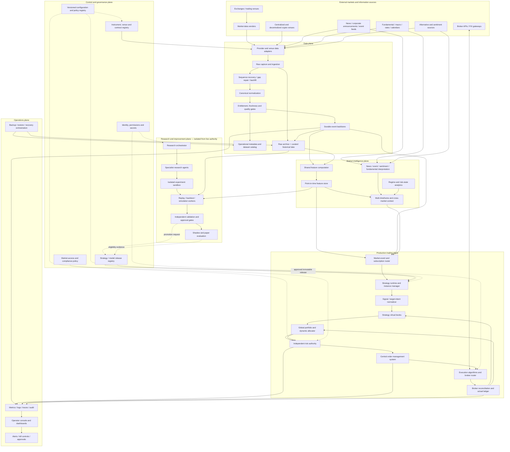
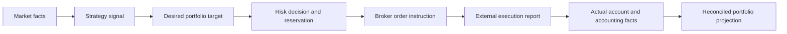
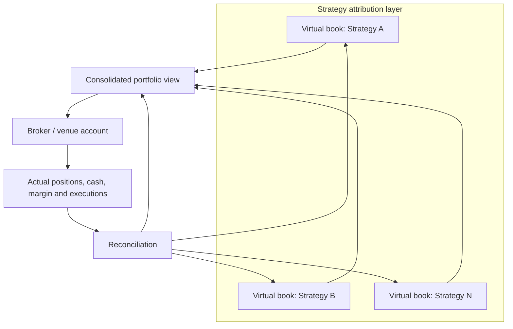

# 00 — Master Architecture Overview

## 1. Purpose and system boundary

The platform is a multi-market quantitative research and trading system. It discovers tradable instruments; acquires market, reference, fundamental, macro, event and alternative data; validates and stores it; creates point-in-time features; runs strategies in parallel; combines their desired exposures into a portfolio; subjects proposed orders to independent risk controls; routes permitted orders through broker/venue adapters; reconciles external executions and balances; and continuously evaluates both strategies and the platform itself.

The system supports research, historical replay, backtesting, shadow, paper and live environments. They share domain types and strategy semantics, but use different data and execution adapters. A live account is never silently substituted for a simulated account.

## 2. Master system context

## 3. Three planes plus shared foundation

### 3.1 Data plane

Owns acquisition, sequence correctness, normalization, quality state, durable distribution, retention and dataset lineage. It does not decide whether a strategy should trade. Its core output is trusted, timestamped, attributable information, not a trading signal.

### 3.2 Production trading plane

Owns runtime strategy execution, target construction, portfolio state, capital budgets, independent risk decisions, OMS state, broker interaction and reconciliation. It must continue to operate safely if the research plane is offline. It must refuse new risk when required inputs or authorities are unavailable.

### 3.3 Research and intelligence plane

Owns market/strategy research, hypothesis generation, feature exploration, ML/DL training, experiment management, model evaluation and release proposals. It may be computationally heavy and asynchronous. It never receives unrestricted production broker credentials and cannot promote its own work directly to live.

### 3.4 Shared control and operations foundation

Owns identity, policy, versioned configuration, instrument and release registries, observability, auditability, operator approvals, recovery and deployment. It provides governance across planes without letting one plane mutate another plane's state arbitrarily.

## 4. The key domain distinction: facts, intents and instructions

- Market event: observation from a venue/provider, with source timestamps and sequence metadata.
- Signal/insight: strategy hypothesis about direction, expected horizon, confidence and rationale codes.
- Target intent: desired instrument exposure or change, expressed in portfolio terms.
- Risk decision: independent authorization, rejection or constrained approval with a reservation of scarce resources.
- Order: concrete instruction with venue-specific type, quantity, limit/stop parameters, time-in-force and client IDs.
- Execution: broker/venue-reported fill, correction, bust, fee or state transition.
- Ledger entry: accounting fact derived from a verified execution, cash movement, fee, funding, corporate action or adjustment.

Never infer a fill from an accepted order, infer a broker position from a strategy target, or infer an actual account balance from virtual strategy P&L.

## 5. Portfolio accounting layers

Virtual books preserve strategy attribution and hypothetical ownership. The consolidated portfolio view nets risk and capital across the system. The broker's account and execution reports define actual positions, available funds and fills. If strategy A wants +100 units and strategy B wants −40 units in the same fungible account/instrument, the central system may route a net +60 only if broker, regulatory, shorting, tax-lot, margin and execution rules permit it; the virtual books must still preserve +100 and −40 attribution. Do not assume all markets or accounts support netting.

## 6. Hybrid capital allocation policy

Capital is bounded by hard controls but dynamically allocated within the approved budget. The hierarchy is: firm/system risk budget → asset-class/market budget → strategy-family budget → strategy-instance budget → instrument and order limits. The allocator estimates an appropriate share using validated risk-adjusted performance, drawdown, return stability, correlation, liquidity, costs, strategy capacity, current regime, parameter/model uncertainty and available margin. It also reserves capacity for uncertainty, margin calls and operational contingencies.

The allocator proposes budgets and target exposures. Only the independent risk authority authorizes risk-taking orders. A strategy cannot increase its own allocation, alter its guardrails or bypass a denied risk decision.

## 7. Architecture quality attributes

| Attribute | Architectural response | Acceptance evidence |
|---|---|---|
| Correctness | Canonical contracts, timestamp provenance, sequence checks, accounting reconciliation | Deterministic replay, invariant tests, reconciliation tests |
| Safety | Independent pre-trade gate, atomic reservations, fail-closed policies, kill controls | Fault injection and denied-order tests |
| Recoverability | Durable event/outbox, checkpoints, idempotent consumers, broker resync | Restart/replay/reconciliation drills |
| Auditability | Immutable source facts, release/version lineage, decision links | Reconstruct any order from input through fill |
| Extensibility | Ports/adapters, canonical identifiers, schema versioning | Add a provider/venue without altering strategy domain code |
| Research integrity | Point-in-time datasets, experiment registry, untouched holdouts | Reproduce report and detect leakage |
| Performance | Bounded queues, shared features, measured latency budgets | Per-stage latency and load tests |
| Operability | Metrics, logs, traces, health and explicit degraded states | Operator can identify stale feeds, risk state and order uncertainty |
| Compliance | Market/jurisdiction policies and broker-specific controls | Approved market-access checklist before live enablement |

## 8. Logical architecture is not deployment topology

The diagram shows responsibilities, not necessarily processes. The first production-capable implementation should be a modular application with explicit interfaces, an operational relational database, durable append-only market/event storage and separately managed ingestion/compute workers. Split domains into services only when throughput, blast radius, independent deployment, security isolation or team ownership justifies the operational cost. Do not spawn a service for every instrument/timeframe/strategy combination.

## 9. Operating modes

| Mode | Data source | Execution adapter | Permitted outcome |
|---|---|---|---|
| Research | Versioned historical datasets | None | Analysis and experiment artifacts |
| Backtest | Deterministic historical replay | Fill/fee/slippage simulator | Simulated orders and ledger |
| Shadow | Live feed, no broker order submission | Shadow execution | Compare live decisions without orders |
| Paper | Live or replayed feed | Paper broker/simulator | Simulated fills and virtual account state |
| Live | Licensed live feed | Approved broker/venue adapter | Real orders, subject to authorization and controls |

Each environment has explicit credentials, account IDs, policy, storage namespace and release channel. Switching an environment must be an explicit, audited operation.

## 10. Boundary assumptions

- The system is a research and trading platform, not an exchange, clearing member or broker-dealer by default.
- Market-data redistribution and commercial usage rights must be verified independently per provider and dataset.
- No guaranteed profitability, fill certainty or real-time coverage is assumed.
- Very-low-latency HFT, exchange co-location, direct market access and full-depth order-book strategies require a separate specialised engineering and compliance decision.
- Live deployment is blocked until broker, exchange, jurisdiction and applicable retail/professional algo-trading requirements are confirmed.

## 11. Related documents

Proceed to [instrument identity](01-market-taxonomy-instrument-registry.md), [data ingestion](02-universal-market-data-platform.md), [storage](03-storage-lineage-datasets.md) and [event delivery](04-event-backbone-messaging.md). For the actual order lifecycle, read [risk](10-independent-risk-authority.md), [OMS](11-oms-execution.md), [broker adapters](12-broker-venue-adapters.md) and [end-to-end flows](15-end-to-end-flows.md).
