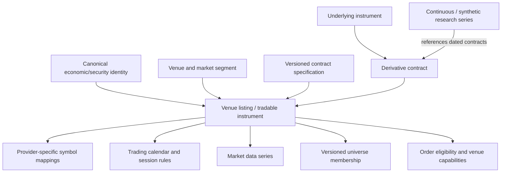
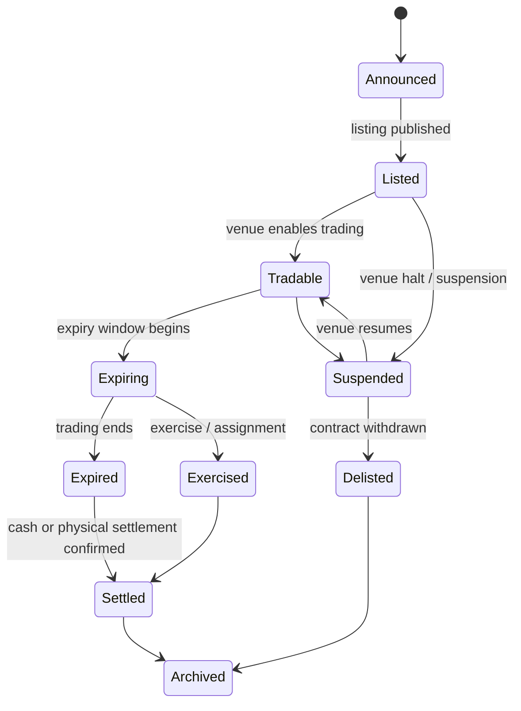
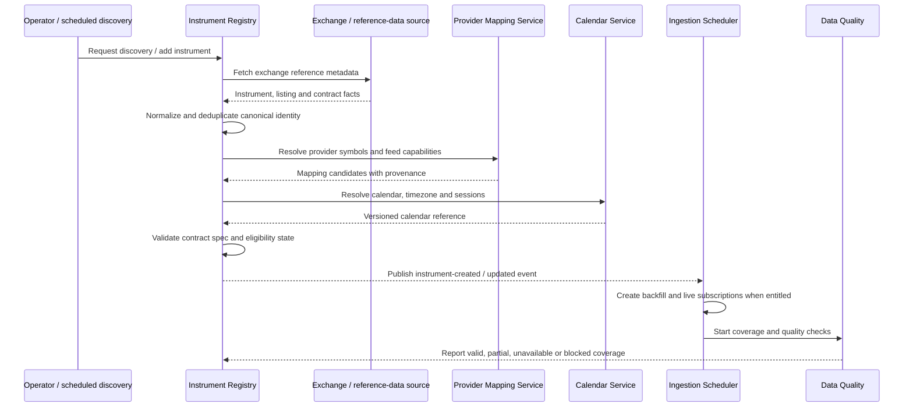

# 01 — Market Taxonomy and Instrument Registry

## 1. Responsibility

The instrument registry is the canonical catalogue of what the platform can observe or trade. It separates an economic/security identity from the venue listing, provider symbol, derivative contract and synthetic research series. Every subsystem uses canonical IDs; symbols are display labels and adapter mapping keys, not primary keys.

## 2. Why identity needs layers

A single visible ticker can be reused across exchanges, currencies, share classes, products or data vendors. A derivative contract is a distinct tradable object whose expiry, strike, put/call, multiplier, settlement style and venue rules matter. A continuous futures series is a synthetic analytical series, not an orderable contract. Crypto pairs differ by venue and product (spot, margin, dated future, perpetual swap). FX pairs and metal contracts need contract conventions and settlement/currency context.

## 3. Identity model

Recommended entities:

- `instrument`: canonical economic identity or product definition.
- `venue`: exchange, broker-dealer venue, crypto exchange, ECN or other trading venue.
- `listing`: specific tradable listing on a venue, with currency, segment and local symbol.
- `contract_spec_version`: effective-dated tick size, lot size, multiplier, settlement, margin-related metadata, expiry and exercise/assignment semantics.
- `provider_symbol_map`: provider and feed-specific symbol, namespace, market-data type and mapping validity window.
- `trading_calendar`: timezone, sessions, auctions, breaks, holidays and exceptional closures.
- `universe_snapshot`: point-in-time collection of eligible instruments used by a strategy or experiment.
- `underlying_relationship`: underlying, option root, future family, index membership or other relationship.

## 4. Market taxonomy

| Market family | Instrument types | Essential market-specific metadata |
|---|---|---|
| Indian equities | Cash equity, ETF, index, rights/other listed instruments | Exchange segment, ISIN where applicable, symbol, lot/tick, circuit/price bands, session/auction, corporate actions, settlement conventions |
| International equities | Common/ordinary shares, ADR/GDR, ETF, index | MIC/venue, share class, currency, local session, corporate actions, delisting, currency and settlement conventions |
| Crypto | Spot, margin, perpetual, dated future, options, token/index | Venue, base/quote/settlement asset, contract multiplier, funding, mark/index price, margin mode, liquidation and maintenance-margin rules, 24/7 session policy |
| FX | Spot, forward, futures, options, currency pair | Base/quote, pip/precision, lot convention, quote convention, value date, rollover/swap, session and liquidity-provider identity |
| Metals / energy / agriculture | Spot reference, futures, options, ETFs | Underlying grade/location, unit, contract size, delivery/settlement, expiry, first notice/last trade, price limits, roll rules |
| Rates / bonds | Cash bond, bill, note, futures, swaps if in scope | Issuer, maturity, coupon, day-count, yield/price convention, settlement and accrued interest |
| Derivatives across families | Futures, options, swaps/other supported contracts | Underlying, expiry, strike, call/put, exercise style, multiplier, settlement, deliverable, exercise cutoff, Greeks source/model provenance |

The canonical abstraction must not erase these differences. A common `Instrument` interface exposes common fields plus typed, versioned specifications for asset-class-specific rules.

## 5. Derivative contract lifecycle

The lifecycle differs for cash equities, options, futures, perpetual swaps and crypto tokens. Store the provider/venue source and effective timestamps for lifecycle transitions; never infer that an absent quote means a contract is expired.

## 6. Futures continuous series

A continuous future is a back-adjusted, ratio-adjusted or otherwise stitched research series. It is useful for some long-history features and backtests, but the continuous identifier is not submitted to an exchange. The research pipeline must retain:

- The exact dated contract selected for each timestamp.
- The roll rule and roll timestamp.
- The adjustment methodology and adjustment factors.
- Whether the selected contract was tradable at that moment.
- The raw unadjusted contract prices used for simulated fills.

Backtests that generate orders against a continuous series must resolve each target to the actual dated contract active at that event time.

## 7. Universe and point-in-time eligibility

A strategy's universe is a versioned dataset, not a live query that silently rewrites the past. Store membership start/end time and the reason for inclusion/exclusion. Preserve delisted, suspended and bankrupt instruments where legally and technically available. Record IPO/listing dates and historical index membership to avoid survivorship bias. Eligibility may also depend on broker permissions, liquidity thresholds, price bands, short availability, margin and market-access rules.

## 8. Contract and tick correctness

Order validation must use the correct effective-dated contract spec. Important fields include:

- Price tick and quantity step/lot size.
- Minimum/maximum quantity and notional.
- Contract multiplier and quote currency.
- Minimum price increment bands when they vary with price.
- Trading sessions, expiry, exercise and settlement.
- Order-type and time-in-force support.
- Price limits, circuit bands and venue trading state.
- Margin, leverage, reduce-only and position-mode rules where relevant.

Never hardcode these values globally or assume they remain constant forever. Store `effective_from`, `effective_to`, source, observed time and spec version.

## 9. Registry onboarding flow

An instrument should not become tradable merely because it was discovered. Its data entitlement, contract metadata, broker mapping and compliance eligibility are independent checks.

## 10. API and event boundaries

Registry commands: `DiscoverInstrument`, `ApproveListing`, `UpdateContractSpec`, `MapProviderSymbol`, `UpdateCalendar`, `SetEligibility`. Facts emitted: `InstrumentDiscovered`, `ListingCreated`, `ContractSpecEffective`, `ProviderMappingVerified`, `InstrumentSuspended`, `InstrumentExpired`, `UniverseSnapshotCreated`. Consumers must use IDs and versioned specs; they must not scrape mutable display names or symbols.

## 11. Acceptance criteria

- Same ticker on two venues resolves to different listing IDs.
- Same economic security may have multiple listings, currencies and share classes without collision.
- A derivative contract is uniquely identified by venue/product/underlying/expiry/strike/right/deliverable as applicable.
- Continuous futures IDs cannot pass OMS tradability validation.
- Effective-dated tick/lot changes replay correctly for historical orders.
- Historical universe membership is reproducible at a requested timestamp.
- Unknown or ambiguous provider mappings remain unverified and cannot feed production strategies.
