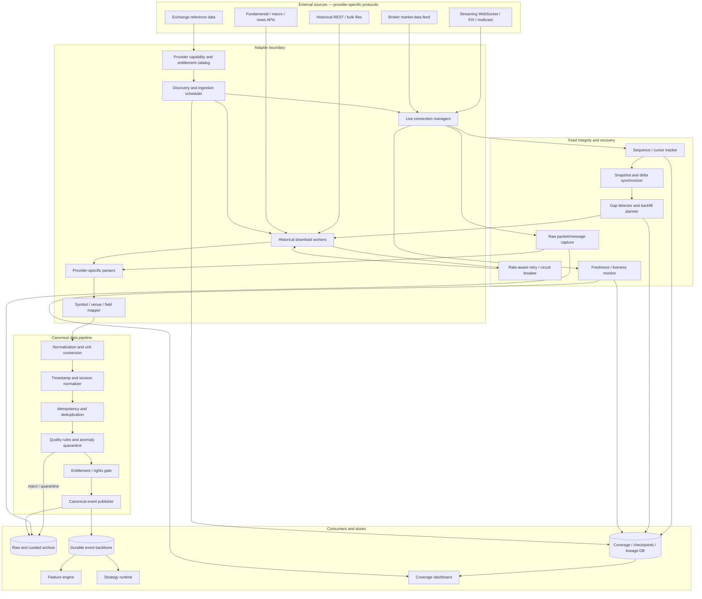
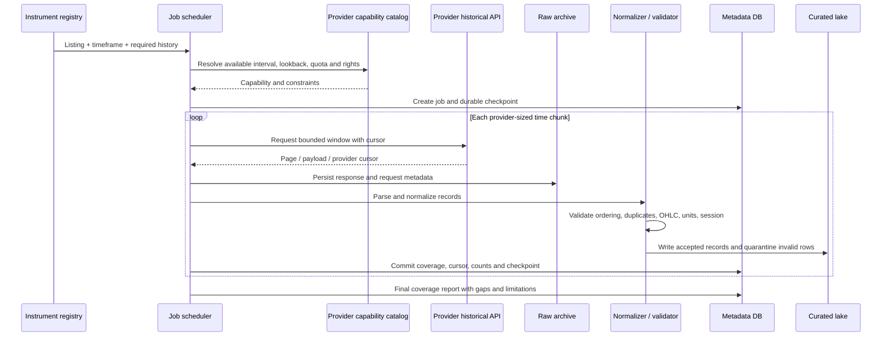

# 02 — Universal Market-Data Platform

## 1. Mission and responsibility

The Universal Market-Data Platform (UMDP) acquires reference, historical and streaming data from multiple providers and venues; records the original source facts; repairs interruptions where possible; normalizes records into canonical contracts; validates entitlement, freshness, ordering and content quality; and publishes trustworthy events to storage, analytics and strategy consumers.

It is a **data service**, not a strategy engine. It must report uncertainty explicitly. A missing feed, stale quote, incomplete candle or unreconciled order book must never be silently represented as current, complete data.

## 2. Logical component map



## 3. Provider capability registry

Provider selection must be evidence-based and data-family-specific. A provider capability record should include:

- Provider, product, venue/exchange and dataset family.
- Instruments/segments and identifier namespace covered.
- Historical start/end and maximum lookback by interval.
- Supported bar intervals, tick/trade/quote/order-book depth and snapshot capability.
- Live, delayed, indicative or end-of-day classification; expected update cadence and measured latency distribution.
- Timestamp semantics, timezone, event sequence/cursor semantics and correction policy.
- Corporate-action, symbol-change, delisting, futures-roll and contract-master support.
- Rate limits, concurrency, pagination, request weights, websocket connection and subscription limits.
- Service status, reliability history, outage behavior and support channel.
- License, permitted users, display/non-display use, derived-data rights, retention and redistribution limits.
- Pricing, free-tier limits, account/geography eligibility and credential requirements.
- Last verification date, source links, confidence and known gaps.

A capability matrix is maintained per `provider × venue × dataset_type × product_tier`, not as one broad provider label. “API available” does not prove live entitlement, full history, redistribution rights or production suitability.

## 4. Data families

| Family | Canonical data types | Typical consumers |
|---|---|---|
| Reference | instruments, listings, contract specs, calendars, symbology, corporate actions | registry, ingestion, backtest, OMS |
| Market bars | OHLCV, trade-count, VWAP/turnover, adjusted/unadjusted variants | features, strategies, research |
| Trades and quotes | tick trades, best bid/ask, quote updates, auction/indicative prices | microstructure, execution, bars |
| Order books | L1/L2/L3 snapshots and incremental deltas, imbalance | execution research, order-book strategies |
| Derivatives | option chains, futures curves, OI, IV, Greeks, funding, basis, mark/index | derivatives strategies, margin and risk |
| Fundamentals | statements, ratios, estimates, filings, corporate events | long-horizon research, screening |
| Macro and rates | policy rates, inflation, GDP, employment, yields, calendars | macro regime and cross-asset models |
| News/events/sentiment | headlines, filings, event timestamps, normalized entities, source sentiment | event research and slower decision horizons |
| Alternative/cross-market | sector/industry, flows, positioning, relevant public datasets, currency and commodity references | cross-market research |

Each record states its original source, timestamps, availability/entitlement, quality and normalization version. Store raw text/documents only to the extent licensed and permitted.

## 5. Historical ingestion lifecycle



Job states: `queued → planning → running → checkpointed → validating → completed/partial/failed/cancelled`. Each request is a deterministic chunk with stable ID. A process crash resumes from the last committed checkpoint. Provider pagination cursor and time window are stored independently. A completed job does not imply full market history if provider coverage is limited; report actual coverage and known gaps.

## 6. Live feed and sequence-recovery lifecycle

A live connection manager owns subscriptions and heartbeat/reconnect behavior. A feed-specific integrity handler owns sequence semantics. These are not interchangeable: reconnecting a socket does not repair a missing order-book delta.

```mermaid
sequenceDiagram
  participant V as Venue stream
  participant C as Connection manager
  participant B as Bounded receive buffer
  participant S as Sequence / snapshot synchronizer
  participant API as Snapshot endpoint
  participant Q as Quality gate
  participant BUS as Event backbone
  C->>V: Connect, authenticate, subscribe
  V-->>C: Stream events with event/sequence IDs
  C->>B: Append raw messages
  B->>S: Deliver in received order
  alt Feed uses snapshot + incremental sequence
    S->>S: Buffer deltas; record first/last sequence
    S->>API: Request authoritative snapshot
    API-->>S: Snapshot + last sequence ID
    S->>S: Find bridging update and apply contiguous deltas
    alt Gap or invalid bridge
      S->>S: Mark book invalid; discard local state
      S->>API: Fetch new snapshot and rebuild
    else Continuous sequence
      S->>Q: Publish reconstructed book state / deltas
    end
  else Feed uses trade IDs, cursors or sequence rules
    S->>S: Apply venue-specific duplicate / gap / replay policy
    S->>Q: Publish only valid records with integrity metadata
  end
  Q->>BUS: Publish valid events; stale/gapped state remains flagged
  C->>C: Heartbeat, renew token and planned reconnect
```

Example: Binance's documented depth procedure buffers WebSocket deltas, requests a REST snapshot, aligns the snapshot update ID with the buffered update range, applies only contiguous deltas, and rebuilds after a gap. It also documents a 24-hour connection lifetime and ping/pong behavior. That is an example of why feed recovery logic belongs to each adapter, not a generic retry loop. Other venues have different snapshot/delta and packet-sequence rules.

## 7. Canonical normalization contract

Normalize to typed records without destroying original information. At minimum:

- `instrument_id`, `listing_id`, `venue_id`, `provider_id`, `feed_id`.
- `event_type`, schema version, source message ID and source sequence/cursor where available.
- `event_time`, `received_at`, `ingested_at`, `available_at` and timestamp precision.
- Original timezone/clock context and normalized UTC timestamp.
- Price/quantity decimal precision, quote/base/settlement currency and units.
- Session/calendar ID, trade condition, correction/cancel indicator and source flags.
- `raw_object_uri` or raw payload reference, parser version, mapping version and quality status.

Use decimal or integer-tick representations for monetary prices and quantities where exactness matters. Do not use binary floating-point as the authoritative representation for financial values. Preserve original provider strings/payload for audit where allowed.

## 8. Bar construction and correction policy

A bar needs interval, open/close boundary convention, timezone/session, source aggregation method and completion state. `bar_end_time` and `available_at` differ: a one-minute bar may close at 10:01:00 but only become available to the system after provider publication and ingestion. A strategy at 10:01:00 cannot use it until the configured availability condition is met.

Support `OPEN/PARTIAL`, `FINAL`, `CORRECTED` and `RETRACTED` states. Late trades and vendor corrections can revise bars. Keep revisions rather than silently overwriting previously observed facts. The feature engine must decide whether a strategy is allowed to use provisional bars and must record that choice in the experiment/live configuration.

## 9. Freshness and data-quality gates

Quality is a vector, not one vague green check. Suggested fields:

- `connection_state`, `last_message_at`, `last_event_at`, `measured_lag_ms`.
- `sequence_state`: continuous, gap-suspected, gap-confirmed, rebuilding, unknown, not-applicable.
- `coverage_state`: complete, partial, unavailable, entitlement-blocked, provider-limited.
- `schema_state`, `mapping_state`, `timestamp_state`, `session_state`.
- `price_sanity`, `volume_sanity`, `cross-source divergence`, `correction backlog`.
- `book_validity` and snapshot age for order-book data.

Consumer policies vary. A daily research job may tolerate a partial historical sample with a warning. A live order-book strategy must stop consuming an invalid book. A stale price may still be useful to display but cannot silently satisfy a live risk price check.

## 10. Scheduling, rate limits and backpressure

The scheduler should prioritize: repair gaps in data needed by active strategies; complete scheduled backfills; ingest high-priority instruments; refresh reference/contract data; then low-priority research universes. It needs provider-specific token buckets, concurrency limits, exponential backoff with jitter, retry budgets, circuit breakers and manual pause. Do not retry non-retryable entitlement or invalid-parameter errors indefinitely.

Use bounded queues. When consumers fall behind, expose lag and choose a policy by data type: never drop authoritative order/position events; persist then process; optionally coalesce only explicitly coalescible market snapshots (e.g. latest ticker) when the strategy contract allows it; never coalesce sequence-critical depth deltas. Backpressure must be visible, not hidden by unbounded memory growth.

## 11. Provider failover

Failover is a governed data-source change, not simply “use the next API key.” Before switching, verify that the alternative matches instrument, venue, price type, entitlement, timestamp convention, adjustment policy and quality. Avoid splicing incompatible feeds into one bar series without provenance. A failover event records old/new source, boundary timestamp, reason and validation status. For execution-critical prices, broker/venue-specific source authority may be required.

## 12. Yahoo Finance / yfinance positioning

Treat Yahoo Finance/yfinance as a research/bootstrap adapter where permitted, not as presumed universal production infrastructure. Intraday lookback, symbol coverage, reliability, derivatives fields, real-time status, history and licensing can vary. The provider capability catalog must verify current actual behavior and terms. Do not infer that polling a delayed or rate-limited data endpoint creates an exchange-grade live feed.

## 13. Data platform SLOs and acceptance

Define service-level indicators by feed class rather than one global SLA: capture availability, ingest lag percentiles, sequence-gap recovery time, missing-bar repair time, valid-row rate, stale-state detection delay, raw-to-curated completeness and scheduler queue age. Targets remain TBD until measured against selected providers and intended strategy horizons.

Acceptance: replay captured provider fixtures deterministically; detect injected gaps/duplicates/out-of-order messages; rebuild sequence-managed books from snapshots; resume historical downloads after process termination; honor provider quota; reject unverified symbol mappings; distinguish delayed from live data; and demonstrate that a stale/gapped feed blocks only the consumers whose policy requires it while remaining visible to operators.
