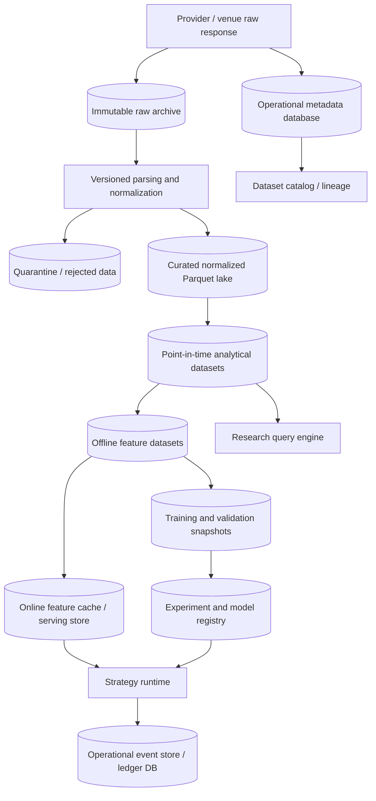

# 03 — Storage, Lineage and Dataset Lifecycle

## 1. Storage is purpose-specific

Do not force every workload into one database or treat one CSV per instrument as the system of record. Operational state, high-volume append-only observations, analytical history, low-latency current state and model artifacts have different access patterns and durability requirements.

## 2. Recommended logical stores

| Store | Primary purpose | Candidate implementation | Rules |
|---|---|---|---|
| Operational relational DB | Instrument registry, jobs, checkpoints, policies, strategy instances, orders, executions, risk reservations, ledger, approvals | PostgreSQL for multi-process/multi-user production; SQLite only for local prototype/single-writer use | ACID transactions, constraints, migrations, backups, indexes |
| Raw archive | Original provider responses, documents, snapshots and immutable capture artifacts | Object storage or filesystem during prototype | Content-addressable names, retention/license controls, provenance, no silent replacement |
| Curated analytical lake | Normalized bars, trades, quotes, fundamentals and historical snapshots | Parquet partitioned by dataset/venue/instrument/date or another measured layout | Schema versioning, manifests, compaction, checksums, late-data revisions |
| Research query layer | Large scans, joins and feature exploration | DuckDB/DataFusion/Spark only as workload warrants | Read curated snapshots; do not mutate canonical accounting state |
| Online state/cache | Current quotes, feature values, subscription state, hot portfolio projections | In-process cache initially; Redis or equivalent when cross-process access demands it | Rebuildable; never the sole source of actual order/ledger facts |
| Event log / broker reconciliation history | Durable domain facts and replay/recovery | Relational append-only tables plus event log, or brokered durable log | Retention, offset management, idempotency, schema evolution |
| Artifact store | Model binaries, training manifests, backtest reports, datasets and release artifacts | Object storage/filesystem with registry metadata | Checksums, immutable version, access control |

The exact product choice depends on volume, operational capacity, budget, deployment and licenses. PostgreSQL + Parquet + DuckDB is a sensible research-first default; a streaming broker is introduced when multiple independent consumers, replay and throughput justify it.

## 3. Dataset layers

- **Bronze/raw:** exact received payload or file, request parameters, provider, received time, source location, checksum and terms metadata.
- **Silver/normalized:** typed canonical records, normalized timestamps and units, instrument mapping version, quality status and source lineage.
- **Gold/point-in-time:** complete, usable datasets with explicit calendar, corporate actions, contract lifecycle and availability-time semantics.
- **Feature datasets:** derived values with code/config version, warm-up, source dataset versions and event-time availability.
- **Training snapshots:** exact labeled examples, feature set, labels, universe, split assignments and target definitions.
- **Production inference snapshots/logs:** features actually observed and consumed by a model/strategy decision.

Never overwrite Bronze. A correction creates a new raw/curated revision and a new manifest. If a dataset must be reprocessed, retain the prior version and identify which experiment/model used which version.

## 4. Point-in-time correctness: event time versus knowledge time

Each fact may have several times:

- `event_time`: when the market/economic event occurred.
- `published_at`: when the source published it, if available.
- `received_at`: when the platform received it.
- `ingested_at`: when it was committed to platform storage.
- `available_at`: earliest time the strategy/research process was allowed to consume it.
- `valid_from/valid_to`: effective period described by a reference or fundamental fact.

This is a bitemporal/availability-aware requirement. A financial statement with quarter-end date must not be treated as known on quarter-end if the filing was published weeks later. A corrected historical bar received today must not silently rewrite what the strategy could have known last year.

## 5. Dataset catalog and manifests

Every dataset version should have a manifest with:

- Stable `dataset_id`, immutable `dataset_version` and human-readable name.
- Market, venue, instrument/universe, data family, timeframe/granularity and currency/unit.
- Coverage range, expected sessions, observed coverage and missing periods.
- Provider/source identifiers, source license/entitlement and permitted uses.
- Raw source object references and checksums.
- Schema, parser, normalization, calendar and instrument-map versions.
- Corporate-action and futures-roll methodology if applicable.
- Event-time, timezone, publication and availability conventions.
- Validation report and known caveats.
- Creation time, code commit, job run and upstream dataset versions.

The catalog supports discovery by market, instrument, timeframe, type, date range, quality, license and currentness. Dataset selection in experiments pins immutable versions rather than “latest.”

## 6. Partitioning and file export

For OHLCV and other time series, a candidate Parquet layout is `market_family/venue/data_type/timeframe/year/month/day/` or `data_type/venue/instrument_id/year/month/`; choose from measured query shapes and avoid tiny files. Partitioning by highly granular symbol alone may create too many partitions. Maintain manifests and compact small files periodically.

CSV is a user-friendly interchange/export format, not canonical truth. Generate per-instrument/timeframe CSV when requested or on a controlled schedule. Include stable IDs, timezone and bar-boundary columns. Use deterministic ordering, explicit decimal precision, schema headers and atomic temp-file-to-final-file replacement. A CSV export should include the dataset version/provenance sidecar so it is not mistaken for an unversioned canonical history.

## 7. Actual trading accounting and immutable facts

Use append-only execution events and a double-entry ledger for financial postings. Do not update a position balance directly as the only record of why it changed. Rebuildable projections may be updated, but the underlying execution, fee, funding, dividend, corporate action, deposit/withdrawal, borrow, interest and correction facts remain auditable.

Every posting has account, asset/currency, debit/credit or signed amount convention, source event, effective time, booking time and external reference. Transfers and FX conversions require explicit legs. Reconciliation compares internal expected state with broker/venue statements and records breaks rather than silently forcing equality.

## 8. Data retention, security and licensing

Retention is controlled per provider/asset class/license. Raw payload storage can be restricted or prohibited under a data contract; capture only what the license permits. Apply encryption at rest/in transit, role-based access, secret redaction, personal-data minimization and deletion obligations. Backup policy includes RPO/RTO targets (to be chosen), restore tests, object-lock/versioning where appropriate and independent backup credentials.

## 9. Acceptance criteria

- A result can identify every upstream raw source and transformation version.
- A backtest pins immutable dataset and feature versions.
- Historical queries can filter by `available_at`, not only `event_time`.
- Corporate actions and futures rolls are reproducible as-of decision time.
- CSV exports can be regenerated byte-equivalently from the same manifest where deterministic formatting is configured.
- Actual positions and P&L can be reconstructed from ledger/execution facts.
- Restore tests recover metadata, artifacts, event history and datasets within declared objectives.
