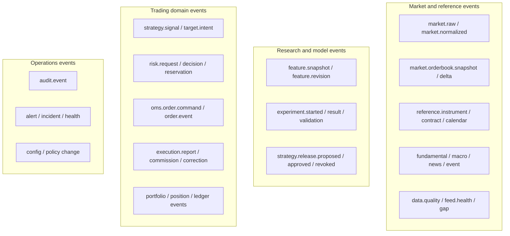

# 04 — Event Backbone and Messaging Semantics

## 1. Why the backbone exists

A market-data update, an order-state transition and a feature refresh can have many independent consumers. Direct point-to-point calls create tight coupling and make replay, recovery and consumer isolation difficult. A message backbone provides durable distribution, ordered processing within a defined key, replay from a checkpoint and observable consumer lag.

The backbone is not a magic guarantee of global ordering or exactly-once effects. Guarantees must be stated per topic, key, producer, consumer and external side effect.

## 2. Event, command and query

| Message kind | Meaning | Example | Rule |
|---|---|---|---|
| Event | A fact that occurred | `TradeReceived`, `OrderAccepted`, `ExecutionReported` | Immutable; past tense; include source and event identity |
| Command | Request to cause a change | `SubmitOrder`, `CancelOrder`, `StartBackfill` | Has caller, intent, idempotency key and expected preconditions |
| Query | Request for current/historical state | `GetPosition`, `GetDatasetCoverage` | Read projection; does not mutate state |

Do not publish “order filled” because a command to submit was sent. Publish fill only after an authoritative execution report and validation. Use request/response where a bounded answer is needed; use asynchronous events for facts and fan-out.

## 3. Topic/domain taxonomy



The actual broker/topic product is selected later. Topic names, ownership, retention, compaction and partition counts belong in a versioned topic catalogue.

## 4. Canonical envelope

Every event has a common envelope:

```json
{
  "event_id": "globally-unique-id",
  "event_type": "market.trade.v1",
  "schema_version": 1,
  "producer": "provider-adapter:venue-feed",
  "correlation_id": "workflow-or-decision-id",
  "causation_id": "immediate-parent-event-or-command-id",
  "aggregate_type": "listing",
  "aggregate_id": "canonical-listing-id",
  "partition_key": "venue|listing-id",
  "event_time": "source-event-time-utc",
  "received_at": "platform-receive-time-utc",
  "ingested_at": "durable-commit-time-utc",
  "available_at": "consumer-availability-time-utc",
  "source": {
    "provider_id": "provider-id",
    "venue_id": "venue-id",
    "source_message_id": "provider-message-or-sequence",
    "sequence": "optional-source-sequence",
    "raw_payload_ref": "raw-object-reference"
  },
  "trace_id": "distributed-trace-id",
  "payload": {}
}
```

This is an illustrative logical contract, not a final JSON Schema. Define exact types, decimal encoding, nullability and validation in schema files before coding. Timestamps should be RFC 3339 UTC instants; preserve original timezone and precision metadata separately.

## 5. Ordering and partition keys

Ordering is only meaningful within a documented scope. Candidate partition keys:

- Market book/trade updates: venue + listing ID (or feed-specific instrument key) to preserve sequence order.
- Order lifecycle: internal order ID or broker-order ID.
- Execution events: account + external execution ID / order key, with stable dedup identity.
- Strategy state: strategy instance ID.
- Portfolio/account ledger: account ID or ledger aggregate ID.

A single globally ordered stream is neither scalable nor necessary. Cross-instrument strategies need event-time watermarks, bounded lateness and explicit synchronization rules.

## 6. Delivery semantics and duplicate handling

Assume at-least-once delivery unless a narrower, verified guarantee exists. Every consumer that performs a side effect stores processed event IDs or idempotency keys in the same transaction as its state change where possible. Duplicate execution reports must not double-book fills or fees. Consumer offsets/checkpoints are committed only after durable processing according to the chosen transaction design.

Exactly-once transport semantics do not automatically make a broker order submission exactly-once: a network timeout can occur after a broker accepted an order but before the client received the acknowledgement. That requires stable client order IDs, query/reconciliation, and an explicit uncertain-submission state in OMS.

## 7. Transactional outbox and inbox

When an application changes database state and also publishes an event, two independent writes can diverge. Use a transactional outbox: write state and an outbox row in one database transaction; a publisher forwards committed rows and marks them delivered. Consumers use an inbox/dedup table for idempotent processing.

```mermaid
sequenceDiagram
  participant APP as Domain module
  participant DB as Relational DB
  participant OUT as Outbox publisher
  participant BUS as Event backbone
  participant CON as Consumer
  participant IN as Consumer DB / inbox
  APP->>DB: BEGIN transaction
  APP->>DB: Update aggregate state
  APP->>DB: Insert outbox event with stable event_id
  APP->>DB: COMMIT
  OUT->>DB: Read unsent outbox rows
  OUT->>BUS: Publish event
  BUS-->>OUT: Broker acknowledgement
  OUT->>DB: Mark published / advance cursor
  BUS->>CON: Deliver (possibly more than once)
  CON->>IN: BEGIN; insert inbox event_id if new
  alt New event
    CON->>IN: Apply domain side effect
  else Duplicate event
    CON->>IN: Ignore already-processed event
  end
  CON->>IN: COMMIT
  CON->>BUS: Commit consumer offset after durable processing
```

## 8. Replay and event sourcing boundaries

Replay is important for market-data reconstruction, backtesting, troubleshooting and rebuilding projections. Do not automatically event-source every table. Use immutable event histories where audit/recovery benefit outweighs complexity; use conventional relational state with audit/outbox for configuration and lower-volume CRUD. Define which state is authoritative and which projection is rebuildable.

Market data is often huge and better stored in time-partitioned lake/archive formats rather than indefinitely in the same hot message broker. The broker is a live distribution/replay buffer; the historical lake is the long-retention analytical archive.

## 9. Schema evolution

- Schema every topic and API contract.
- Prefer additive backward-compatible changes.
- Never reinterpret an existing field with a new meaning.
- Version event type or schema when semantics break.
- Maintain compatibility tests and consumer inventory.
- Store schema version in every event/dataset.
- Define migration/replay strategy for old versions.

## 10. Backpressure and priority

Bound every queue and expose depth/age. Protect order, execution, risk and ledger facts from loss; use durable buffering and backpressure. If market updates cannot keep up, record lag and degradation. Coalescing may be allowed for explicitly lossy snapshots only; not for sequence-critical deltas, trades required for complete volume, order executions or account state.

Prioritize control and safety messages over optional research workloads. A research consumer falling behind must not block the order/risk path. Separate resource pools and topic quotas where necessary.

## 11. Technology selection guidance

Start with an in-process typed event bus for modular boundaries and a durable outbox/event log for critical facts. Introduce Kafka/Redpanda/Pulsar or another durable broker when independent consumer groups, high throughput, cross-process replay, operational isolation or scaling needs are demonstrated. Do not choose a broker solely because the architecture diagram contains a message bus.

## 12. Acceptance criteria

- A consumer can replay from a known offset/checkpoint without double-applying effects.
- An order command timeout cannot trigger an unsafe blind duplicate submission.
- Producer database state and event publication cannot silently diverge.
- Event ordering guarantees are documented per partition key.
- Schema compatibility checks run in CI.
- Consumer lag and dead-letter/quarantine queues are visible and recoverable.
