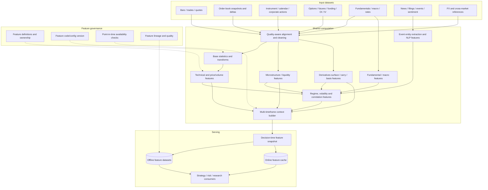
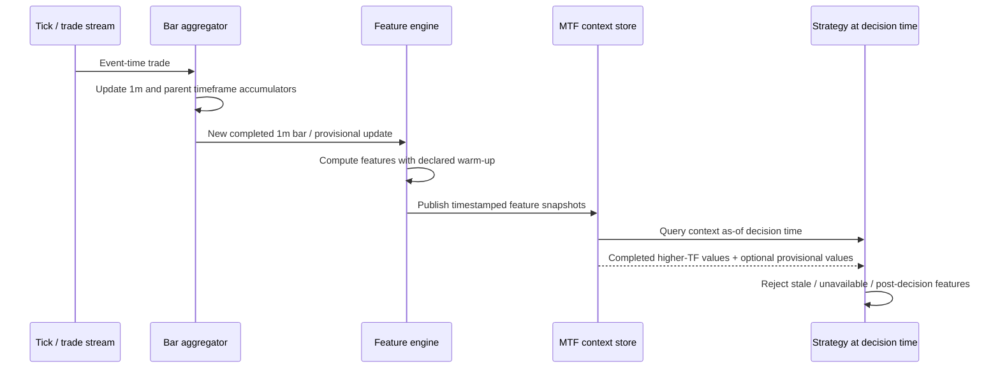

# 05 — Feature Engineering and Market Intelligence

## 1. Purpose

The market-intelligence layer converts normalized market and non-market facts into reusable, point-in-time context for strategies, portfolio construction, risk, research and reporting. It owns transformations and analytical context; it does not own order execution or grant trading permission.

A feature is not just a number. It is a versioned value with instrument/universe scope, event-time window, source availability, computation version, quality state and provenance.

## 2. Feature pipeline

## 3. Feature definition contract

Every feature definition specifies:

- Stable `feature_id`, semantic name, owner and schema version.
- Input datasets/fields and upstream feature IDs.
- Formula/code reference, code commit and configuration parameters.
- Window length, sampling convention, timeframe, warm-up and missing-value behavior.
- Event-time calculation and `available_at` rule.
- Whether the feature uses completed bars, partial bars or tick-by-tick updates.
- Units, scale, normalization and currency treatment.
- Corporate-action, session and instrument-lifecycle behavior.
- Quality requirements and allowed consumers.
- Deterministic test vectors and reference outputs.

A feature named `rsi_14` is not sufficiently specified unless timeframe, price field, bar completion rules, adjustment convention and implementation version are known.

## 4. Multi-timeframe context

A one-minute strategy may use five-minute, hourly and daily context, but all context must be as-of the decision timestamp. A currently forming hourly candle cannot be treated as complete. The context engine should expose:

- Latest completed bar per timeframe.
- Optional in-progress bar with `is_final=false` and update time.
- Feature timestamp, availability timestamp and source quality.
- Staleness/age and missing-window markers.
- Aggregation convention and session-boundary treatment.

The decision engine must not receive future data through a cached latest-value query. Every strategy decision should persist the exact feature snapshot IDs consumed.

## 5. Online/offline parity

A feature computed offline from Parquet and the same feature computed online must have matching semantics. Avoid separate untested implementations. Share transformation code where practical, or validate both against common deterministic fixtures. Version feature computation and store both online inputs and outputs for decisions that need auditability.

Warm-up rules are explicit. A model must not trade until required history is available and quality gates pass. Backtest initialization and live restart use equivalent warm-up behavior. Missing warm-up is not silently imputed with future or cross-period values.

## 6. Market-context domains

### Technical and statistical
Returns, realized volatility, range, trend, momentum, mean reversion, volume, turnover, volatility clustering, gap and cross-sectional ranks. Indicator families must be evaluated for correlation/redundancy; multiple versions of the same underlying effect are not independent confirmations.

### Microstructure and liquidity
Bid/ask spread, quoted depth, imbalance, trade intensity, signed volume (with declared estimator), queue proxies, slippage estimates, price impact and realized spread. These features require feed-specific quality and are not valid when book sequence is broken or depth entitlement is absent.

### Derivatives and carry
Futures basis/curve shape, roll yield, funding, open interest, option implied volatility surface, skew, term structure, Greeks and dealer/market-position proxies where valid. Store whether values are provider-reported, model-implied or internally calculated. Pin the pricing/volatility model version and rates/dividend assumptions.

### Fundamental and macro
Statements and ratios with filing/publication time; estimates with revision time; macro releases with scheduled and actual publication time; yield curves and policy rates. Data must preserve revisions/vintages to avoid using later-revised values in historical tests.

### News, events and sentiment
Ingest licensed source text/metadata; resolve instrument/entity; deduplicate syndications; classify event types; record source reliability, publication/receipt time and model version. Sentiment scores are model outputs, not truth. Keep raw-to-extracted entity and score lineage. LLM summaries should link to source records and remain outside the latency-critical execution path.

### Regime and cross-market intelligence
Volatility, trend/range, liquidity, correlations, dispersion, credit/rates/FX/commodity relationships and calendar/event risk. Regime models expose uncertainty and transition state; they should not be used as hard guarantees or as sole risk controls.

## 7. Feature access patterns

- Strategy runtime: bounded, low-latency reads of the latest valid snapshot by instrument/timeframe.
- Backtests: deterministic reads of offline feature snapshots as-of simulation time.
- Research: large analytical scans and feature discovery.
- Risk: independent, conservative values for volatility, liquidity, spread, margin and exposure; missing risk inputs trigger policy-defined restrictions.
- Monitoring: feature freshness, distribution drift, missingness and value-range anomalies.

## 8. Controls against data leakage

- Every join has an as-of condition using `available_at`.
- Forward fills have maximum age and cannot cross prohibited sessions/events.
- Cross-sectional ranks use only instruments in the point-in-time universe.
- Corporate actions and index membership are effective-dated.
- Feature normalization parameters are fit only on training data and frozen for validation/test/live use.
- Labels are not available as features; overlapping labels require purging/embargo in evaluation.
- Feature snapshots at decision time are retained for audit/reproduction.

## 9. Acceptance criteria

- The same feature test fixture produces identical online/offline values within defined numerical tolerance.
- Partial bars are visibly distinguished from final bars.
- No feature available after a decision timestamp can enter that decision.
- Missing/stale feature behavior is deterministic and tested.
- Feature lineage resolves to raw/curated data, code and config versions.
- Model decisions can be reconstructed from exact feature snapshots.
