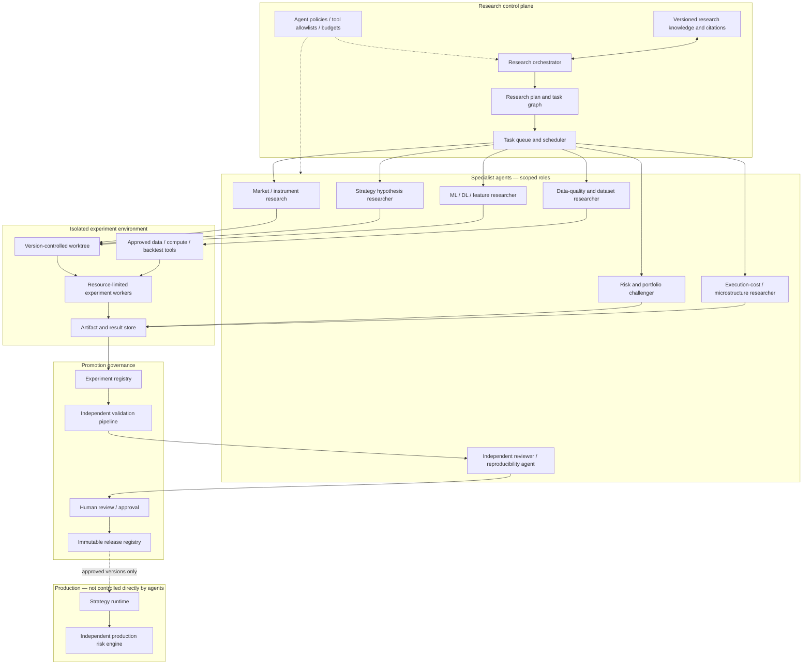
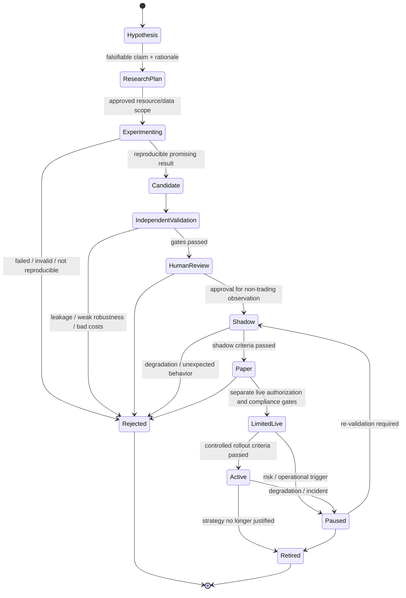

# 06 — Research and Agent Platform

## 1. Mission and trust boundary

The research platform uses humans, deterministic tools, statistical methods, ML/DL and LLM-based agents to investigate markets, propose hypotheses, construct experiments, analyse results and recommend changes. It is a separate trust zone from live order execution.

An agent may produce code, reports, data queries, experiment configurations and release proposals inside an isolated workspace. It cannot grant itself permissions, change hard risk limits, turn on live accounts, retrieve unrestricted broker secrets, approve its own strategy release or send production orders.

## 2. Logical architecture

## 3. Agent roles and separation of duties

| Role | Can do | Cannot do |
|---|---|---|
| Orchestrator | Decompose research tasks, assign agents, track dependencies, consolidate outputs | Approve a live strategy alone or access broker signing secrets |
| Market researcher | Study instruments, microstructure, market structure, provider coverage and literature | Convert unsupported claims into production rules |
| Strategy researcher | Propose falsifiable strategy hypotheses and prototype code | Promote its own candidate or change production capital limits |
| Data researcher | Audit coverage, survivorship, revisions, licensing metadata and leakage | Alter raw source facts or silently repair data without lineage |
| ML/DL researcher | Explore features/models, train and evaluate within resource budgets | Use test/holdout data to tune repeated candidates; deploy directly |
| Risk researcher | Challenge assumptions, stress regimes, correlation and risk measures | Override production risk engine or authorize an order |
| Execution researcher | Estimate spread, slippage, capacity, order type and venue mechanics | Submit production orders or claim unverified fill certainty |
| Independent reviewer | Reproduce, test, challenge statistical validity and review security | Be the same agent/identity that authored and approved a release |

Use different agent identities or independently executed validation jobs for the author and reviewer. The reviewer must have access to complete experiment manifests, not just a polished summary.

## 4. Hypothesis-to-release lifecycle

A strategy may move backward or be retired. “Self-improving” does not mean every training cycle must produce a live deployment. The result may be to keep, reduce, pause or delete a strategy.

## 5. Experiment manifest and reproducibility

Every experiment stores:

- Hypothesis ID, owner, rationale, expected mechanism and falsification conditions.
- Immutable code commit/worktree hash and dependency lockfile/container image.
- Data and universe snapshot IDs, coverage and point-in-time rules.
- Feature definitions/versions, warm-up, labels and transformation fit boundaries.
- Strategy family, parameter set and random seeds.
- Model architecture, training framework, weights/artifact checksum and training logs.
- Train/validation/test date ranges, purging/embargo and untouched holdout policy.
- Backtest engine version, fill/slippage/fee/tax/borrow/funding/margin model versions.
- Cost assumptions and provider entitlements as applicable.
- Metrics, drawdown paths, trade list, exposures, correlation, capacity and regime breakdown.
- All attempts, parameter searches and rejected variants (multiple-testing record).
- Reviewer identity, independent reproduction output, decision and approval evidence.

A report without a reproducible manifest is a research note, not a validated candidate.

## 6. Agent permissions and tool sandbox

- Read-only access to approved historical datasets by default.
- Write access only to isolated worktrees, experiment namespaces and artifacts.
- Compute, memory, wall-clock, API request and spending budgets.
- Network egress allowlist; no arbitrary shell/network access on production nodes.
- Secrets scoped to research providers only; no broker trading keys.
- LLM prompt injection defense: all retrieved documents, code, logs and market text are untrusted data, never privileged instructions.
- Human approval for data export, costly compute, external publication or policy changes.
- Audit every tool invocation, dataset access, command and file write.

## 7. LLM, ML/DL and deterministic trading responsibilities

LLMs are useful for unstructured research, reading filings/news, synthesizing hypotheses, explaining failures, writing experiment scaffolds and reviewing documentation. ML/DL models may infer signals or forecasts using bounded inference contracts. Deterministic code owns position sizing constraints, target construction, validation, risk checks, order state and execution control.

For short-horizon strategies, benchmark measured inference and end-to-end latency. An LLM's reasoning speed and output variability make it unsuitable as an unbounded critical path for 1m/5m or order-book decisions. Longer-horizon research may use LLM context, but every resulting trading feature must be timestamped, versioned and independently evaluated.

## 8. Research knowledge and retrieval

Store sourced claims with URL/document ID, publication date, retrieval date, source credibility, quoted facts and agent interpretation separately. Keep research notes, experiment records and production rules in distinct namespaces. Outdated or contradicted information must be marked superseded; agents cannot treat prior generated text as verified fact without source provenance.

## 9. Promotion gates

Required gates should be explicit and asset-class-aware:

1. Reproducible code/data environment and no unresolved data-quality blocker.
2. No look-ahead, survivorship or target leakage; point-in-time audit passes.
3. Costs and execution assumptions are realistic for the venue/horizon.
4. Out-of-sample and walk-forward results meet pre-registered thresholds.
5. Robustness across market regimes, instruments and parameter neighborhoods.
6. Capacity, liquidity and portfolio correlation reviewed.
7. Statistical selection bias/multiple testing addressed.
8. Independent reviewer reproduces key metrics.
9. Shadow and paper results meet declared criteria.
10. Human authorization, market-access and compliance approval for live deployment.

The thresholds are not universal constants. They must be defined by instrument, strategy family, horizon, account, broker and risk mandate before candidate testing.

## 10. Acceptance criteria

- Agents cannot access live broker order credentials.
- No agent can self-approve and promote its own change.
- An experiment can be reproduced from its manifest.
- Research resource and tool policies are enforceable and audited.
- Prompt-injected source content cannot grant permissions or alter system rules.
- Promotion records link to code, data, features, model, validation, reviewers and release.
