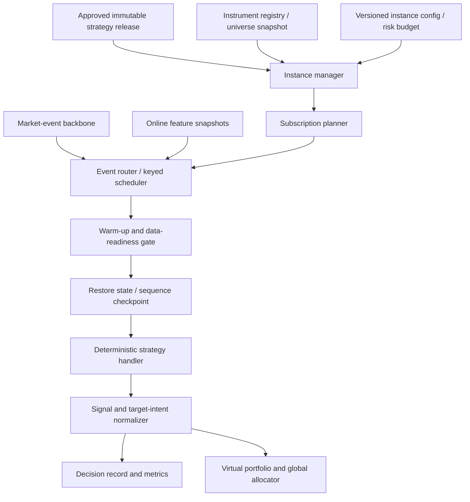
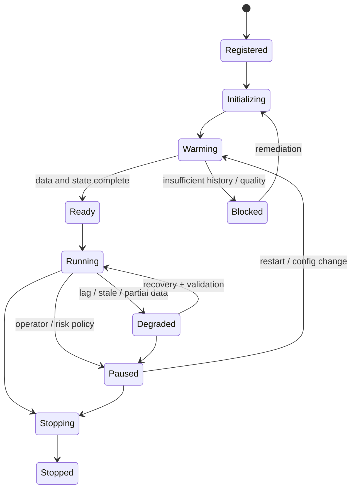

# 07 — Strategy Runtime and Signal Contracts

## 1. Responsibility

The strategy runtime evaluates approved strategy releases against subscribed market events and point-in-time features, maintains each strategy instance's state, and emits normalized signal/target intents. It does not submit orders directly. Strategies are independent logical instances but share data subscriptions, feature computation and bounded worker infrastructure.

## 2. Strategy decomposition

A production strategy is the combination of:

- `strategy_family`: conceptual logic, e.g. trend, momentum, mean reversion, breakout, volatility, carry, stat-arb, event-driven or market making.
- `strategy_release`: immutable code, dependency, model and configuration version.
- `strategy_instance`: deployment of a release against a universe, venue/account scope, timeframe, capital/risk budget and environment.
- `strategy_state`: internal rolling state/checkpoints, warm-up and last processed event ID.
- `subscription_plan`: event/feature types and instrument/timeframe set.
- `decision_record`: exact input snapshots, signal, target and reason codes.

Do not create a separate OS process per instrument × timeframe × strategy × model combination. Use shared ingestion and features with subscribed strategy instances executed in bounded worker pools. Isolate tenants or resource-heavy strategies only when required by latency, memory, trust or failure containment.

## 3. Strategy runtime flow

Each strategy handler receives a typed `StrategyContext`: instrument/contract specs, current environment, event timestamp, event ID, feature snapshot IDs, quality/freshness state, portfolio view allowed by policy, prior strategy state and configuration. It returns signals/intents, never a raw broker API request.

## 4. Normalized signal schema

A signal should include:

- `signal_id`, `strategy_instance_id`, immutable `strategy_release_id`.
- `instrument_id`, `listing_id`, venue and `timeframe` or event horizon.
- Decision timestamp, data watermark and input snapshot references.
- Direction/side, signal strength and optional calibrated probability with calibration version.
- Expected holding horizon, expected return/distribution, forecast uncertainty and validity window where supportable.
- Proposed target exposure or exposure delta with unit/currency.
- Volatility/liquidity/turnover estimates and model risk measures used.
- Reason codes and explainability references, not free-form rationale as control data.
- Correlation/causation IDs, run/environment and idempotency key.

A `confidence` score is **not** automatically the probability that a trade will be profitable. If a calibrated probability is used, its label, horizon, calibration dataset, calibration version and reliability must be documented.

## 5. Target intent versus signal

Signals describe an analytical view; target intents describe a desired state. The portfolio layer needs the latter to reason about holdings and avoid repeatedly translating the same signal into incremental orders. A target may express target units, target notional, target portfolio weight or delta exposure, but the unit must be explicit.

Target intent schema should include `target_id`, instrument, account/portfolio scope, strategy attribution, target type/unit, desired value, current virtual exposure snapshot, validity/expiry, priority, confidence/risk metadata, and `replace/cancel` semantics. The allocator can combine or net targets while preserving source attribution.

## 6. Strategy conflict and ensemble handling

If strategies disagree on the same instrument, do not arbitrarily let the last message win. The portfolio allocator sees the target set, current consolidated exposure, correlations and risk constraints. It can net, cap, prioritize, defer or reject exposures. Correlation must consider both historical co-movement and common factor/position exposure. Ensemble methods should be evaluated for incremental benefit after costs and risk, not by raw count of confirming indicators.

## 7. Timeframe and event handling

A strategy declares:
- Bar/event timeframe and expected cadence.
- Whether it uses trades, quotes, order book or completed bars.
- Whether provisional bars are permitted.
- Warm-up window and minimum data coverage.
- Event-time ordering/watermark and allowed late data.
- Market session/calendar and stale data policy.
- Maximum processing latency and queue age before the decision is skipped.

A one-minute, hourly and daily strategy operate as separate instances or policy variants, but can consume shared multi-timeframe features. Different horizons need different execution/cost assumptions and risk limits.

## 8. Runtime resilience

Use partitioned/keyed state ownership so one instance's events are serialized where stateful ordering is required. Persist checkpoints and last processed event IDs. On worker restart, restore from checkpoint and replay events with idempotent state transitions. A stale or sequence-invalid input sets the instance state to `DEGRADED` or `PAUSED` according to its declared contract; it cannot keep emitting valid signals from invalid inputs.

## 9. Strategy instance state machine

A release change creates a new release/instance revision and records a controlled transition. Never mutate code/parameters underneath a live instance without an audited rollout.

## 10. Acceptance criteria

- Strategy code has no direct production broker credentials or OMS bypass path.
- Every signal/target links to an immutable release and input feature snapshots.
- Duplicate market events cannot double-advance strategy state.
- Conflicting targets are resolved at the portfolio layer, not through hidden strategy precedence.
- Invalid/stale data can pause or degrade an instance according to its declared policy.
- The same strategy contract can run in historical replay, shadow, paper and live contexts.
