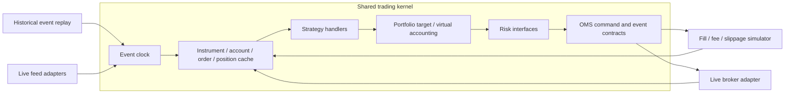
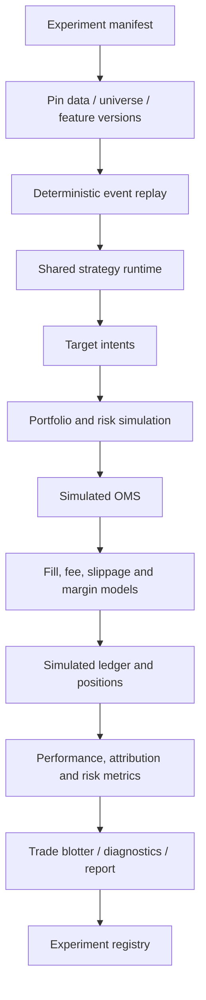

# 08 — Backtesting, Replay and Validation

## 1. Purpose

The simulation platform determines what a strategy would have done under a defined historical or live-like sequence of information and execution conditions. It must answer not only “what return did the model show?” but “which data was knowable, what order was sent, whether it could have filled, at what price/quantity/cost, what capital was tied up, and what constraints applied?”

## 2. Shared-kernel design

Backtest, shadow, paper and live should share strategy interfaces, domain models, clocks, portfolio/target semantics and order lifecycle contracts wherever possible. Their adapters differ: historical event source and simulated execution in backtest; live market data and no-order shadow observer; live market data plus paper simulator; approved broker adapters for live.

A shared interface does not mean a backtest's simulated fills equal live reality. Differences are modelled, measured and disclosed.

## 3. Event-time simulation and data correctness

- Replay in event-time order with defined tie-breaking and late-event handling.
- Use `available_at` to prevent look-ahead: an event is not consumable before its historical availability.
- Preserve session, auction, halt, expiry, time zone, daylight-saving and holiday rules.
- Apply corporate actions and contract lifecycle as-of their effective/publication time.
- Distinguish completed and provisional bars.
- Model missing intervals and provider outages; do not automatically interpolate executable prices.
- For multi-timeframe logic, only expose higher-timeframe values that were available then.
- Warm up feature/model state exactly as production would; no orders during warm-up.

## 4. Execution realism

Reality models are first-class configuration, not a footnote. At minimum model or explicitly exclude:

- Bid/ask spread and the order side relative to available quotes.
- Commission/brokerage, exchange and regulatory charges, taxes/stamp duties where applicable, clearing fees and other venue-specific charges.
- Slippage and market impact as a function of order type, size, liquidity, volatility and participation.
- Partial fills, queue/priority approximation, latency and stale market data.
- Limit order non-fill, cancellations, cancel/replace latency and rejected orders.
- Auction rules, price bands, circuit limits, halts and venue throttles.
- Buying power, margin, leverage, settlement, short availability/borrow and forced liquidation.
- Futures expiry/roll, option exercise/assignment/settlement, Greeks and volatility surface changes.
- Crypto funding, maker/taker fees, liquidation/maintenance margin, mark/index prices and venue outages.
- FX rollover/swaps, contract value, currency conversion and market session liquidity.

A bar-only simulator cannot accurately model queue position or depth impact. Label its assumptions and prohibit it from validating microstructure/HFT claims.

## 5. Backtest architecture and outputs

Persist every simulated decision, target, order, order-state transition, fill, fee, position, ledger entry and risk rejection, linked by IDs. Store time-series portfolio equity and exposure so drawdowns, concentration and recovery are explainable.

## 6. Validation protocol

1. **Code and data sanity:** determinism, schema, missingness, timestamps, mapping, warm-up and sanity baselines.
2. **In-sample research:** exploratory discovery only; record all trials.
3. **Out-of-sample validation:** fixed split untouched by tuning.
4. **Walk-forward evaluation:** train/fit on past windows, test strictly forward, roll schedule fixed in advance.
5. **Purging/embargo:** prevent overlapping label windows from leaking across splits.
6. **Parameter robustness:** neighbourhood stability, not only one optimized parameter point.
7. **Regime and instrument robustness:** bear/bull, volatile/calm, liquidity and session changes; include delisted and failed instruments where relevant.
8. **Cost and capacity stress:** adverse spread/slippage/fees, smaller liquidity, delayed data and larger size.
9. **Multiple-testing and selection-bias review:** record number of trials, selection process and any correction/deflation methodology.
10. **Portfolio interaction:** correlation, overlapping positions, risk budgets, margin and netting.
11. **Independent reproduction:** reviewer runs experiment from pinned manifest.
12. **Shadow/paper:** compare decisions and real-time execution behavior before live allocation.

## 7. Metrics

Report net and gross return, CAGR or annualized return where valid, volatility, Sharpe/Sortino with assumptions, max drawdown and duration, tail loss/expected shortfall, hit rate, payoff ratio, turnover, exposure, leverage, fees, spread/slippage, capacity, time in market, holding period, trade count, fill rate, rejected/cancelled rate, margin usage, liquidation and borrow/funding costs. Include uncertainty/confidence intervals and sample size. Do not rely on one risk-adjusted score.

Break down results by instrument, venue, timeframe, strategy, side, regime, month/session and liquidity bucket. Preserve trade-level examples and losing periods.

## 8. Shadow and paper semantics

- Shadow: consume live events, calculate signals/targets and compare with a simulated hypothetical execution path, but never send broker orders.
- Paper: place orders into a paper account or simulator; distinguish simulated fills from actual exchange fills. Some broker paper environments do not reproduce production queue/fill quality.
- Limited live: explicitly authorized real capital with hard limits and enhanced monitoring; strategy allocation begins small and can be revoked.

A paper pass is necessary but not sufficient for live. Require broker market access, compliant order generation, operational readiness, reconciliation and human authorization.

## 9. Acceptance criteria

- Same data/strategy/config/replay seed yields deterministic decisions and ledger within declared tolerances.
- No future-available record can enter historical features or decisions.
- Backtest and live use the same signal/target/order domain contracts.
- Costs, margin and fill model versions are pinned in every report.
- A strategy claiming order-book edge cannot pass validation with bar-only data.
- Every experiment report is reproducible and retains rejected trials/selection history.
