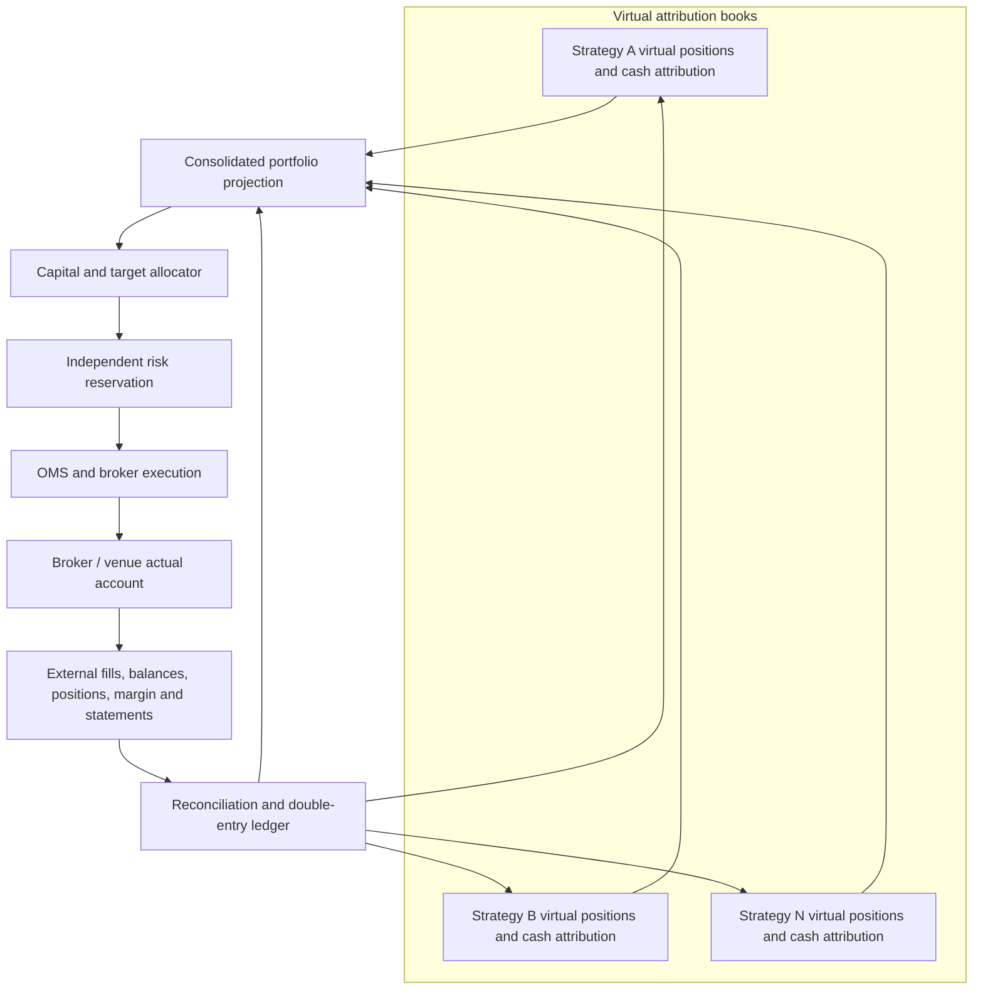
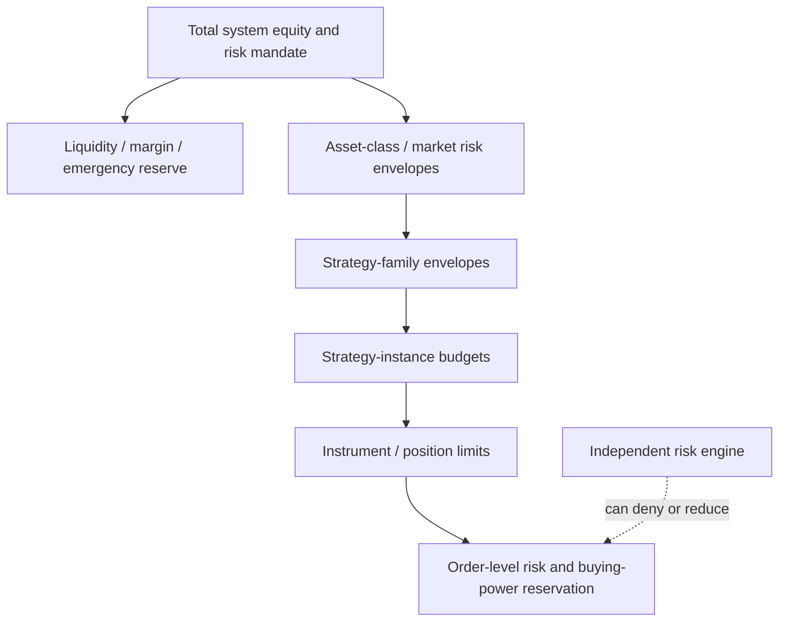

# 09 — Portfolio Intelligence, Hybrid Capital Allocation and Accounting

## 1. Responsibility

Portfolio intelligence combines independent strategy intents into a coherent portfolio and capital plan. It preserves strategy attribution while evaluating consolidated exposure, correlation, liquidity, available capital and margin. It allocates **risk capacity**, not just nominal money. The independent risk authority remains the final permission gate.

## 2. Three accounting views



1. **Virtual strategy book:** theoretical attribution of a strategy's targets, trades, P&L and allocated risk budget. It explains which strategy contributed what.
2. **Consolidated portfolio view:** net exposure, concentration, currency, factor, sector, gross/net notional, margin, liquidity and risk across all strategies and accounts.
3. **Actual broker/venue account and ledger:** authoritative external cash, positions, orders, fills, fees, funding, margin and statements. The local projection is reconciled to these facts.

A virtual book is not a real segregated broker account unless a broker explicitly provides separate accounts/subaccounts. Do not claim legal segregation or tax-lot separation from an internal attribution ledger.

## 3. Hybrid capital allocation

Hard limits bound the allocation space; dynamic allocation chooses within it. Illustrative hierarchy:



The exact budget dimension may include nominal capital, volatility risk, expected shortfall, margin usage, gross/net notional and concentration. No one measure is sufficient across cash equities, leveraged derivatives, FX and crypto.

### Dynamic allocator inputs

- Current equity, available cash, settled/unsettled funds and margin headroom by account/currency.
- Hard policy limits, market access permissions and reserved capital.
- Strategy performance with uncertainty, sample size, out-of-sample evidence and recent degradation.
- Drawdown, return volatility, tail risk and recovery behavior.
- Strategy-to-strategy and strategy-to-portfolio correlation; common factor and instrument overlap.
- Capacity, liquidity, spread, turnover, expected slippage and fees.
- Market regime, volatility, event risk and data/model quality.
- Strategy maturity state: experiment, paper, limited live or approved active.
- Execution venue constraints and portfolio-level netting feasibility.

Allocation should be stable, bounded and reviewable. Avoid frantic reweighting on a few recent wins. Use limits on allocation change, minimum evidence and periodic re-evaluation. The allocator can recommend zero allocation.

## 4. Allocation cadence and governance

- **Strategic:** slow-changing budget decisions based on robust out-of-sample and live evidence.
- **Tactical:** bounded changes for regime, liquidity, capacity and validated risk changes.
- **Emergency:** immediate deterministic risk reduction on limit breach, stale critical data, margin/venue condition or operational incident.

An agent or strategy may submit an allocation proposal with evidence, but only the authorized portfolio policy component can calculate a proposed budget, and only the risk authority can authorize an order reservation.

## 5. Portfolio construction flow

```mermaid
sequenceDiagram
  participant S as Strategy instances
  participant V as Virtual books
  participant P as Portfolio aggregator
  participant A as Dynamic allocator
  participant R as Risk authority
  participant O as OMS
  S->>V: Publish target intent with attribution
  V->>P: Current virtual exposure and target set
  P->>P: Consolidate duplicate/conflicting targets and net views
  P->>A: Portfolio state, constraints and candidate targets
  A->>A: Calculate risk budgets / sizes / priorities
  A-->>R: Proposed target and order-risk request
  R->>R: Validate global and local limits; reserve resources atomically
  alt Approved or constrained
    R-->>O: Authorized order intent + reservation token
    O->>O: Plan child orders / execution schedule
  else Denied
    R-->>A: Reject/reduce with reason codes
    A-->>V: Update target status and strategy attribution
  end
```

## 6. Netting, attribution and account constraints

The aggregator may combine strategy target requests for the same fungible instrument to reduce turnover, but only if account, broker, product, legal, settlement, tax-lot, shorting and execution constraints permit it. It must preserve the original strategy-level intents and record the allocation method. If one strategy wants long and another short, internal netting could reduce the external position, but it must not conceal independent strategy risk or create impermissible crossing/beneficial-ownership behavior.

Where strategies run in different accounts, currencies, legal entities or broker venues, they cannot be casually netted. Currency conversion, margin offsets and collateral recognition are account/broker-specific.

## 7. Portfolio risk dimensions

Track at least gross and net exposure, leverage, concentration, sector/industry and factor exposure, delta-equivalent exposure, option Greeks, duration/convexity where applicable, FX exposure by currency, commodity exposure, basis/counterparty exposure, margin usage, liquidity horizon, liquidation cost, borrow/funding cost and stress loss. Correlations can change sharply in stressed regimes; supplement historical covariance with stress/scenario analysis and explicit concentration limits.

## 8. Double-entry ledger and P&L attribution

Maintain a double-entry journal or another formally reconciliable accounting model. Every posting links to an external execution, fee, funding payment, dividend, corporate action, cash transfer, interest/borrow charge, FX conversion or correction. Positions and P&L are projections derived from these facts and current valuation marks.

P&L attribution separates:
- Price movement / realized and unrealized P&L.
- Fees, spread, slippage and market impact where measurable.
- Funding, borrow, interest, dividends, coupon and corporate actions.
- FX translation and base-currency effects.
- Allocation and strategy attribution adjustments.
- Unexplained reconciliation breaks (never silently spread across strategies).

## 9. Reconciliation loop

At startup and on a schedule/event, reconcile open orders, executions, positions, balances, margin and fees to broker/venue facts. Use external IDs, execution IDs and timestamps. Handle corrections, busts and late fees as new facts. A mismatch triggers a break record and risk policy: freeze affected instrument/account or reduce activity until reconciled. Never “fix” an internal balance by directly overwriting it without an audit adjustment reason and external evidence.

## 10. Acceptance criteria

- Each real fill can be attributed to one or more virtual strategy allocations.
- Consolidated portfolio exposure equals the aggregation of virtual books plus separately identified manual/external positions and reconciling adjustments.
- Allocations obey hard caps and retain reserve; no strategy increases itself.
- Cross-strategy netting is explicit and respects account/venue constraints.
- Broker balances, positions, fills and fees reconcile with recorded discrepancies visible.
- Double-entry postings balance and P&L has traceable components.
