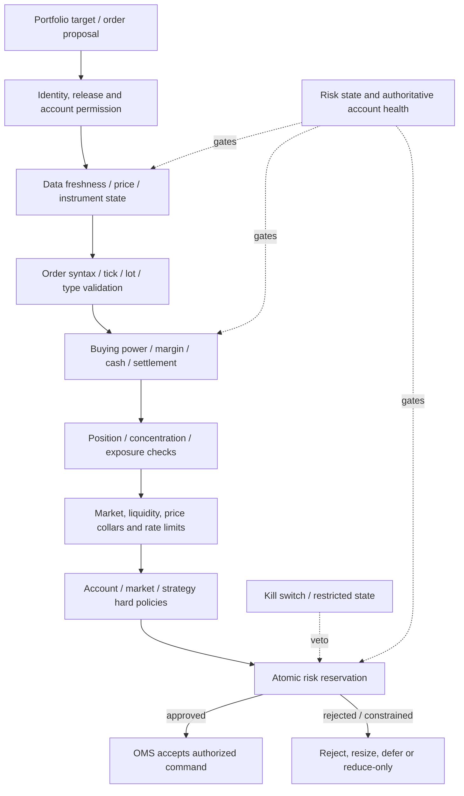
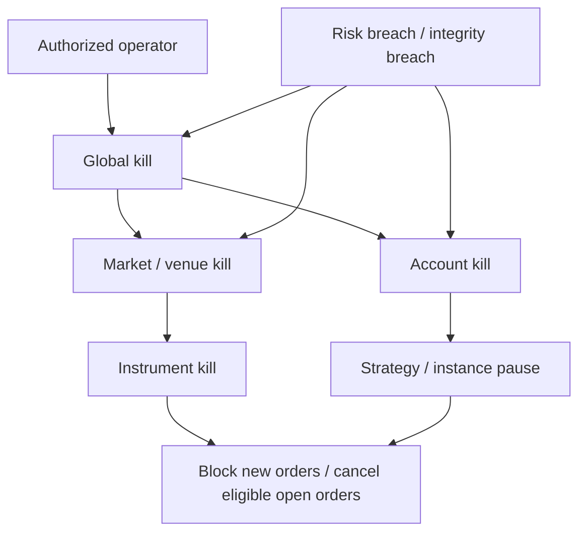

# 10 — Independent Risk Authority

## 1. Mission and independence

The risk authority is a separate control boundary that can authorize, constrain, defer or reject every order proposal. Strategy code, LLM agents, portfolio optimizers and execution algorithms cannot bypass it. Its rules are versioned, auditable, independently tested and fail closed when required authoritative state is missing.

The risk engine is not merely a collection of stop-loss indicators. It must protect account buying power, positions, venue rules, concentration, liquidity, operational integrity and market access before and after orders.

## 2. Control path

## 3. Risk scopes and hard limits

- System/global: total equity drawdown, total leverage, gross/net notional, catastrophic stress loss, global kill switch.
- Market/asset class: capital envelope, session availability, concentration, liquidity and cross-market exposure.
- Account/broker: cash, settled/unsettled balance, buying power, margin, order rate, open order limits, venue permissions.
- Strategy family and strategy instance: risk budget, concurrent positions, loss/drawdown budget, allocation cap, turnover.
- Instrument/contract: max quantity/notional, max participation, volatility/price collars, expiry and concentration.
- Order: max size/notional, price deviation, order type, time-in-force, rate, duplicate and outstanding-order checks.

Hard limits cannot be weakened by the strategy or allocator. Some limits are static policy; others are computed conservatively from current equity, volatility, available margin or liquidity with bounded parameter updates.

## 4. Pre-trade checks

1. Caller identity, release eligibility, account/market permissions and environment mode.
2. Instrument listing is tradable, correct effective-dated contract spec and valid calendar/session.
3. Market price/mark is fresh, quality-valid and from an authorized source; order-book-dependent checks require a valid book.
4. Quantity, price, tick, lot, minimum notional, order type, time-in-force and reduce-only semantics valid.
5. Duplicate intent/order detection by stable idempotency key and target state.
6. Available cash, buying power, unsettled funds, initial/maintenance margin and worst-case reservation.
7. Existing positions and open orders included in projected exposure; pending cancels remain risk-bearing until confirmed canceled.
8. System, account, instrument and strategy hard limits; max order size and price collar.
9. Concentration, factor, currency, delta/Greeks, leverage, liquidity and stress limits as applicable.
10. Venue state, order-rate throttles, restricted symbols, regulatory policy and kill-switch state.
11. Atomic reservation of buying power/risk budget to prevent two concurrent requests from both consuming the same available headroom.

## 5. Atomic reservation and concurrency

A check followed by a later reservation is unsafe: two parallel strategies may both pass against the same stale available cash and jointly exceed it. Use an atomic compare-and-reserve operation (transaction/serializable lock or dedicated account risk state owner). A reservation includes account, instrument, strategy attribution, order ID/idempotency key, notional/margin/risk amounts, policy version, expiry and status. Reservation is adjusted on broker acknowledgement, fill, partial fill, cancel confirmation, reject or correction. Pending cancel is not released until the broker confirms cancellation or the order is otherwise terminal.

## 6. Risk decision contract

The response is one of: `APPROVE`, `APPROVE_WITH_CONSTRAINTS`, `REJECT`, `DEFER`, `REDUCE_ONLY` or `CANCEL_REQUIRED`. It includes decision ID, proposal ID, policy version, risk snapshot ID, reservation ID (if approved), allowed quantity/price limits, expiry, reason codes, evaluated checks and correlation ID. Free-text explanation is supplemental; machine-readable reason codes are authoritative.

## 7. Post-trade and continuous risk

Monitor marks, positions, open orders, realized/unrealized P&L, margin, Greeks, exposure, volatility, liquidity, correlation, data freshness and execution slippage. Trigger scoped action: warn, cap new risk, reduce-only, cancel open orders, strategy pause, account halt or global kill. Do not confuse canceling outstanding orders with flattening positions; emergency flattening itself needs a separate safe procedure and may be impossible during halt/outage.

## 8. Kill-switch hierarchy

Define who can trigger/reset each scope, what existing orders do, whether reduce-only orders are allowed and what reconciliation checks are required before restart. Reset requires fresh health, positions/orders reconciliation and explicit authorization. The ability to flatten is not guaranteed; venue outage, circuit halt or illiquidity may prevent it.

## 9. Fail-closed behavior

If risk service, account state, price authority, instrument spec or reservation database is unavailable or stale, reject new risk-increasing orders. A narrowly scoped reduce-only/cleanup path may exist only if separately designed, tested and authorized. Do not silently bypass risk because a service is unavailable.

## 10. Security and independent authority

Run risk policy and reservation state in a protected module/service with least-privilege access. Strategy workers cannot write risk config. Research agents cannot query or alter production secret stores. Risk policy changes require code/config review, approval, versioning, test coverage and rollout audit. Keep an append-only decision log to explain every approval, constraint and rejection.

## 11. Acceptance criteria

- Two concurrent orders cannot over-reserve buying power or risk budget.
- Pending-cancel orders continue to count until terminal confirmation.
- Invalid/stale market data blocks new risk-increasing orders.
- A failed risk authority blocks new live risk.
- Kill switches have scoped, tested behavior and audited reset conditions.
- Every approved order has a decision, policy version, reservation and risk snapshot.
