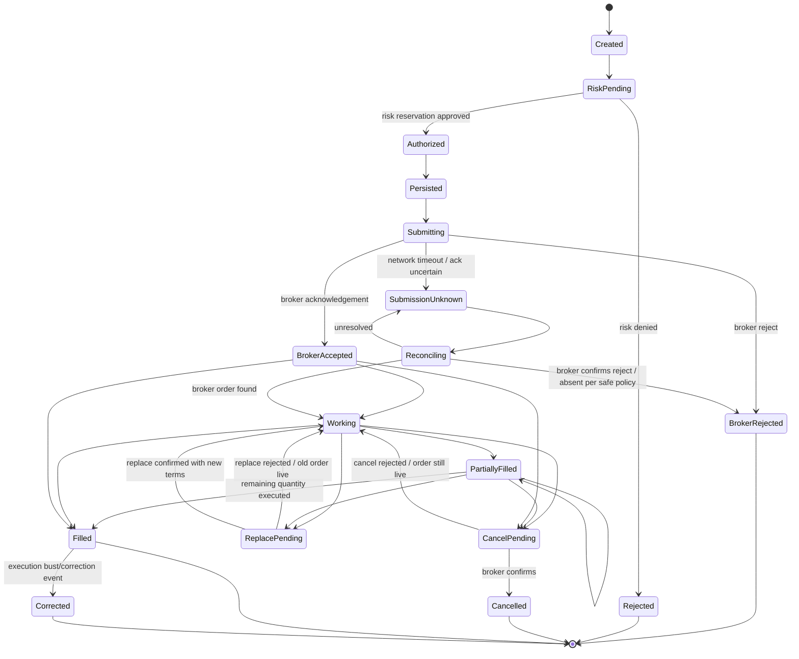

# 11 — Order Management System and Execution Lifecycle

## 1. Responsibility

The OMS is the authoritative internal state machine for orders and child orders. It accepts only risk-authorized order intents, persists them before submission, assigns stable IDs, routes them to an execution adapter, processes acknowledgements/rejections/cancels/replaces/executions/corrections, and exposes current state plus an immutable event history.

The OMS is not a strategy engine, portfolio allocator, broker or accounting ledger. It coordinates those boundaries through explicit contracts.

## 2. Parent/child order model

A strategy target is translated into a parent order/working objective. An execution algorithm may create child orders across time/venues. The parent retains target quantity, strategy/account attribution, urgency, schedule and completion policy; each child has its own venue, client ID, order type, limit, time-in-force, state and fills. Parent state is derived from children and must preserve partial completion and residual quantity.

Possible execution methods: direct market/limit/stop, TWAP, VWAP, participation-of-volume, implementation-shortfall or venue-specific algo. Their availability is venue/broker-specific and they do not guarantee price or fill.

## 3. OMS lifecycle

The diagram is conceptual: actual broker reports may arrive out of order, and a partially filled order may later be canceled or corrected. Preserve each event and derive state using adapter-specific sequence and transition rules. A pending cancel is not canceled; pending replace is not replaced.

## 4. New order submission flow

1. Validate schema, environment and idempotency key.
2. Obtain risk decision and atomic reservation.
3. Persist parent/child intent, client order ID and audit/outbox row transactionally.
4. Send through broker adapter using stable client ID where supported.
5. Record acknowledgement, broker order ID, rejection or uncertain submission.
6. Process fills, partial fills, fees, corrections and terminal state.
7. Update portfolio/accounting projections via events, never by assumption.

## 5. Uncertain submission is a first-class state

A socket timeout after sending does not tell us whether the broker accepted the order. Blind retry can create a duplicate order. Use a stable broker-supported client order ID, query open orders/order history and reconcile execution reports before deciding whether to retry. If the broker has no safe idempotency/query mechanism, mark unresolved and block potentially duplicating activity until operator or controlled reconciliation resolves it.

## 6. Execution report semantics

Keep separate fields for:
- Requested order quantity and leaves quantity.
- Cumulative executed quantity and average fill price.
- Current order status and event/execution type.
- Pending cancel/replace request state.
- Broker order ID, client order ID and external execution ID.
- Commission/fee report and its currency.
- Trade date/settlement date and venue timestamps.
- Execution correction/bust linkage.

FIX distinguishes the purpose of an execution report (`ExecType`) from current order status (`OrdStatus`). Cancel-pending or replace-pending is not successful cancellation/replacement. A commission report may arrive separately from an execution. Adapter implementations must preserve native distinctions and map them into the internal lifecycle without losing fields.

## 7. OMS data model

- `order_intent`: originating target and strategy/account attribution.
- `parent_order`: execution objective and aggregate requested quantity/notional.
- `child_order`: venue instruction and broker client ID.
- `order_event`: append-only lifecycle event.
- `execution`: unique external fill record; corrections link to original.
- `fee`: brokerage/commission/fee/funding record, potentially arriving separately.
- `risk_reservation`: budget/margin capacity reserved for order.
- `order_route`: selected broker/venue and execution algorithm.
- `reconciliation_case`: unresolved state mismatch or uncertain submission.

## 8. Cancel, replace and amend

Cancel and replace are asynchronous requests. Do not release risk reservation until the broker confirms the remaining quantity is canceled or replaced. Partial fills can occur while a cancel is pending. On replace, preserve the old terms, new requested terms, broker response and effective timestamp. If replace is rejected, old order may remain working; the OMS must reflect this correctly.

## 9. Position and ledger updates

Only validated broker/venue executions update actual positions and financial ledger. Parent/child order acknowledgement does not change position. A fill creates execution facts; fees may arrive later; execution corrections may reverse or amend previous postings. Portfolio and virtual books consume the same immutable events but apply different attribution rules.

## 10. OMS invariants

- Every child order has one stable internal ID and a client idempotency key.
- A fill cannot exceed valid leaves quantity without explicit bust/correction/reconciliation logic.
- Duplicate external execution IDs do not double-book.
- Pending cancel/replace retains risk until a terminal result.
- State transitions are validated and every raw broker report is retained.
- A failed adapter cannot silently mark an order rejected or canceled.
- Uncertain submissions trigger reconciliation before retry.
- Actual positions derive from execution/account facts, not submitted quantities.

## 11. Acceptance criteria

Fault-test partial fills, fill-before-ack, late acknowledgements, duplicate reports, cancel/fill races, replace rejects, commission-late arrival, execution busts, connection loss after send and process restart with open orders. Verify no duplicate order or double accounting results.
