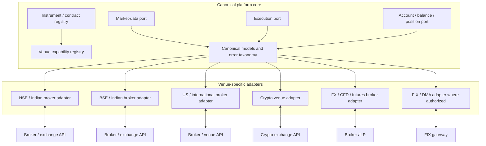

# 12 — Broker and Venue Adapter Architecture

## 1. Ports and adapters

The platform defines internal broker/data/execution ports. Each broker or exchange adapter translates its authentication, symbols, contracts, rate limits, session behavior, order types, state reports, market-data sequence rules and errors into these internal contracts. Strategy and portfolio code never depends directly on a vendor SDK or exchange payload.

## 2. Adapter interfaces

Expected capabilities (some optional, each explicitly declared):

- Reference: list instruments, contracts, tick/lot/price bands, sessions and lifecycle.
- Market data: historical bars, trades, quotes, book snapshot/delta, subscription and entitlement state.
- Execution: submit, cancel, replace, mass cancel, status query, order history and client order ID.
- Account: balances, positions, open orders, margin/buying power and statement/contract notes.
- Reports: execution reports, corrections/busts, commissions/fees, corporate actions, funding and settlement.
- Operational: heartbeat, rate-limit headers, connection state, server time, service status and maintenance windows.

The adapter capability registry records supported order types, time-in-force, precision, market sessions, shorting, leverage, reduce-only, hedge/net position mode, margin, client idempotency, query coverage, sandbox availability, streaming behavior and account restrictions.

## 3. Broker/venue capability matrix

Do not assume one adapter feature applies across providers. Maintain a matrix by `adapter × account_type × product × venue_segment`. Missing capability means “unsupported/unknown,” not “best effort.” OMS validates capability before constructing the order.

## 4. Authentication and credentials

- Use secrets manager/KMS or OS-level secure secret storage; never commit API keys.
- Separate market-data keys from trading keys and research credentials.
- Use dedicated service identities and least privilege.
- Disable withdrawals/transfers on trading keys where provider supports it; scope IPs and product access if available.
- Rotate/revoke secrets, audit access and redact logs.
- Agents, notebooks, backtest workers and dashboards do not receive production order credentials.
- Keep sandbox/testnet and production credentials fully separate.

## 5. Order routing

Routing considers explicit account mapping, instrument tradability, market permission, broker health, price/feed authority, fees, order-type capability, rate limits, liquidity, margin and regulatory restrictions. Smart order routing across venues is an advanced module and must not be assumed before legal/venue permissions and market data are available. The system initially routes only to explicitly configured, approved accounts/venues.

## 6. Connection and recovery

Adapters own connection lifecycle, token renewal, heartbeats, planned reconnects, sequence/cursor recovery, throttling, clock offset measurement and resubscription. For market data, sequence recovery follows venue documentation. For execution, reconnect is followed by open-order, execution and account reconciliation before enabling new order flow.

## 7. Clock synchronization

Maintain UTC wall-clock synchronization for timestamps and monotonic clocks for local durations. Track measured offset/uncertainty to provider/venue time where possible. Record source timestamps without rewriting them. Latency reports distinguish network, provider publication, adapter receipt, queueing, strategy compute, risk decision, OMS persistence, broker submission and acknowledgement.

## 8. Error taxonomy

Normalize adapter errors into categories while retaining native code/message:

- Authentication/permission/entitlement.
- Invalid symbol/contract/order field/precision.
- Market closed/halted/restricted instrument.
- Buying power/margin/position restriction.
- Rate limit/throttle/temporary overload.
- Network timeout/disconnect/unknown submission.
- Provider maintenance/service unavailable.
- Sequence gap/stale snapshot/invalid market-data state.
- Broker rejection/cancel rejection/replace rejection.
- Internal serialization/schema/configuration error.

Retry policy is category-specific. Do not retry permanent validation/permission errors. Do not retry unknown order submissions until reconciliation identifies the original order state.

## 9. Market-access compliance hooks

The adapter exposes broker/exchange-required algo identifiers, client tagging, order-rate constraints, kill switches, audit records, approved provider identity and other market-access fields. Applicable requirements differ by jurisdiction, broker, account type and product. Implement a per-market policy profile and do not assume crypto rules equal Indian equities or US equities rules.

## 10. Acceptance criteria

- A new broker can be added without importing its SDK into strategy modules.
- Adapter fixtures map native errors and events losslessly enough for audit.
- Capability matrix prevents unsupported order types and products.
- Production and sandbox credentials cannot be mixed.
- Restart automatically reconciles open orders/fills/positions before normal trading resumes.
- Connection, rate-limit, clock and sequence health are observable.
