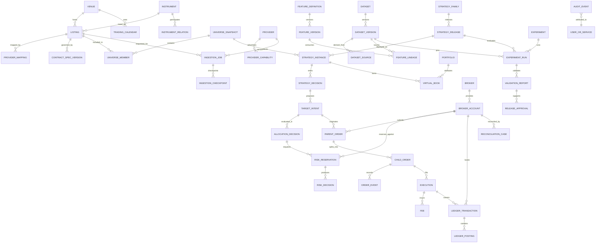

# 13 — Logical Database and Entity Model

## 1. Scope and ownership

This is the logical entity model, not a final physical schema. It separates master/reference data, data catalog, research, strategy deployment, portfolio accounting, risk reservations, OMS and audit. Some high-volume time-series records belong in Parquet/object storage or a streaming log rather than relational rows. The relational DB owns transactional operational state and references immutable datasets/artifacts.

## 2. Entity relationship overview

## 3. Core entity groups

### Reference and market access
`venue`, `instrument`, `listing`, `contract_spec_version`, `provider`, `provider_capability`, `provider_mapping`, `trading_calendar`, `universe_snapshot`, `universe_member`, `instrument_relationship`, `market_access_profile`.

### Data operations and lineage
`dataset`, `dataset_version`, `dataset_source`, `data_quality_report`, `ingestion_job`, `ingestion_chunk`, `ingestion_checkpoint`, `provider_request`, `feature_definition`, `feature_version`, `feature_lineage`, `raw_object_reference`.

### Research and releases
`strategy_family`, `strategy_release`, `model_artifact`, `experiment`, `experiment_run`, `experiment_trial`, `validation_report`, `shadow_run`, `paper_run`, `release_approval`, `release_revocation`.

### Runtime and portfolio
`strategy_instance`, `strategy_state_checkpoint`, `strategy_decision`, `signal`, `target_intent`, `portfolio`, `virtual_book`, `virtual_position`, `allocation_decision`, `exposure_snapshot`, `valuation_mark`.

### Risk, OMS and accounting
`broker`, `broker_account`, `risk_policy_version`, `risk_snapshot`, `risk_decision`, `risk_reservation`, `parent_order`, `child_order`, `order_event`, `execution`, `execution_correction`, `fee`, `ledger_transaction`, `ledger_posting`, `cash_movement`, `reconciliation_case`, `reconciliation_item`.

### Platform governance
`user_or_service`, `role_binding`, `secret_reference`, `config_version`, `approval`, `audit_event`, `incident`, `kill_switch_event`, `deployment`, `service_health_snapshot`.

## 4. Important schema rules

- Use stable canonical IDs; retain provider-native and broker-native IDs in dedicated mapping/reference columns.
- Every mutable master record that affects historical decisions is effective-dated and versioned.
- All financial values include currency and use exact decimal/integer representation.
- Every event/order/execution has stable idempotency/dedup keys and external IDs.
- Foreign keys and unique constraints prevent orphan mappings, duplicate fills and duplicate client order IDs within the relevant account scope.
- Store UTC instants with original source timestamp/timezone/precision metadata.
- Use append-only tables or immutable object references for event facts; projections can be updated/rebuilt.
- Keep broker account, strategy virtual book and portfolio IDs distinct.
- Every release/run links to code hash, config, dependency lock, data versions, feature versions and runtime/engine version.
- Raw payloads may live outside SQL; store URI, checksum, retention and entitlement metadata.

## 5. Physical storage guidance

PostgreSQL is the recommended transactional target for a multi-process platform. SQLite can support a local prototype or single-process deployment but can become a serialization and concurrency bottleneck with multiple ingestion workers, portfolio processes and OMS writes. Time-series observations should typically use partitioned Parquet/object storage and/or a dedicated time-series store only after query/retention requirements are measured. Do not store all tick/order-book depth as row-per-event indefinitely in the same operational database without a capacity design.

## 6. Indexing and partitioning considerations

- Unique: `(provider_id, native_symbol, feed_type, effective_from)` for mapping where semantics permit.
- Unique: external execution ID within broker/account/venue scope.
- Unique: client order ID within account/broker scope.
- Query: listing + event time for time-series metadata.
- Query: account + order status + created time for OMS/reconciliation.
- Query: strategy instance + decision time for signal/trade attribution.
- Query: dataset ID + version and coverage.
- Partition append-only ledger/events by time only when retention/query scale warrants it; maintain global uniqueness strategy.

## 7. Migration discipline

Version schema migrations; make migrations backward-compatible where rolling deployment requires it; take tested backups; validate row counts and financial invariants; keep a migration log and checksums. For high-risk accounting/OMS changes, use shadow writes or read-only comparison before switching authoritative readers. No destructive cleanup of historical execution or audit data as a side effect of schema migration.

## 8. Open implementation choices

The detailed column-level schema, partition thresholds, SQL engine, retention, high availability, backup RPO/RTO and whether to use a dedicated time-series extension depend on expected tick volume, users, deployment, provider rights and available operations capacity. Benchmark with a realistic sample before locking in a physical design.
