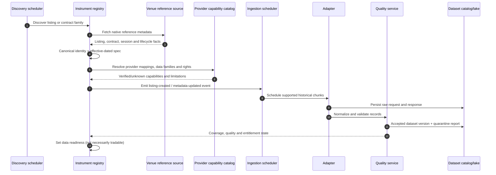
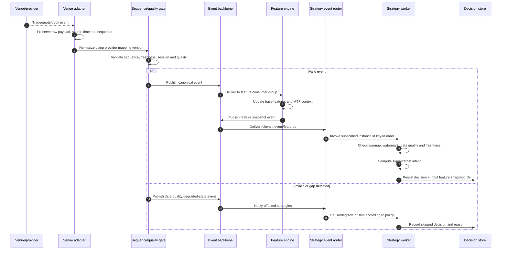
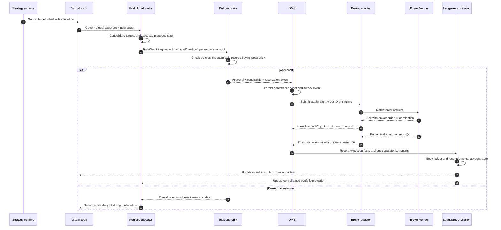
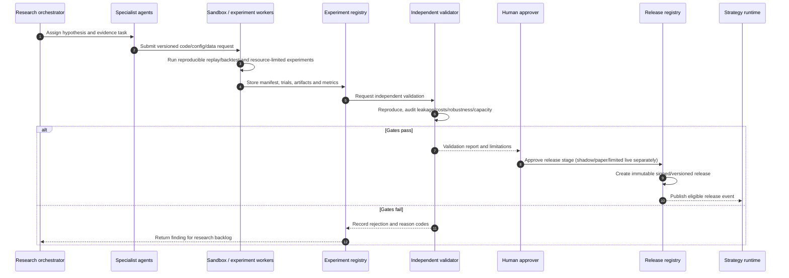

# 15 — End-to-End Sequence Diagrams and Traceability

These traces explain how information and authority move across module boundaries. Each sequence is an acceptance-test candidate. IDs/correlation links must be retained across every hop so an operator can reconstruct one decision or order without searching uncorrelated log text.

## 1. New instrument discovery to usable dataset



## 2. Live market event to strategy decision



## 3. Target to risk authorization to actual fill



## 4. Submission timeout and unknown broker state

```mermaid
sequenceDiagram
  autonumber
  participant O as OMS
  participant A as Broker adapter
  participant B as Broker
  participant R as Reconciliation service
  O->>O: Persist child order + stable client ID
  O->>A: Submit order
  A->>B: Send native order request
  Note over A,B: Network breaks after broker may have received request
  A--xO: Timeout; no acknowledgement observed
  O->>O: Mark SUBMISSION_UNKNOWN; retain risk reservation
  O->>R: Reconcile by client ID / account / time window
  R->>B: Query open orders, order history and executions
  alt Broker order found
    B-->>R: Matching order / reports
    R-->>O: Bind broker ID and import current state
    O->>O: Resume normal event lifecycle
  else Broker conclusively reports no order
    B-->>R: No matching order, within supported query guarantees
    R-->>O: Resolution evidence
    O->>O: Retry only under explicit adapter policy and same idempotency key if supported
  else Query incomplete or conflicting
    B-->>R: Ambiguous state
    R-->>O: Remain unknown; escalate and block duplicate-risk action
  end
```

Do not assume a “not found” response proves no order if the broker's query endpoint is eventually consistent or has incomplete history. Adapter-specific reconciliation windows and guarantees must be documented.

## 5. Research proposal to eligible release



## 6. Process restart and recovery

```mermaid
sequenceDiagram
  autonumber
  participant N as Runtime node
  participant DB as Operational DB/event store
  participant B as Broker/venue
  participant R as Reconciliation
  participant Q as Feed recovery
  participant S as Strategy workers
  N->>DB: Load committed checkpoints, config, pending outbox and risk reservations
  N->>B: Reconnect and authenticate using scoped secret
  N->>B: Query open orders, executions, positions, balances and margin
  B-->>R: Authoritative broker/account state
  DB-->>R: Internal OMS, ledger and portfolio state
  R->>R: Compare external and internal state; create break cases
  alt Reconciled and risk healthy
    R-->>N: Enable controlled trading state
    N->>Q: Reconnect market data and repair sequences/gaps
    Q-->>N: Feed quality restored
    N->>S: Restore state and replay from checkpoint idempotently
    S-->>N: Warmup complete / ready
  else Mismatch or uncertainty
    R-->>N: Keep affected account/instrument blocked
    N->>N: Alert operator and preserve evidence
  end
```

## 7. End-to-end trace IDs

For one hypothetical trade, the platform should be able to traverse:

`market_event_id → feature_snapshot_id → strategy_decision_id → target_id → allocation_decision_id → risk_decision_id → reservation_id → parent_order_id → child_order_id → client_order_id → broker_order_id → execution_id → ledger_transaction_id → reconciliation_case_id (if any)`.

The same correlation/causation IDs should appear in structured logs, traces, audit events and user-facing diagnostics. Not every event has every ID; preserve links rather than making them mandatory where they do not apply.
