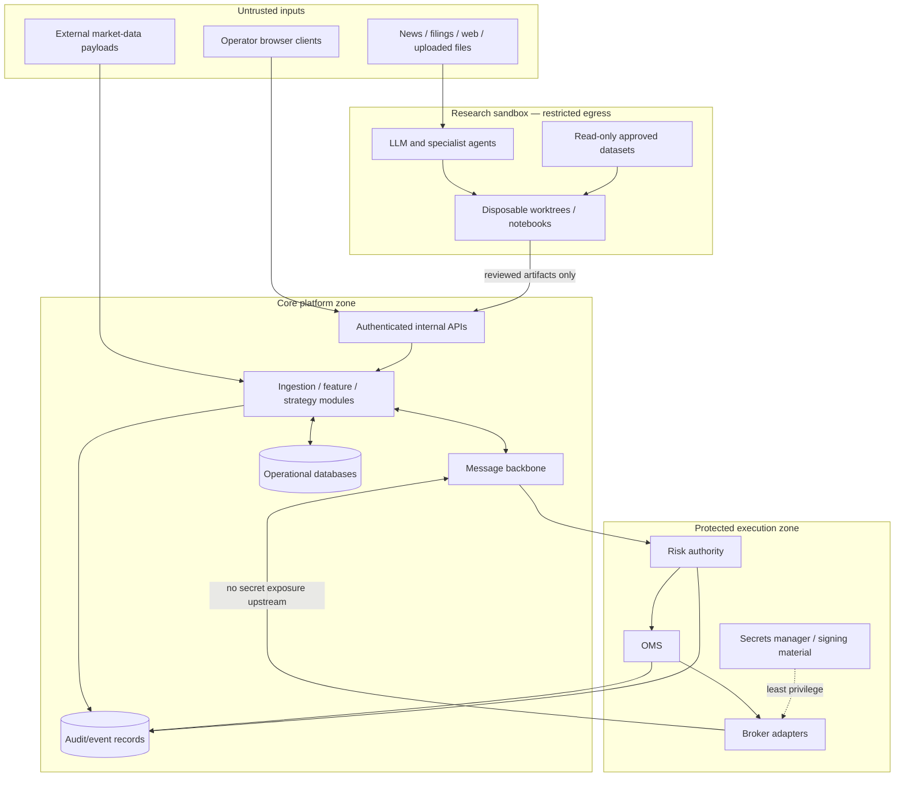

# 16 — Operations, Observability, Security and Governance

## 1. Operations control plane

Operators need to see whether the system is safe to trade, not just whether processes are running. The control dashboard should expose market-data integrity, strategy readiness, account/broker reconciliation, risk state, order lifecycle, model/release eligibility, storage/queue health and current incidents.

## 2. Operational dashboard domains

| View | Must show |
|---|---|
| Global status | Environment, trading enabled/disabled, global kill state, incidents, stale critical services |
| Markets and feeds | Venue/provider connection, entitlement, event lag, sequence state, snapshots, coverage and fallback source |
| Instruments | Registry mapping, lifecycle, calendar, data completeness, current feed and allowed consumers |
| Ingestion | Jobs, chunk progress, checkpoints, rate limits, retries, gaps, quarantine, bytes/rows and last success |
| Feature platform | Feature version, freshness, missingness, compute lag, drift and model dependencies |
| Strategies | Release, instance, state, last event/decision, queue lag, warmup, active target, P&L and risk budget |
| Portfolio | Equity, cash, exposure, currency, leverage, margin, concentration, drawdown and virtual-vs-actual reconciliation |
| Risk | Policy version, reservations, rejections, utilization, breaches, kill-switch scope and reset approvals |
| OMS | Parent/child orders, state, pending cancel/replace, unknown submissions, fills and broker IDs |
| Broker/account | API/stream health, balances, open orders, positions, margin, statement reconciliation and last sync |
| Research | Agent jobs, resource budget, experiment trials, validation status, promotion approvals and model drift |
| Infrastructure | CPU, memory, disk, network, DB pool, storage growth, queue depth and backup age |

## 3. Observability signals

Use correlated structured logs, metrics and distributed traces. Add domain-specific audit records for approvals, risk, orders and accounting. OpenTelemetry is a suitable vendor-neutral instrumentation approach, but the actual backend should be chosen based on retention, budget and operational ability.

### Platform golden signals
- Latency: ingest lag, feature lag, decision latency, risk latency, OMS/broker acknowledgement latency.
- Traffic: events/sec, requests/sec, orders/min, fills/min, dataset rows/bytes.
- Errors: provider errors, schema rejects, sequence gaps, strategy exceptions, broker rejects, reconciliation breaks.
- Saturation: queue depth/age, CPU, memory, storage, DB connections, rate-limit utilization.

### Trading-specific metrics
- Market-data freshness and integrity by instrument/feed.
- Signal and target rates, rejected/skipped signals and reasons.
- Gross/net exposure, risk utilization, drawdown, VaR/ES where applicable, margin headroom.
- Fill rate, partial fill rate, cancel/replace rate, slippage, spread paid and fees.
- Unknown order count, reconciliation break age and execution-report lag.
- Strategy/model drift, calibration, feature missingness and out-of-distribution conditions.

Do not put secrets, full account credentials or sensitive personal data in logs. Avoid unbounded metric labels such as every arbitrary symbol/order ID; use traces/logs for high-cardinality details.

## 4. Alert severity and response

- **SEV-1 / safety:** duplicate or unauthorized order risk, actual account mismatch, risk authority unavailable, unintended live mode, global data integrity failure affecting live orders. Immediately halt affected risk; page operator.
- **SEV-2 / degraded trading:** critical venue feed stale, sequence gap, broker disconnect, margin threshold, unknown order, reconciliation break. Block affected orders/strategy/account as defined; investigate.
- **SEV-3 / research degradation:** backfill delayed, research agent failure, noncritical feature lag, dashboard issue. No live risk unless dependency is shared.
- **SEV-4 / informational:** routine provider changes, scheduled maintenance, low-priority drift warnings.

Alert severity is based on risk and blast radius, not simply HTTP errors or process down status.

## 5. Security zones

## 6. Security controls

- Strong service/user identity, role-based and attribute-based authorization, least privilege and separation of duties.
- Separate production, paper, research and development accounts, networks, keys and databases.
- Secrets manager, key rotation, short-lived credentials where supported, signing-key protection and no secrets in code/logs/prompts.
- Egress control for research agents; untrusted files and text treated as data, not instructions.
- Dependency pinning, SBOM, vulnerability scanning, code signing and artifact provenance.
- Encryption at rest/in transit, database network isolation, backups with separate credentials and restore verification.
- Operator MFA, approval workflows for live enablement/risk-policy changes and emergency actions.
- Tamper-evident audit retention for order/risk/config/approval/secret-access changes.
- Rate limits and resource limits against accidental or malicious floods.

## 7. Audit event coverage

Record identity, timestamp, environment, action, old/new values or artifact references, authorization context, source IP/device where appropriate, correlation ID, approval ID and outcome for: login/permission changes, secret access/rotation, account activation, trading enablement, strategy release/promotion, risk policy changes, capital allocation overrides, kill switch, broker mapping, instrument eligibility, order submission/cancel/replace, reconciliation adjustments and data export.

## 8. Operator controls

Dashboard buttons must invoke authorized backend commands with idempotency and explicit confirmation for destructive/high-risk actions. Examples: pause strategy, disable account, block instrument, cancel open orders, start reconcile, retry ingestion, promote release, reset kill switch. The UI must display result from backend; it must not present a local optimistic state as completed. “Cancel all” and “flatten all” are distinct controls with different consequences.

## 9. Acceptance criteria

- An operator can trace a fill back to decision and source snapshots.
- Stale data, unknown orders, risk outages and mismatch alerts are tested.
- Sensitive credentials never appear in logs, model prompts, dashboards or research workspaces.
- Production enablement and policy changes require authorized audited approval.
- Research agent network and tool permissions are technically enforced.
- Backup restore and incident response drills are recorded.
