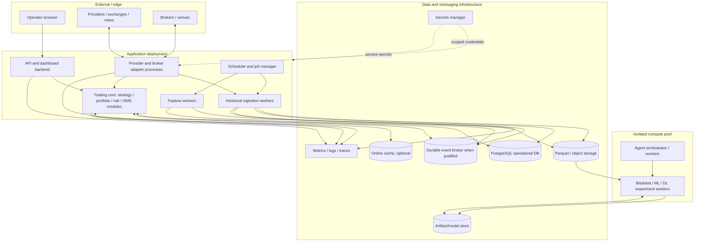

# 17 — Deployment, Runtime Topology and Scaling

## 1. Logical versus physical architecture

The architecture diagrams define responsibility boundaries. They do not imply one process per box. Premature microservices increase network failure modes, deployment burden, schema drift and operational cost. Begin with a modular monolith for transactional trading domains plus isolated ingestion/research workers, then split based on measured bottlenecks and isolation needs.

## 2. Proposed initial deployment topology

## 3. Modular-monolith boundaries

Initial modules in the trading core:

- Domain: instruments, market events, strategy releases, signals, targets, accounts, orders, executions, risk and ledger.
- Application: commands/use cases and orchestration for each bounded context.
- Ports: market data, event publisher, repository, broker execution, account state, clock, feature access.
- Adapters: SQL repositories, in-process event bus, object store, provider/broker SDKs.

Keep import/dependency direction explicit: domain types do not import UI/ORM/vendor SDK; strategy module does not import broker client; risk cannot depend on an LLM; OMS cannot trust a frontend-only risk check.

## 4. Workload isolation

Separate at least these resource classes:

- Live adapter and execution/risk workload: bounded latency, reserved CPU/memory, minimal noisy-neighbour impact.
- Historical data ingestion: rate-limit-aware and checkpointable; scalable workers with provider quotas.
- Feature computation: batch/stream; bounded queues and shared reusable transformations.
- Research/LLM/ML/DL: resource-heavy, potentially GPU-intensive, isolated from live risk/OMS resources.
- Dashboard/API: operator responsiveness, not allowed to block trading core.

A research model training job must not starve the execution process of CPU, memory, file descriptors or network bandwidth.

## 5. Compute strategy and scaling model

Scale by data subscriptions, event throughput, feature compute, experiment queues and account/venue concurrency—not by multiplying every strategy/instrument/timeframe into separate containers. Reuse raw ingestion and feature calculation; strategy instances subscribe to only the events/features they need. Use partitioned workers for instruments or accounts with ordering guarantees. Add caching and batch inference where latency and model semantics allow.

## 6. Candidate technology stack (not irrevocable)

| Concern | Practical starting option | Decision trigger to evolve |
|---|---|---|
| Domain/runtime language | Python for research and initial system; isolate measured hot paths | Profiling demonstrates latency/CPU bottleneck or memory safety need |
| Trading hot path | Typed deterministic modules, with native/Rust/C++ component only if benchmark requires | Measured latency budget fails under realistic load |
| API/dashboard | FastAPI or comparable service | Team/stack requirements |
| Operational DB | PostgreSQL; SQLite for prototype only | Multi-writer, replication, availability and query needs |
| Historical analytics | Parquet + DuckDB | Volume/concurrent query needs justify distributed compute |
| Event bus | In-process typed bus + outbox initially; Kafka/Redpanda/Pulsar later | Multiple consumers, replay throughput and operations justify it |
| Cache | In-process cache; Redis when cross-process low-latency read is needed | Cache consistency and scale requirements |
| Observability | OpenTelemetry SDKs with selected collector/backend | Retention, cost and alerting needs |
| Deployment | Docker Compose for local/dev; controlled VM/container orchestration for first deployment | High availability and scale justify Kubernetes or managed alternatives |

Do not choose technology by hype. Benchmark event volume, data retention, recovery and query patterns first.

## 7. Latency classes

Define separate latency budgets, measured end-to-end:

- End-of-day / daily research.
- Intraday completed-bar strategies (e.g. one/five-minute decisions).
- Quote/tick-driven strategies.
- Order-book/microstructure strategies.
- True low-latency/HFT (out of initial scope unless separately approved).

Measure provider publication-to-receipt, queue lag, feature compute, strategy inference, risk check, OMS persistence, network submission and broker acknowledgement. A “1-minute strategy” does not automatically require microsecond architecture; a strategy reacting to every order-book update may.

## 8. High availability and recovery

For live accounts, define primary/standby behavior, single-writer ownership/fencing for OMS and risk reservations, durable state, backup/restore, credential failover, broker reconnect and reconciliation. Avoid two active processes both believing they own the same account order stream. Use leases/fencing tokens and verify broker-side idempotency. Failover is not complete until open orders/positions/balances are reconciled.

## 9. Capacity planning

Estimate by market family and feed:

`events/sec × bytes/event × retained duration`, feature update frequency, number of subscribers, queue retention, backfill concurrency, order count, audit events, model training artifacts and expected universe size. Account for bursts at market open/news/volatility spikes, not just average load. Set per-provider request budgets, worker limits, disk high-water marks and retention/compaction policies.

## 10. Deployment environments

Development, test, staging/shadow, paper and production have different accounts, secrets, data licenses and release channels. Production uses immutable builds, pinned dependencies, signed artifacts, controlled config and rollback. A production release never inherits a developer's `.env` file or local broker credentials.

## 11. Acceptance criteria

- CPU/GPU-intensive research cannot starve live OMS/risk.
- Only one authorized writer controls each live account/order state partition.
- Restart/failover restores state and reconciles broker before sending new risk.
- Workload scale is measured by throughput and subscriptions, not process-per-combination.
- Production builds and config are reproducible and rollbackable.
