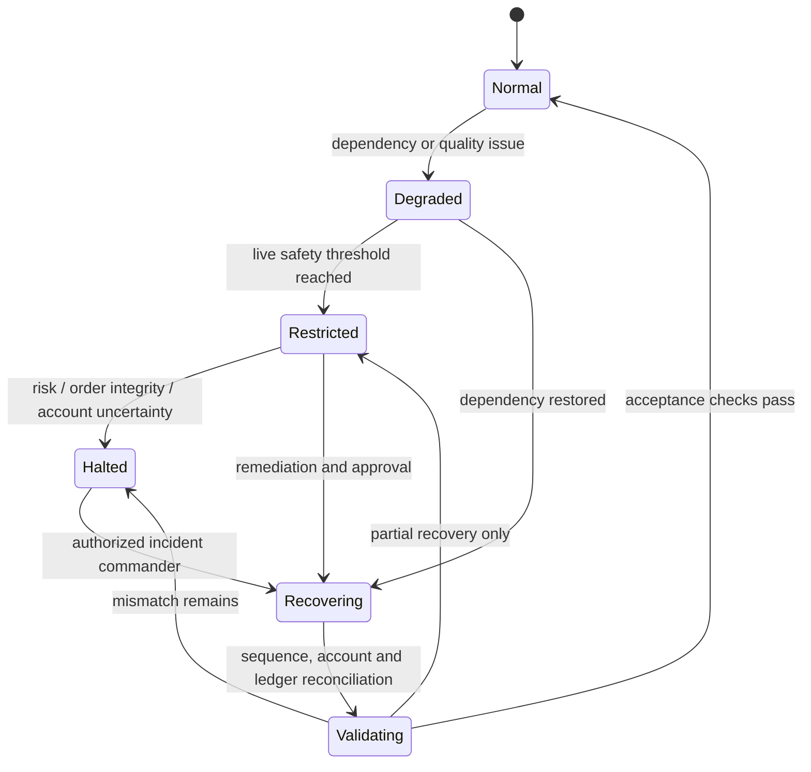

# 18 — Failure Modes, Degraded States and Runbooks

## 1. Failure policy

A trading system should make unsafe states visible and bounded. “Retry until it works” is not a safety plan. Every critical dependency has a failure state, timeout, retry budget, circuit breaker, recovery procedure and decision about whether new risk is allowed.

## 2. Failure matrix

| Failure | Detection | Immediate policy | Recovery evidence |
|---|---|---|---|
| Market-data disconnect | Heartbeat timeout / socket close | Mark feed stale; pause dependent strategies; retain raw evidence | Reconnect, venue-specific sequence/snapshot recovery, freshness restored |
| Sequence gap in order book | Sequence ID discontinuity | Invalidate local book; block book-dependent strategy/execution checks | Snapshot bridge and contiguous delta sequence verified |
| Historical provider throttling | 429 / rate-limit headers | Backoff with jitter; reduce concurrency; checkpoint | Quota window clear and successful bounded request |
| Provider entitlement denied | Permission response | Stop repeated retries; mark dataset blocked | Authorized entitlement or alternate verified provider |
| Bad symbol mapping | Unknown/ambiguous instrument | Quarantine; no live use | Mapping independently verified against reference source |
| Bad/corrected bar | OHLC/continuity/revision anomaly | Quarantine/revise; notify dependent consumers | Reprocessed version and lineage published |
| Event broker outage | Producer/consumer failure, lag | Persist outbox; bound queues; protect OMS/risk | Broker restored; idempotent catch-up and lag cleared |
| Consumer crash | Health check / checkpoint age | Restart from committed checkpoint; dedup events | Replay and projection invariants pass |
| Operational DB outage | connection/transaction errors | No new risk-increasing orders; preserve durable adapter evidence | DB restored, outbox/order state/ledger reconciled |
| Feature engine lag | Watermark/age threshold | Skip or degrade strategy according to contract | Fresh feature snapshots and warm-up complete |
| Strategy exception | Worker crash/invalid output | Isolate instance; no signal from failed worker | Restart from checkpoint, test output and data readiness |
| ML model invalid/OOD | Schema, range, drift or uncertainty gate | Reject model output / fallback only if explicitly approved | Valid version/model health and shadow verification |
| Risk authority unavailable | Health/decision timeout | Fail closed for new risk | Risk policy/state restored, reservations reconciled |
| Broker disconnect | Heartbeat/API failure | Block new orders; retain pending/unknown state | Reconnect and reconcile open orders/fills/positions/cash |
| Submit timeout | No ack after send | Mark submission unknown; do not blind retry | Broker query resolves original order or controlled escalation |
| Cancel pending too long | OMS timer | Continue counting exposure/reservation; query broker | Terminal cancel/fill/reject status confirmed |
| Account mismatch | Broker vs ledger diff | Freeze affected scope according to policy | Break investigated, supported adjustment posted and approved |
| Margin/collateral alert | Broker/account update | Stop new leverage; reduce risk under policy | Margin restored and account verified |
| Clock drift | NTP/offset monitor | Degrade time-sensitive feed/strategy; flag timestamps | Clock offset within defined tolerance |
| Storage full | Disk/object quota alert | Stop noncritical ingestion; preserve OMS/risk/audit capacity | Capacity restored, backfill resumed from checkpoint |
| Secret expired/compromised | Auth failure/security alert | Revoke/rotate; block affected connection | New scoped secret verified and audit reviewed |
| Agent prompt injection | Tool policy / sandbox violation | Deny action, quarantine artifact, log attempt | Review source/workspace; restore clean sandbox |
| Duplicate live process | Lease/fencing conflict | Only lease holder may submit; stop stale writer | Single owner and broker reconciliation confirmed |

## 3. Incident response state machine

## 4. Core runbooks

### Broker disconnected
1. Mark the broker account `DEGRADED`; block new risk-increasing orders.
2. Preserve all outbound commands and the last confirmed broker IDs/statuses.
3. Reconnect with bounded retries and verify authenticated account identity/environment.
4. Query open orders, order history, executions since checkpoint, positions, cash and margin.
5. Reconcile pending/unknown submissions; never retry a possibly accepted order blindly.
6. Import fills/corrections/fees, update ledger and record breaks.
7. Restore order flow only after account and risk reservations reconcile; require operator approval for material breaks.

### Market-data sequence gap
1. Mark the specific feed/instrument/order book invalid and publish quality event.
2. Pause consumers that require a valid sequence; do not block unrelated independent feeds.
3. Buffer subsequent messages within bounded memory limits.
4. Fetch authoritative snapshot and apply adapter-specific bridge procedure.
5. If bridge fails or buffer overflows, discard local book and rebuild.
6. Record missing range, duration, snapshot and recovery result.
7. Resume only after data integrity and freshness conditions pass.

### Database / core restart
1. Ensure only one process obtains the account writer lease/fencing token.
2. Restore configuration and committed state; drain durable outbox/inbox according to order.
3. Reconcile broker/venue external facts before enabling live orders.
4. Rebuild projections from immutable events/ledger where necessary.
5. Restore strategy state from checkpoint and replay idempotently.
6. Recompute data quality and warm-up; pause instances with incomplete inputs.
7. Record recovery evidence and operator acknowledgement.

### Kill switch activation
1. Identify scope (strategy, instrument, market, account or global).
2. Block new risk and submit configured cancels for eligible open orders.
3. Keep pending cancel exposure reserved until broker confirmation.
4. Do not assume positions are flattened; assess actual exposure separately.
5. Notify responsible operator and persist reason, trigger, policy version and actions.
6. Reset only after cause resolved, reconciliation complete and authorized approval.

## 5. Chaos and fault-injection tests

Simulate process kill after database commit but before event publish, duplicate broker execution report, order acknowledgement lost after send, fill received before ack, cancel/fill race, sequence gap with high event burst, snapshot stale, provider rate-limit, clock skew, DB full, broker partial history, outbox replay duplicate, two active account writers and delayed commission. Verify safe state, no double order, no double ledger posting and clear operator alert.

## 6. Acceptance criteria

- Every critical failure has a machine state and documented safe action.
- No live risk increases while risk authority or authoritative account state is unavailable.
- Unknown orders and reconciliation breaks remain visible until resolved.
- Recovery is tested from persisted checkpoints, not only clean shutdowns.
- Kill-switch semantics distinguish cancel orders from flatten positions.
