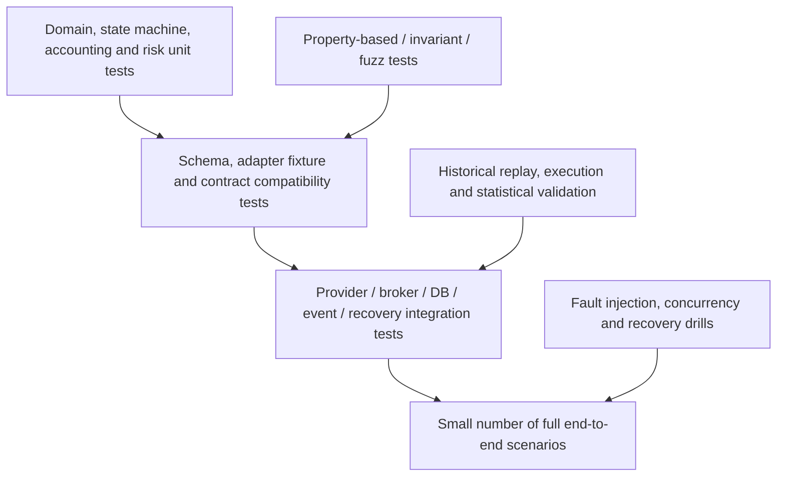
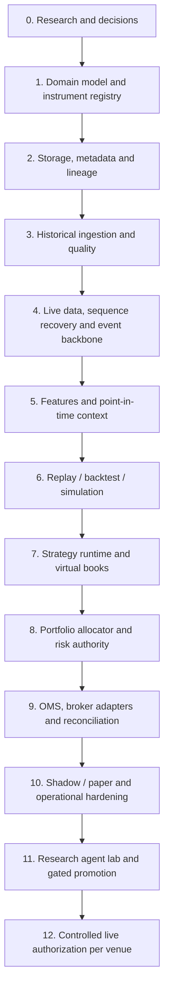

# 19 — Test Strategy and Implementation Roadmap

## 1. Test philosophy

No subsystem is “complete” because its unit tests pass or an agent reports success. Each capability needs evidence at the contract boundary, in an integrated environment, under realistic load, through failure/recovery, and from an operator's perspective. The system must be built in dependency order and each stage must leave a stable, independently useful foundation.

## 2. Test pyramid and specialist checks

### Domain invariants
- A listing maps to one effective contract-spec version at a given time.
- Financial amounts conserve under double-entry postings.
- Duplicate events/executions cannot double-apply state.
- An order cannot be marked canceled without authoritative cancel confirmation.
- A pending order reserves risk until the correct terminal outcome.
- Risk reservations cannot jointly exceed the configured account capacity.
- Strategy target totals and consolidated portfolio projections reconcile under defined attribution rules.

### Adapter contract tests
Use recorded/sanitized real payload fixtures and provider test/sandbox environments where available. Test pagination, timestamp formats, precision, daylight saving, subscription lifecycle, reconnect, sequence gap, duplicate/out-of-order events, native errors, rate limits, auth expiry and capability mismatch. Re-run when provider API versions change.

### Market-data data tests
Validate OHLC invariants, monotonicity, duplicates, gaps against calendar, bar completion/revision semantics, trade/quote ordering, book snapshot/delta reconstruction, volume/units, corporate actions, futures expiry and provider divergence. Include deliberately corrupt data.

### Trading/risk/OMS tests
Test all order state transitions, partial fills, fill-before-ack, cancel/replace races, reject, unknown submission, broker disconnect, correction/bust, late fee and restart reconciliation. Test risk limit boundary values, concurrent reservation, price bands, stale market data, account permission and fail-closed behavior.

### Research/statistical tests
Test point-in-time joins, universe membership, look-ahead/leakage, data snooping, survivorship, overlapping labels, out-of-sample isolation, walk-forward boundaries, fee/slippage sensitivity, capacity and reproducibility.

### Security tests
Secret scanning, role and permission tests, network egress restrictions, prompt injection attempts, untrusted code sandbox, dependency/SBOM scans, audit immutability and production credential isolation.

## 3. Implementation roadmap

This roadmap keeps all market families in the canonical model from the outset. The first connectors can be chosen to validate the architecture, but the shared interfaces and data taxonomy support every target family.

### Phase 0 — Research and architecture decisions
Deliver provider capability/licensing matrix; broker/exchange access constraints; asset-class domain decisions; operational risk assessment; data volume estimates; interface and schema ownership; acceptance tests. Exit when unknowns are explicit, owners assigned and first choices evidence-backed.

### Phase 1 — Canonical domain and registry
Implement venue, instrument, listing, contract-spec version, symbol mapping, calendar, derivative lifecycle and historical universe. Seed all asset classes with example fixtures; actual production universe is configured later. Exit when identity collision and as-of tests pass.

### Phase 2 — Storage, metadata and lineage
Implement operational DB migrations, raw archive abstraction, Parquet dataset writer, manifests, catalog, checkpoints, audit and restore test. Exit when a dataset can be traced to source and regenerated from a pinned manifest.

### Phase 3 — Historical ingestion
Build provider adapter port, capability catalog, job scheduler, chunking, resume, retry/rate limiting, normalization, quarantine, gap/coverage reports and exports. Connect multiple data families and verify asset-specific semantics. Exit when jobs resume after kill and coverage is honest.

### Phase 4 — Live ingestion and messaging
Build adapter lifecycle, stream capture, heartbeat, sequence recovery, durable publisher/outbox, topic contracts, bounded queues, consumer checkpoints and freshness dashboard. Exit when gap/duplicate/reconnect fault tests pass.

### Phase 5 — Feature and intelligence plane
Implement bar aggregation, feature definitions, online/offline parity, availability-time logic, multi-timeframe context, quality snapshots and decision-time feature storage. Exit when no future feature can leak into decisions.

### Phase 6 — Backtest/replay/simulation
Build shared event clock, strategy contract shell, historical replay, cost/fill models, simulated OMS/ledger and experiment manifests. Exit when reproducibility and point-in-time tests pass.

### Phase 7 — Strategy runtime
Implement releases/instances, subscription planning, warm-up/checkpoint, deterministic worker handling, signals/targets, decision store and virtual books. Exit when strategies can run independently without direct orders.

### Phase 8 — Portfolio and risk
Implement consolidated portfolio, hybrid allocator, currency/exposure, atomic reservation, policy versioning, hard limits, kill switches and audit. Exit when concurrent risk and fail-closed tests pass.

### Phase 9 — OMS and broker integration
Start with explicit adapter sandbox/test environment. Implement state machine, parent/child orders, unknown submission handling, reconciliation, executions/fees/corrections and ledger. Exit after adversarial order-state tests and account reconciliation.

### Phase 10 — Shadow, paper and operations
Operate continuously on live feed without orders, then paper. Validate latency, alerting, recovery, security, data quality, slippage and drift. Complete runbooks and on-call/operator drills.

### Phase 11 — Research agent lab
Only after data, experiments and validation are reliable, add orchestrator and specialist agents with isolated tools/compute, reproducible experiment and release gates. The agent layer is not a prerequisite for the basic deterministic trading core.

### Phase 12 — Controlled live
Requires market-access/legal/broker approvals, signed release, funded account authorization, configured limits, tested kill and reconciliation, operator coverage, explicit risk budget and rollback. Start with strictly limited exposure and venue-specific monitoring; expansion is evidence-driven.

## 4. Definition of done per module

A module is done only when it has: clear ownership; contract/schema; persistence and state transitions; unit and contract tests; integrated test; failure/recovery behavior; metrics and logs; access policy; documentation/runbook; reproducible build; acceptance evidence; and an explicit list of unsupported capabilities. “Not implemented” is an acceptable honest state; hidden mock behavior is not.

## 5. Acceptance gates before live

- No critical data-quality or source-entitlement blocker.
- Instrument/contract/calendar and venue capabilities verified.
- Point-in-time datasets and backtest assumptions reviewed.
- Strategy validation independent and statistically credible.
- Risk policies, reservations and kill controls tested under concurrency/fault.
- OMS uncertain submission, partial fill, cancel race and reconciliation tested.
- Broker/exchange market-access requirements met.
- Live secrets separated, least-privilege and tested rotation.
- Operational dashboards and incident ownership available.
- Operator approval and small-capital rollout plan recorded.
