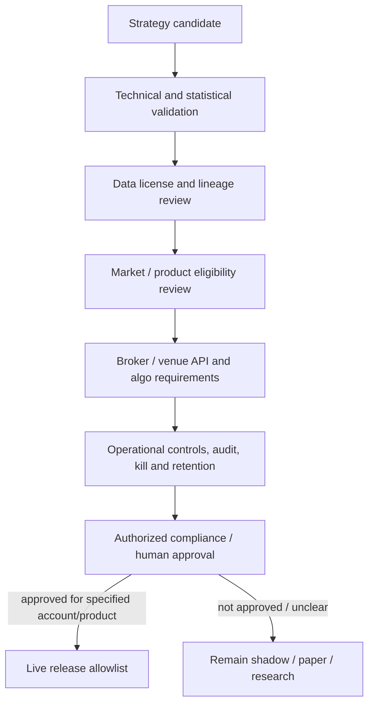

# 20 — Regulation, Licensing and Market Access

## 1. Why this belongs in the architecture

Regulation, market-data licensing and broker permissions are not paperwork that can be added after the trading engine is complete. They influence who may submit orders, which APIs/accounts may be used, whether an algo identifier or provider empanelment is required, how orders are tagged/rate-limited, which records must be retained, and whether data may be stored, displayed, derived or redistributed.

This section is an engineering checklist, **not legal advice**. Rules change, and requirements depend on jurisdiction, venue, broker, account type, strategy, product and whether the platform is used personally, commercially, for clients or as a service.

## 2. Indian equities and securities derivatives

SEBI issued its 4 February 2025 circular titled “Safer participation of retail investors in Algorithmic trading” (Circular No. SEBI/HO/MIRSD/MIRSD-PoD/P/CIR/2025/0000013). SEBI subsequently issued timeline/formulation updates, including a 30 September 2025 extension. NSE's current empanelled algo-provider page refers to NSE circular NSE/INVG/73992 dated 30 April 2026 and updated exchange requirements. This is enough to make Indian market-access compliance a first-class subsystem, but not enough to decide the user's exact obligations without knowing broker, account, strategy distribution and deployment model.

Before Indian live trading, verify with the intended broker and relevant exchange/SEBI material:

- Whether the order flow is classified as algo trading and which framework applies.
- Broker/exchange API access, registration/approval, strategy/provider empanelment if applicable.
- Algo IDs, tagging, static IP or other infrastructure conditions where applicable.
- Order-per-second / rate thresholds, controls, testing and audit requirements.
- Broker risk controls, kill-switch process and client authorization.
- Record retention, monitoring and incident reporting duties.
- Whether strategy is proprietary/personal, offered to clients, distributed, or operated as a third-party service; obligations can differ.

Do not infer that a personal strategy on a retail account is exempt or permitted simply because a broker offers an API. Obtain written broker guidance and professional legal/compliance advice for the actual use case.

## 3. International markets and crypto

Each jurisdiction and venue requires its own policy profile. US securities, futures/commodities, FX, EU/UK instruments and crypto-assets have different regulatory regimes and account eligibility. Crypto venues may impose jurisdictional restrictions, product eligibility, leverage limits and API rules; spot, margin, perpetuals and derivatives are distinct products. The platform must not route around geographic or account restrictions.

## 4. Market data licensing

For every provider/data family, record:

- Professional/non-professional classification and intended user population.
- Display versus non-display usage.
- Internal use, commercial use, derived data and model-training rights.
- Redistribution, screenshots, client access, delayed data and derived outputs.
- Storage/retention, historical archive and backup rights.
- Geographic restrictions, attribution and audit requirements.
- Fees, reporting, device/user counts and audit obligations.
- Vendor/API terms and source of truth for changes.

A public URL or unauthenticated API does not mean data is free for commercial use, redistribution or ML model training. Keep the license record linked to datasets and feature/model lineage.

## 5. Broker and venue controls

The market-access policy engine should support per-jurisdiction/per-broker profiles containing permitted accounts, product types, order tags, throttles, price/quantity limits, mandatory risk checks, approved IPs, time windows, restricted symbols, record retention and operator authorization. The adapter exposes the broker-specific fields but the core policy owns whether the platform is permitted to use them.

## 6. Compliance gate in release workflow

Approval is scoped to venue, account, product, strategy version and deployment model. A new market or distribution model requires a new review; do not treat approval as universal.

## 7. Acceptance criteria

- Every live route has a verified market-access profile and permitted account/product.
- Data license terms are attached to datasets and uses.
- Algo identifiers, order tags and rate limits can be represented and enforced where required.
- Compliance approval is versioned, scoped and auditable.
- Unknown regulatory status blocks live enablement rather than being interpreted optimistically.

## 8. Primary official references

- SEBI 4 February 2025 retail algo trading circular: https://www.sebi.gov.in/legal/circulars/feb-2025/safer-participation-of-retail-investors-in-algorithmic-trading_91614.html
- SEBI 30 September 2025 extension: https://www.sebi.gov.in/legal/circulars/sep-2025/extension-of-timeline-for-implementation-of-sebi-circular-dated-february-04-2025-on-safer-participation-of-retail-investors-in-algorithmic-trading-_96979.html
- NSE empanelled algo providers and references to exchange implementation standards: https://www.nseindia.in/static/trade/empanelled-algo-providers-exchange
- NSE platform services / algo-trading reference page: https://www.nse.in/static/trade/platform-services-non-neat-decision-support-tools-algorithm-trading

Always verify latest official circulars and broker requirements again immediately before live implementation and deployment.
