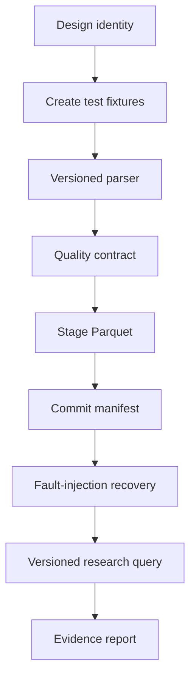

# Capstone — reproducible Indian derivatives data import

**Goal:** Implement a narrowly scoped local pipeline using synthetic and expressly permitted input files. There is no requirement to bypass exchange terms or buy an API subscription.

## Input specification

- One synthetic dated contract master with equity, index, future and call/put options.
- One synthetic daily report with two instrument classes and a deliberately duplicated row.
- A second corrected version of that report with one changed price and one deleted record.
- Malformed and unsupported-format fixtures.

## Required outputs

1. Instrument registry mapping dated source symbols to stable internal IDs.
2. Raw artifacts preserved (when permitted) with hashes and timestamps.
3. Canonical normalized EOD observations, quality report and quarantine output.
4. Staged Parquet and committed manifest in SQLite.
5. CLI query by instrument/date/dataset release.
6. Demonstrated recovery from crash after file publication before manifest commit.
7. First and corrected dataset releases remain independently queryable.
8. Reproducibility report: code revision, environment lock, parser version, input hash, tests.

## Acceptance matrix

| Gate | Required evidence |
|---|---|
| Identity | same contract reimport maps to same internal ID |
| Integrity | raw and immutable output hashes verified |
| Idempotence | duplicate import creates no extra logical publication |
| Recovery | crash injection + restart leaves one consistent visible release |
| Correction | V1 and V2 query separately with differences disclosed |
| Quality | unknown/missing observations never silently fabricated |
| Performance | sample memory and disk use recorded, not guessed |
| Independence | learner explains system without copy-pasting architecture prose |

### Capstone sequence

