# Data Platform V1 — Indian Markets

**Status:** proposed implementation specification; no claims that adapters, accounts or subscriptions are live.  
**Deployment:** local-first Linux · SQLite metadata · versioned Parquet observations · permitted raw inputs.  
**Scope:** NSE-first equity, indices, stock/index futures and options reference + EOD data; BSE-ready schema. Historical intraday, live trading, L2 and L3 are capability targets, not V1 acceptance criteria.

## Vertical slice

```mermaid
flowchart LR
 FILE[Permitted local report] --> HASH[Raw archive + SHA-256]
 HASH --> PARSER[Versioned source parser]
 PARSER --> RESOLVE[Historical instrument ID]
 RESOLVE --> CHECK[Financial and schema validation]
 CHECK --> STAGE[Staged Parquet]
 STAGE --> VERIFY[File content verification]
 VERIFY --> COMMIT[Immutable file publish + SQLite manifest]
 COMMIT --> QUERY[Python / CLI / DuckDB query]
```

## Source qualification gate

Before any automatic downloading, record origin, permitted acquisition method, usage rights, history available for each market segment, schema, timestamps, rate limits, update/revision policy, legal and operational risks. A third-party wrapper is not itself a data entitlement.

## Acceptance gates

1. Clean local installation using uv and locked dependencies.
2. Stable identity for representative equity, index, future and option records.
3. Historical contract specifications and dated source snapshots preserved.
4. One *verified and permitted* reference format and one EOD report type processed, initially through local import.
5. Raw input hashed and preserved subject to source rights.
6. Normalized records validated and stored as immutable published Parquet.
7. SQLite manifest links source, parser version, dataset version and artifact hashes.
8. Reimport is idempotent; crash fault injections recover without false completed status.
9. Missing observations and unknown coverage never silently marked complete.
10. Queries by instrument/date/release return reproducible data; no dashboard dependency.

## Source evidence

- NSE historical reports: https://www.nseindia.com/static/resources/historical-reports-capital-market-daily-monthly-archives
- NSE derivatives reports: https://www.nseindia.com/all-reports-derivatives
- NSE Clearing UDiFF file specifications: https://www.nseclearing.in/udiff
- SEBI derivatives source index: https://www.sebi.gov.in/curation/equity_derivatives.html

**Open verification:** automation rights, archive date coverage, actual source field semantics and parser versions, any updated current restrictions. Never infer a legal entitlement from an HTML download link alone.
