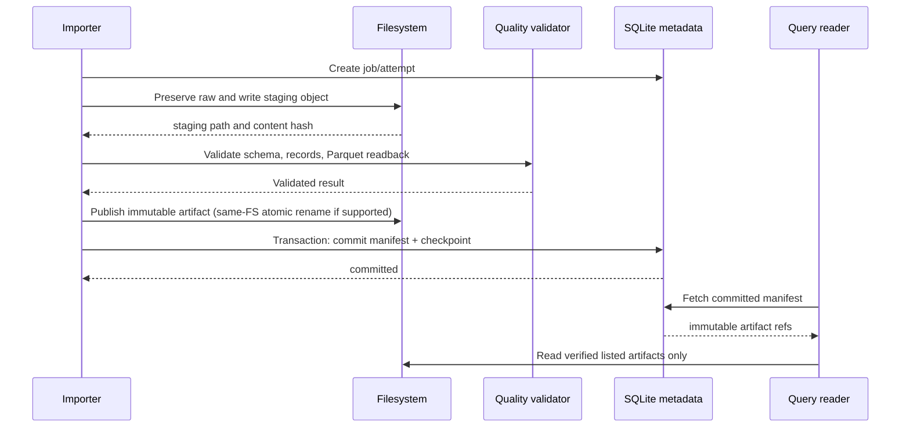

# Crash-safe file + metadata publication

A successful SQLite transaction **cannot** atomically commit a Parquet file on the filesystem. We use manifest-gated visibility and recovery reconciliation.

## Crash matrix

| Crash boundary | Durable possible state | Recovery |
|---|---|---|
| Before stage write ends | Incomplete staging | Discard/retry; no visible dataset |
| Stage complete before validation | Staged bytes, no accepted proof | Validate again |
| Validated before immutable publish | Verified staging artifact | Publish or regenerate safely |
| Published file before manifest commit | Unreferenced immutable artifact | Verify hash, reconcile or clean up |
| Manifest committed | Committed manifest and immutable file expected | Verify missing/corrupt artifact and flag incident; never report falsely healthy |

## Invariants

- Queries read **committed manifest files only**.
- A file path is immutable after publication.
- Source file + transformation version + normalized schema identify logical work under a documented equivalence relation.
- Idempotent retries may reuse verified staged/published outputs.
- Checkpoints advance only with a durable manifest commit.
- Recovery must be exercised with fault injection at *every* transition.

**Failure gate:** if the manifest points to a missing or wrong-hash file, mark the dataset unavailable/corrupt and alert; do not silently fall back to an older or partial artifact.
