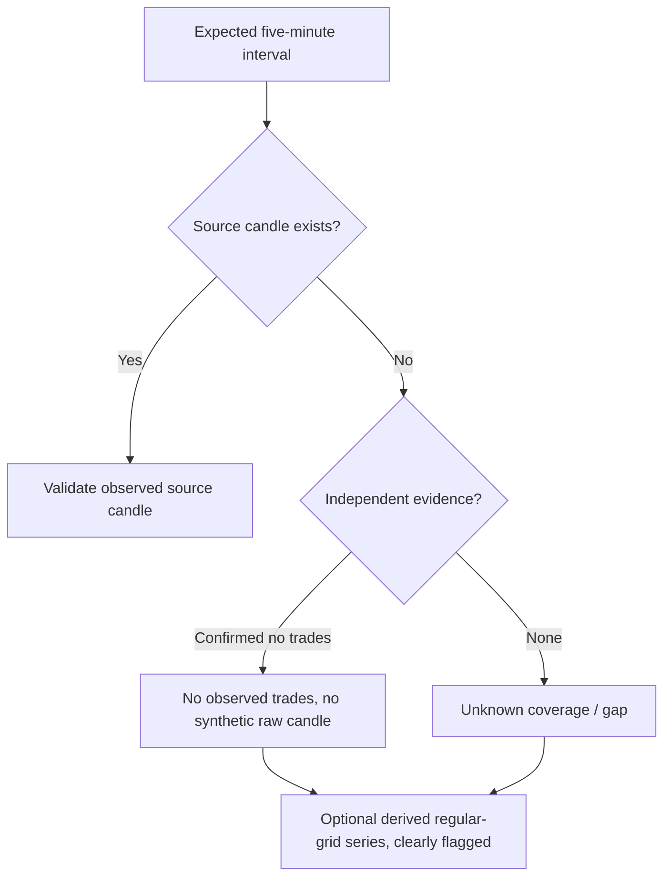

# Data family and event contracts

| Family | Minimum fields | Semantic cautions |
|---|---|---|
| Equity/index EOD | instrument_id, session, OHLC, source, dataset version | Index vs security and adjustments differ |
| F&O EOD | contract instrument_id, session, traded data, OI if supplied, settlement where defined | Do not equate settlement, close and mark price |
| Intraday OHLCV | instrument_id, interval start/end, open/high/low/close/volume, final flag | Missing interval ≠ zero trade |
| Trades | instrument_id, event/arrival time, price, size, source sequence if supplied | Trades may have duplicates or corrections |
| Quotes | instrument_id, bid/ask price and sizes, event time, provenance | Snapshot ≠ event history |
| L2 book | snapshot/update type, price levels, sequence and feed semantics | Cannot infer L3 order IDs |
| L3 book | individual-order events and IDs when truly supplied | Not reconstructible from ordinary L2 |
| Derived IV/Greeks | model, timestamp, inputs, units, output, version | Calculated value, not raw exchange observation |

## Canonical envelope

```text
observation_id | instrument_id | data_family | source_id | source_version
market_event_time | trading_session | source_published_at? | ingested_at
provider_sequence? | value_payload | parser_version | schema_version
quality_flags | raw_artifact_hash
```

Nullable fields with `?` must retain reason if absent, not be silently manufactured. Explicit units: price currency, number of units/contracts, quantity multiplier, implied volatility annualization, timezone. Use timezone-aware timestamps and preserve source precision.

## No-trade interval example


