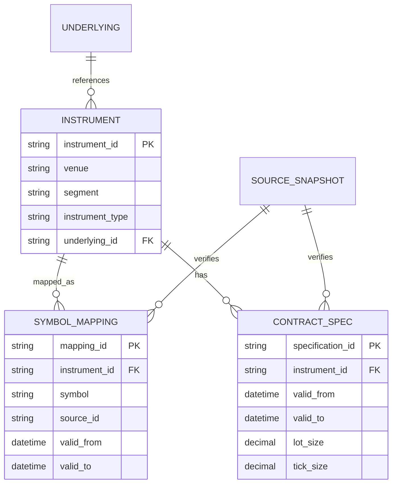

# Instrument registry contract — proposal

## Distinctions

- `underlying_id`: economic reference (company/security/index), not necessarily a tradable instrument.
- `instrument_id`: immutable MOSAIC identity for a listed tradable contract/security or reference index.
- `venue_symbol`: changeable market identifier with effective dates and exact source snapshot.
- `contract_specification`: effective-dated strike/expiry/right/lot/tick/multiplier where relevant; exact semantics require exchange source validation.
- `source_mapping`: broker/vendor symbol/token and observation-valid date interval. Never assume provider tokens are globally stable.

## Conceptual relational model

## Mandatory temporal rules

1. Expired instruments remain queryable.
2. No two active mappings conflict for the same source identity and effective instant without explicit ambiguity.
3. Historical changes in lot size do not automatically imply a new immutable identity.
4. Raw source snapshots survive canonical registry correction (rights permitting).
5. Never infer an old contract universe solely from today's master.
6. Changes that alter contract economic identity must be assessed against exchange rules, not generalized from all other markets.

## Candidate V1 queries

- Resolve observed exchange symbol from a specific report date.
- List all live option contracts for a historical underlying at a cutoff date, using only known snapshots.
- Return specification in effect at timestamp T, with its supporting source ID.
- Explain why a record could not be mapped (unrecognized, ambiguous, expired, source missing).

> **Open question:** which exact NSE fields/IDs and contract adjustment rules we rely on will be decided only after fixture and contract-format inspection.
