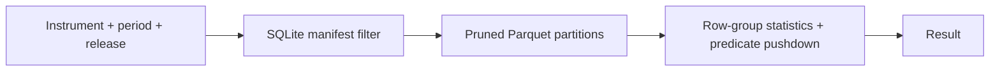

# Parquet layout and local capacity planning

**Starting machine envelope:** roughly 8GB RAM, 300GB free SSD, 128GB external USB and 16GB SD card. Proposed active archive cap 50GB and SSD free floor 30GB are **starting test values**, not capacity forecasts.

## Avoid file-count explosion

For 2,000 contracts × 250 sessions/year, writing one file per contract/session produces 500,000 files/year. Small files increase metadata/open overhead. Instead, begin with shared date/segment batches, sort by instrument and event time, track min/max in manifests and benchmark DuckDB filtering.



## Data layout (illustrative)

```text
archive/
  raw/sha256/aa/<hash>                     # content addressed if rights allow
  staging/<job-id>/...                     # incomplete, invisible
  canonical/bars/venue=NSE/segment=FO/year=2024/month=03/part-*.parquet
  canonical/bars/venue=NSE/segment=CM/year=2024/month=03/part-*.parquet
  manifests/release-<id>.json              # or manifest content within SQLite
```

## Benchmark protocol

1. Generate representative synthetic datasets, preserve seed and schema.
2. Test candidate partition layouts for scan bytes, wall time, peak RSS, number and size of files.
3. Query one instrument/date range, broad segment range and complete annual scan.
4. Simulate one failed job and one corrected source release.
5. Record recommendations and numbers; do not assign an untested optimum.

## Backups and removable media

Use internal SSD for active SQLite and staged publication. External storage may hold cold verified copies; check hashes after copying and test restoration. Do not treat the USB/SD card as an automatically reliable high-write transactional device.

Reference: https://duckdb.org/docs/stable/data/parquet/overview
