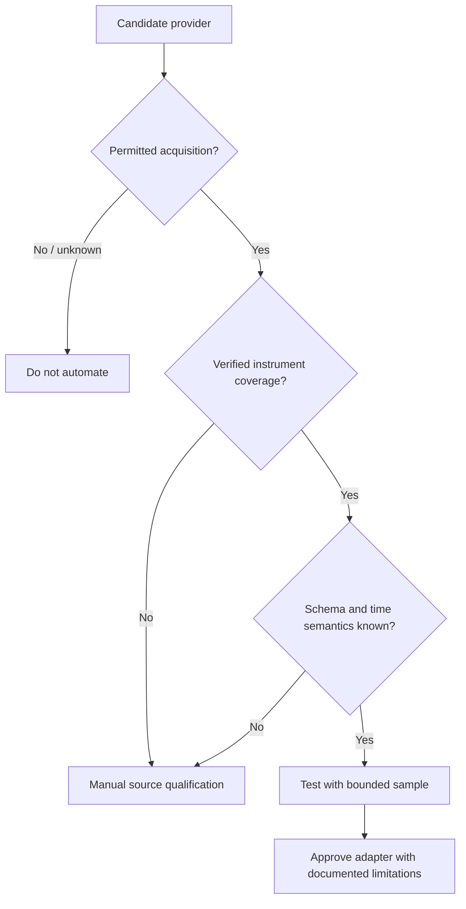

# Source qualification specification

> **No unattended collection until the acquisition method and applicable terms have been verified.** This file is an evaluation contract, not permission to access NSE or any other source automatically.

| Field | Required evidence |
|---|---|
| Source operator, origin and intermediary | Official pages and provider agreements |
| Venue and segments | NSE CM, NSE FO, BSE etc, individually enumerated |
| Data families | Contract masters, EOD bars, OI, intraday, quotes, trades, depth |
| Price and account requirement | Free, subscription, approval, broker access |
| Automated access rights | Explicit terms / permitted API documentation |
| Historical start/end | Actual verified files, not promotional claims |
| Symbol and identity keys | Dated master, venue, expiry, strike, option type |
| Time semantics | Session, source event time, publication, precision and timezone |
| Updates | Final/preliminary, corrections, revision discovery |
| Quality | Missing days, column consistency, nullability |
| Limits | Throttling, maximum batch size, entitlement expiry |
| Storage and reuse rights | Local retention, derived output, redistribution, research |
| Integration proof | Fixture hash, example parser, independent validation |

## Decision logic

**Acceptance:** do not move to `APPROVED` without reproducible evidence for rights, sample data and segment-specific coverage. Store approval date, approver, source URL and linked supporting documents.
