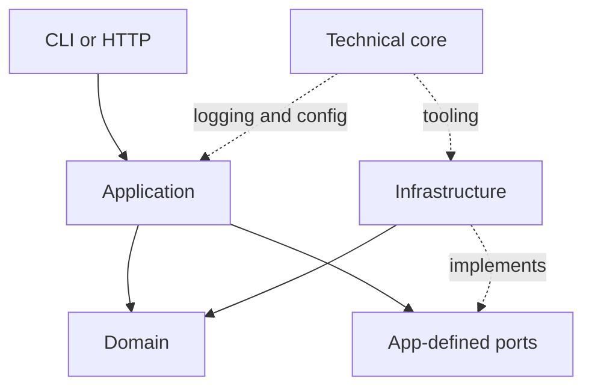

# Engineering handbook

The codebase is a modular monolith with explicit boundaries, not a fleet of services. `domain` holds financial invariants; `application` orchestrates use cases; `infrastructure` performs I/O; `interfaces` expose CLI and future HTTP entry points; `core` owns narrowly shared technical tools.

## Engineering standards

| Topic | V1 choice | Testable consequence |
|---|---|---|
| Python environment | uv + pyproject.toml + lockfile | clean reproducible install |
| Lint/type | Ruff + selected Pyright/Mypy checks | CI fails on violations |
| Persistence | SQLite metadata + Parquet observations | no domain module imports SQL |
| Data rights | qualified sources, permitted local file import | access/retention evidence |
| Concurrency | sequential correctness first; bounded workers later | no duplicate publish on retries |
| Recovery | manifest gate + fault injection | verified post-crash state |
| Config | typed, secrets excluded from Git | no credentials in logs |
| CI | unit, contract, integration, crash tests | failures prevent merge |

## Import direction

`docs/architecture` describes the whole target MOSAIC; `docs/data-platform` constrains V1. The former does not imply every component exists today.
