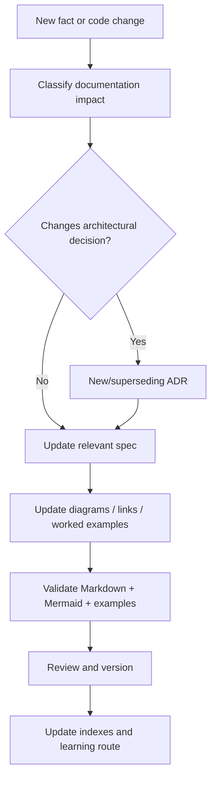

# Living documentation governance

The architecture is expected to evolve; the archive should be stable and changes traceable.

## Document classes and change triggers

| Class | Owner | Update trigger | Review |
|---|---|---|---|
| Architecture `00`–`22` | System architect | changed cross-domain responsibility | ADR + diagram review |
| Data-platform contracts | Data engineer | parser/schema/source/retention change | fixtures + tests + source evidence |
| Engineering standards | Maintainer | toolchain or CI policy change | reproducible test |
| Learning curriculum | Tutor / learner | revealed misconception or mastery gap | evidence and spaced review |
| Strategy research | Quant reviewer | new hypothesis or evaluation policy | independent validation |
| Regulatory/source qualification | Access owner | terms, venue/broker policy or use case changes | dated primary sources |

## Update workflow

## Rules

1. **Never silently overwrite** existing numbered architecture chapters. Amend via versioned commits and ADRs, with reviewers.
2. Maintain a single docs entry point and lightweight local indexes. Avoid duplicate contradictory architecture copies.
3. Prefer short, specific file paths and relative links. Run a link/diagram syntax check in CI.
4. Mark assumptions as assumptions, source-proven facts with dated URLs, and code-complete behaviors with test evidence.
5. Each lesson has: questions, model/derivation, worked example, failure modes, exercise, references, mastery gate.
6. When a source changes or legal access status is uncertain, mark the provider evaluation **unverified** until reassessed.
7. New docs should document the *current* interface plus a clearly labelled *future* capability, not falsely claim both exist.
8. A docs update must include changed indexes or cross-references if it adds a major topic.

## Versioning convention

Use Git commits; meaningful schema changes should also bump their own version. Learning content changes can be recorded in a changelog. A document date alone is not a sufficient reproducibility identifier.
