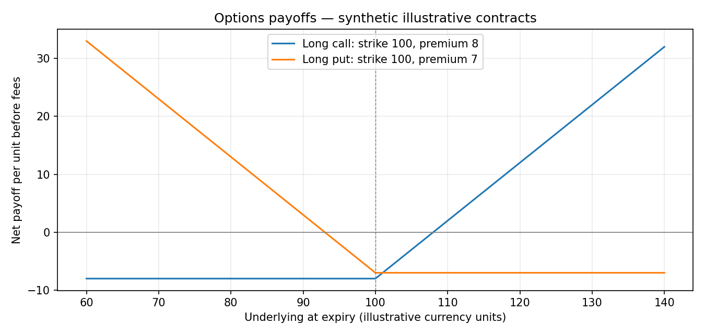
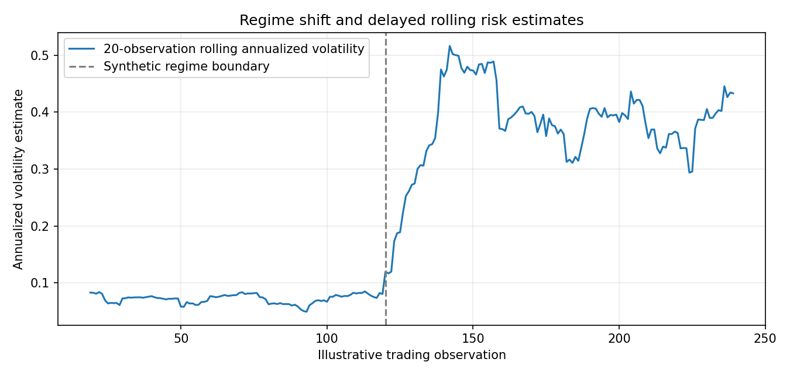
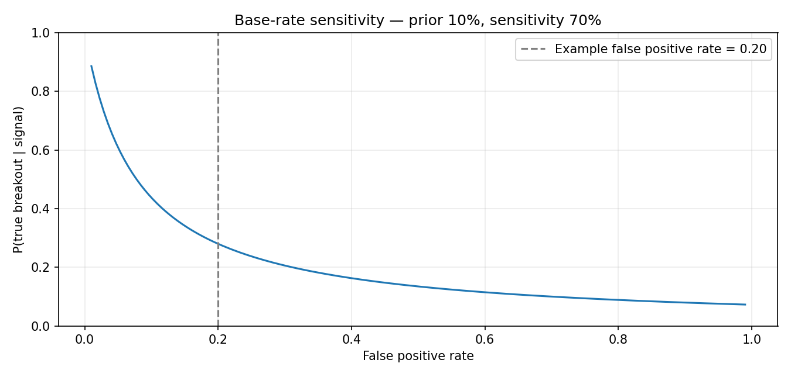

# Graph atlas — how to read these pictures

## 1. Option payoff is not profit prediction

The graph shows terminal net payoff for **illustrative option premiums** and excludes fees, contract multipliers and expiry settlement mechanics. Ask: at which prices does each position break even? Why can't a static payoff describe path-dependent margin/execution risk?

## 2. Risk estimates lag volatility changes

The plot is synthetic. The sudden increase in return dispersion is followed by a lagged rise in rolling volatility. Ask: what happens to a volatility-targeting strategy just before the estimate catches up?

## 3. Bayes and base rates

Hypothetical prior 10%, sensitivity 70%, varying false positive rate. Ask: why does improving specificity matter more when the target event is rare?

## 4. End-to-end research causality

