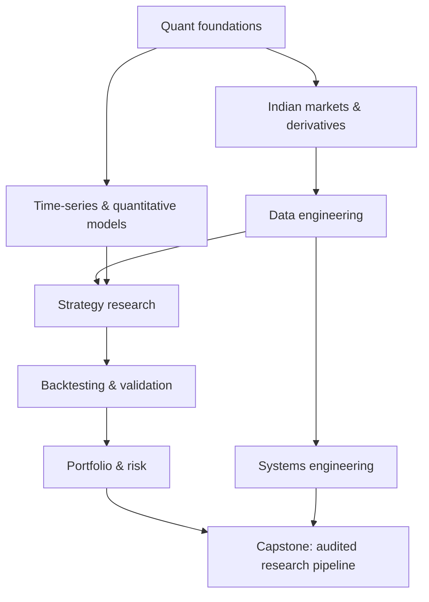

# MOSAIC Learning Academy

A rigorous, iterative course combining mathematics, Indian market mechanics, data engineering, quant research and trading systems. **Do not equate reading a document with mastery.**

## Two-level curriculum

| Track | Focus | Initial prerequisite | Evidence of 4/5 |
|---|---|---|---|
| Quant foundations | Probability, statistics, expectation, Bayesian reasoning | Algebra | Independent derivations and counterexamples |
| Indian markets | Exchange instruments, futures/options, corporate actions | Basic markets | Accurate contract model, lifecycle scenarios |
| Time series | Returns, stationarity, volatility, signals | Statistics | Bias-aware feature notebook |
| Data engineering | Identity, ingestion, Parquet, temporal validity | Python | Reproducible, restart-safe import |
| Strategy research | Hypothesis, execution costs, tests, portfolio | Statistics + data | Registered experiment with clean holdout |
| Systems engineering | Architecture, concurrency, migrations, testing | Python | Crash-recovery tests and resource budgets |

### Socratic Tutor protocol (from uploaded skill)

1. Start with 3–5 **diagnostic questions, one at a time**, spanning easy to hard; don't teach before the diagnostic is finished.
2. Assign **0–5** per subskill: 0 unaware; 1 heard of it; 2 follow along; 3 with help; 4 independent; 5 can teach and handle edge cases.
3. During a live session ask exactly one question and stop. First probe with a narrower question if the response fails; after 2–3 failed attempts explain briefly then re-test differently.
4. Increase a level only after at least two independent checks, including delayed unprompted recall. Include spaced review and downgrade when appropriate.
5. Finish with a mixed exam across all subskills and one integrated capstone. Users can request `show progress`, `harder`, `easier`, `just tell me`, `save state`, `resume from:`.

All examples, lessons, solved calculations and figures are **original MOSAIC study material**. They are not purported to be Jane Street-authored resources. External reading: [Jane Street Probability & Markets Guide](https://www.janestreet.com/probability-markets/) and [Jane Street puzzles](https://www.janestreet.com/puzzles/).

## Recommended learning cadence

For each lesson: predict → derive → solve → test a counterexample → implement a tiny simulation → write a one-paragraph explanation → revisit after 2–7 days. Never automatically award 4/5 just for selecting a multiple-choice option.
