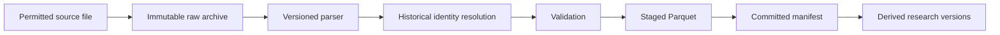

# Raw, canonical and curated data contracts

> **Track:** `data-engineering` · **Lesson:** 1 · **Target:** independent reasoning (4/5)  
> **Prerequisite:** read the track index and complete prior diagnostic questions.  
> **Outcome:** Trace source rows into reproducible versioned datasets without erasing provenance.

## Socratic opening — answer before reading

1. How can raw and canonical contain different row counts without corruption?
2. Should a synthetic forward-filled interval be called canonical observed OHLCV?
3. Why is a parser version part of reproducibility?

**Tutor protocol:** ask one question at a time in a live session. The tutor should not reveal the worked solution until the learner has attempted the problem and been probed on the reasoning. These questions are a study bank, not evidence of mastery.

## Core reasoning

Raw is byte-faithful source material (where retention is permitted). Canonical data normalizes schema and semantics without fabricating market observations. Curated data creates deliberate derived series, such as adjusted closes or resampled grids. Contract versions should name units, nullability, timestamp semantics and source provenance. Do not silently forward-fill absent option bars.

## Mathematical or engineering model

A data record can be modelled as $R=(instrument\_id,event\_time,observation,source\_id,source\_version,ingested\_at)$. Dataset identity should include a manifest of immutable artifact hashes and transformation version; two filenames with identical contents are not necessarily separate economic observations.

## Worked example (read after attempting)

An exchange report row with source trading symbol and settlement price becomes a canonical contract-linked observation only after resolving its historical instrument identity. A zero-trade interval with no source bar remains absent/unknown, not an invented zero-volume candle.

## Visual model

## Failure modes and misconceptions

Identify the assumptions and find a counterexample before adopting the model. In MOSAIC, keep raw observations distinct from modelling assumptions.

## Build or paper exercise

For a synthetic five-row report, design a column mapping and identify which metadata must survive. Label one unsupported column as `unmapped` rather than dropping it without record.

## Verification and cross-connections

Verify dimensional units, edge cases, reproducibility and whether each input was actually observable at decision time.

## Evidence and references

[NSE reports](https://www.nseindia.com/all-reports-derivatives) · [UDiFF specifications](https://www.nseclearing.in/udiff)

## Mastery gate

To claim **4/5**, solve two independent variants, including one without hints after a delay. To claim **5/5**, explain a counterexample, show an edge case and teach the model clearly. Record evidence in `docs/learning-material/MASTERY-TRACKER.md`.
