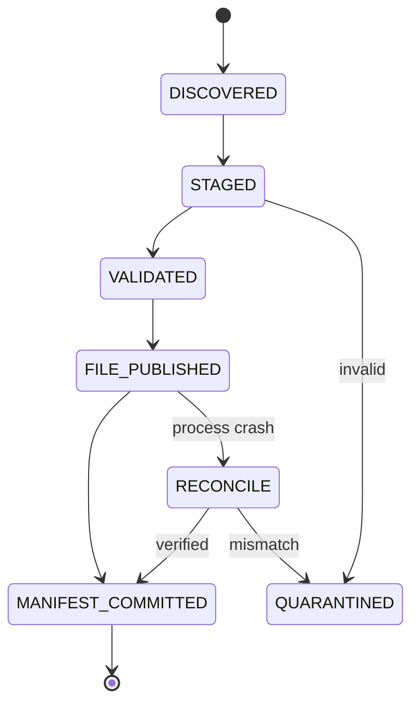

# Idempotency, atomic publication and crash recovery

> **Track:** `data-engineering` · **Lesson:** 2 · **Target:** independent reasoning (4/5)  
> **Prerequisite:** read the track index and complete prior diagnostic questions.  
> **Outcome:** Design an import state machine that survives a crash between Parquet publication and SQLite manifest commit.

## Socratic opening — answer before reading

1. What if the file exists but the manifest does not?
2. What if the manifest exists but the file checksum fails?
3. Why does a checkpoint before durable commit cause data loss?

**Tutor protocol:** ask one question at a time in a live session. The tutor should not reveal the worked solution until the learner has attempted the problem and been probed on the reasoning. These questions are a study bank, not evidence of mastery.

## Core reasoning

File and DB commits are separate resources. Do not claim one transaction covers both. Use immutable staged output, validation, same-filesystem rename when supported, manifest commit as reader visibility gate, and explicit reconciliation of orphaned or incomplete artifacts. Idempotency keys should represent a well-defined attempt or input transformation identity, not arbitrary timestamps.

## Mathematical or engineering model

Conceptual artifact identity $H=SHA256(source\_bytes\Vert parser\_version\Vert normalized\_contract\_version)$. In practice use unambiguous serialization/length-prefixing, and persist source hash and transformation/config IDs separately. This is an **illustrative identity scheme**, not a cryptographic proof of complete dataset correctness.

## Worked example (read after attempting)

Crash after publishing `part-1.parquet` but before SQLite commit: the Parquet file exists but is invisible to ordinary queries. On restart the recovery worker verifies its hash, checks for a manifest, then safely adopts or cleans it. Blindly rerunning and appending duplicates is wrong.

## Visual model

## Failure modes and misconceptions

Identify the assumptions and find a counterexample before adopting the model. In MOSAIC, keep raw observations distinct from modelling assumptions.

## Build or paper exercise

Write a fault matrix for every boundary between the states above. For each, specify what a new process can reconstruct from disk and metadata, without relying on RAM.

## Verification and cross-connections

Verify dimensional units, edge cases, reproducibility and whether each input was actually observable at decision time.

## Evidence and references

[SQLite transactions](https://www.sqlite.org/lang_transaction.html) · [MOSAIC failure runbooks](../../architecture/18-failure-modes-runbooks.md)

## Mastery gate

To claim **4/5**, solve two independent variants, including one without hints after a delay. To claim **5/5**, explain a counterexample, show an edge case and teach the model clearly. Record evidence in `docs/learning-material/MASTERY-TRACKER.md`.
