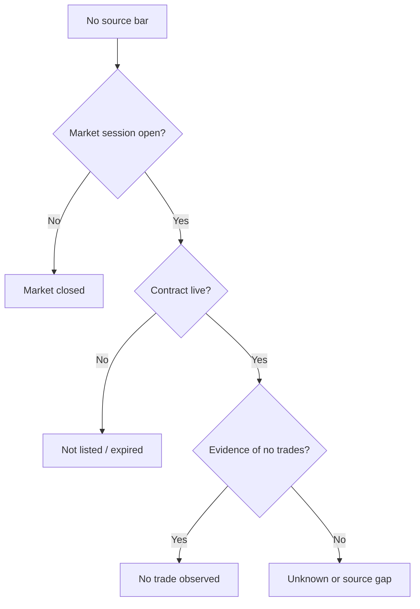

# Market calendars, sparse bars and coverage classifications

> **Track:** `data-engineering` · **Lesson:** 4 · **Target:** independent reasoning (4/5)  
> **Prerequisite:** read the track index and complete prior diagnostic questions.  
> **Outcome:** Separate source absence from zero market activity and from ingestion failure.

## Socratic opening — answer before reading

1. Does an empty OHLCV interval prove no trades?
2. Can an ingestion job succeed with poor dataset coverage?
3. What additional source allows you to distinguish a no-trade interval from missing bars?

**Tutor protocol:** ask one question at a time in a live session. The tutor should not reveal the worked solution until the learner has attempted the problem and been probed on the reasoning. These questions are a study bank, not evidence of mastery.

## Core reasoning

A trading session is venue- and segment-specific. A missing intraday bar could mean no trade, suspension, not listed, closed session, upstream gap or unknown. Do not transform source absence into zero volume without evidence. Separate job execution result, numerical coverage, validation status and business usability.

## Mathematical or engineering model

Coverage = $N_{observed,eligible}/N_{expected,eligible}$ only if an defensible expectation policy exists. For sparse trade bars, the number of expected nonempty bars may be unknowable from OHLCV alone. Report observed interval density and source-reported completeness separately.

## Worked example (read after attempting)

In a 10-minute period an option does not trade but quotes change. The OHLCV feed may legitimately show no bar, while the quote feed contains updates. A research grid can forward-fill with a `synthetic=true` flag, but the canonical observed trade-bar archive must remain unchanged.

## Visual model

## Failure modes and misconceptions

Identify the assumptions and find a counterexample before adopting the model. In MOSAIC, keep raw observations distinct from modelling assumptions.

## Build or paper exercise

Write a quality classifier for five synthetic intervals using a calendar, instrument lifecycle and quote evidence. State where `UNKNOWN` is the only defensible status.

## Verification and cross-connections

Verify dimensional units, edge cases, reproducibility and whether each input was actually observable at decision time.

## Evidence and references

[NSE historical reports](https://www.nseindia.com/static/resources/historical-reports-capital-market-daily-monthly-archives)

## Mastery gate

To claim **4/5**, solve two independent variants, including one without hints after a delay. To claim **5/5**, explain a counterexample, show an edge case and teach the model clearly. Record evidence in `docs/learning-material/MASTERY-TRACKER.md`.
