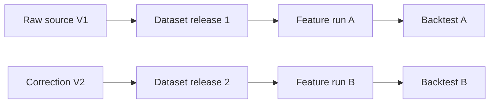

# Bitemporal records, revisions and lineage

> **Track:** `data-engineering` · **Lesson:** 5 · **Target:** independent reasoning (4/5)  
> **Prerequisite:** read the track index and complete prior diagnostic questions.  
> **Outcome:** Track what the market said, when the source said it, and when MOSAIC learned it.

## Socratic opening — answer before reading

1. Which timestamp answers what was true, and which answers what was known?
2. Why can't corrected data silently overwrite old experiment input?
3. How could lineage enable selective retesting rather than rerunning all research?

**Tutor protocol:** ask one question at a time in a live session. The tutor should not reveal the worked solution until the learner has attempted the problem and been probed on the reasoning. These questions are a study bank, not evidence of mastery.

## Core reasoning

Valid time is when a fact applies economically; knowledge/system time is when it was recorded or known. A retrospective vendor correction may change valid-time values but cannot become available to a historical strategy before publication. Lineage forms a dependency graph from source bytes through normalized records to features, models and backtests.

## Mathematical or engineering model

Represent facts with `(valid_from,valid_to,known_from,known_to,source_version)`. A point-in-time query asks for records valid at $t$ **and known by cutoff $c$**. Corrected releases supersede earlier published releases but retain them for reproducibility.

## Worked example (read after attempting)

A financial filing refers to March quarter results and is published in May. A backtest making an April decision must not include it. A corrected May filing ingested in June creates a new source version and invalidates dependent features, not history itself.

## Visual model

## Failure modes and misconceptions

Identify the assumptions and find a counterexample before adopting the model. In MOSAIC, keep raw observations distinct from modelling assumptions.

## Build or paper exercise

Create an event timeline for a source correction with `effective_date`, `published_at`, `ingested_at`, and dataset release IDs. Demonstrate a query using an earlier knowledge cutoff.

## Verification and cross-connections

Verify dimensional units, edge cases, reproducibility and whether each input was actually observable at decision time.

## Evidence and references

[MOSAIC storage and lineage chapter](../../architecture/03-storage-lineage-datasets.md)

## Mastery gate

To claim **4/5**, solve two independent variants, including one without hints after a delay. To claim **5/5**, explain a counterexample, show an edge case and teach the model clearly. Record evidence in `docs/learning-material/MASTERY-TRACKER.md`.
