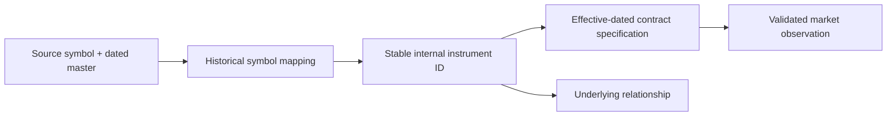

# Indian instrument identity and historical contracts

> **Track:** `indian-markets` · **Lesson:** 1 · **Target:** independent reasoning (4/5)  
> **Prerequisite:** read the track index and complete prior diagnostic questions.  
> **Outcome:** Define unique identities for equity, index, future and option instruments while preserving historical specifications.

## Socratic opening — answer before reading

1. Why is the current instrument master insufficient to reconstruct an old options universe?
2. Would a change in lot size always require a new instrument ID?
3. How do underlying IDs differ from instrument IDs?

**Tutor protocol:** ask one question at a time in a live session. The tutor should not reveal the worked solution until the learner has attempted the problem and been probed on the reasoning. These questions are a study bank, not evidence of mastery.

## Core reasoning

A symbol is a venue's presentation layer, not a permanent identity. For derivatives the economic contract also depends on exchange/segment, underlying, expiry and contract terms. Record *effective-dated* metadata: venue symbol mapping, lot size, tick size and lifecycle status. Distinguish the underlying instrument from the listed derivative instrument. Historical snapshots constrain what could have been known in a past backtest.

## Mathematical or engineering model

An instrument key is conceptual, not a numerical formula. An illustrative option natural key: `(venue, segment, underlying_id, expiry, strike, right, contract_class)`; attach an immutable internal ID. Track `valid_from`, `valid_to`, `observed_at`, `source_snapshot_id`. Beware reissued symbols and historical changes; definitive key rules must reflect source specifications.

## Worked example (read after attempting)

A NIFTY call with strike 25,000 and expiry A is different from the same strike and right with expiry B. If an exchange adjusts an outstanding contract's lot size, the original internal ID may stay stable while the versioned contract specification changes, subject to the exchange's actual contract rules.

## Visual model

## Failure modes and misconceptions

**Trap:** using broker instrument tokens or current symbol strings as historical identity; assuming a master downloaded today is equivalent to one published in the past.

## Build or paper exercise

Design four synthetic sample instruments: equity, index, future, call option. Give a 2024 and 2026 symbol mapping for one instrument, and state what remains stable. Do not invent current exchange contract identifiers.

## Verification and cross-connections

Verify dimensional units, edge cases, reproducibility and whether each input was actually observable at decision time.

## Evidence and references

[NSE UDiFF reports](https://www.nseindia.com/all-reports-derivatives) · [NSE Clearing UDiFF specifications](https://www.nseclearing.in/udiff)

## Mastery gate

To claim **4/5**, solve two independent variants, including one without hints after a delay. To claim **5/5**, explain a counterexample, show an edge case and teach the model clearly. Record evidence in `docs/learning-material/MASTERY-TRACKER.md`.
