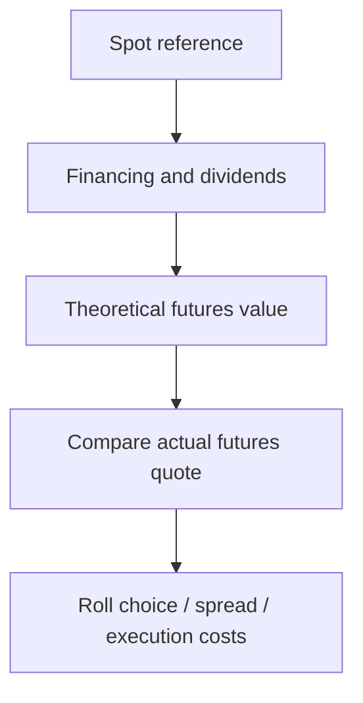

# Futures pricing, basis and rolls

> **Track:** `indian-markets` · **Lesson:** 2 · **Target:** independent reasoning (4/5)  
> **Prerequisite:** read the track index and complete prior diagnostic questions.  
> **Outcome:** Derive an idealized carry relationship and explain why actual futures prices differ.

## Socratic opening — answer before reading

1. Why is futures price not always equal to expected future spot price?
2. What happens to the idealized price when dividend yield rises?
3. Why is back-adjusting a continuous futures series potentially misleading for P&L?

**Tutor protocol:** ask one question at a time in a live session. The tutor should not reveal the worked solution until the learner has attempted the problem and been probed on the reasoning. These questions are a study bank, not evidence of mastery.

## Core reasoning

A future is a dated contract with settlement, margin and mark-to-market mechanics. Spot–futures basis changes with carry, dividends, funding, liquidity and market expectations. An idealized no-arbitrage relation is not a guaranteed forecast. A continuous futures series is synthetic and must specify its roll rule and adjustment methodology.

## Mathematical or engineering model

For a simple continuously compounded stock-index carry model: $$F_0=S_0e^{(r-q)T}$$ where $r$ is funding rate, $q$ is continuous dividend yield and $T$ is years. Basis $=F-S$. For no dividends and simple financing $F≈S(1+rT)$ for short maturities, subject to assumptions.

## Worked example (read after attempting)

Illustration: $S=₹1000$, $r=6\%$, $q=2\%$, $T=0.25$. Then $F≈1000e^{0.04(0.25)}≈₹1010.05$. This is theoretical carry under idealized assumptions; actual quotations can differ due to frictions and pricing inputs.

## Visual model

## Failure modes and misconceptions

Identify the assumptions and find a counterexample before adopting the model. In MOSAIC, keep raw observations distinct from modelling assumptions.

## Build or paper exercise

Build a paper roll example with two contract expiries and explicit daily quotes. Compute unadjusted and back-adjusted series and label which one is a tradable transaction price.

## Verification and cross-connections

Verify dimensional units, edge cases, reproducibility and whether each input was actually observable at decision time.

## Evidence and references

[CFA Institute derivatives resources](https://www.cfainstitute.org/insights/professional-learning/refresher-readings/2026/pricing-valuation-options)

## Mastery gate

To claim **4/5**, solve two independent variants, including one without hints after a delay. To claim **5/5**, explain a counterexample, show an edge case and teach the model clearly. Record evidence in `docs/learning-material/MASTERY-TRACKER.md`.
