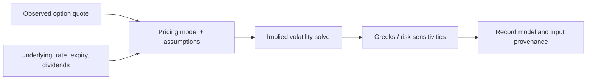

# Implied volatility and option Greeks

> **Track:** `indian-markets` · **Lesson:** 4 · **Target:** independent reasoning (4/5)  
> **Prerequisite:** read the track index and complete prior diagnostic questions.  
> **Outcome:** Differentiate observed prices from model-implied sensitivity estimates.

## Socratic opening — answer before reading

1. Is delta a probability of expiring in-the-money?
2. Can a single observed option price imply IV with no pricing model?
3. Which assumptions break when BSM is applied naively to market-specific derivatives?

**Tutor protocol:** ask one question at a time in a live session. The tutor should not reveal the worked solution until the learner has attempted the problem and been probed on the reasoning. These questions are a study bank, not evidence of mastery.

## Core reasoning

Greeks are **model sensitivities**, not exchange-observed facts unless supplied by a vendor as derived output. Delta measures first-order response to underlying; gamma change in delta; vega response to implied volatility; theta local time sensitivity (conventions differ). Implied volatility is a parameter solving a pricing-model equation, not a directly observable realized volatility.

## Mathematical or engineering model

In a simple BSM European-call setting with no dividends, $$C=S N(d_1)-Ke^{-rT}N(d_2),$$ $$d_1=[\ln(S/K)+(r+\sigma^2/2)T]/(\sigma\sqrt{T}),\quad d_2=d_1-\sigma\sqrt{T}.$$ Delta $=\partial C/\partial S$; gamma $=\partial^2 C/\partial S^2$; vega $=\partial C/\partial\sigma$. For dividend-bearing underlyings include yield and applicable contract assumptions.

## Worked example (read after attempting)

An option quoted at ₹120 has no standalone well-defined IV without underlying price, strike, expiry time, rates, dividends and pricing model. Two vendors may publish different IV estimates using different clocks and reference prices.

## Visual model

## Failure modes and misconceptions

**Misconception:** Black–Scholes assumptions always fit exchange instruments; model Greeks are exact realized hedging profits; IV equals a statistical forecast with guaranteed accuracy.

## Build or paper exercise

Paper exercise: hold all else fixed and reason how a call price changes with rising volatility. Explain which Greeks are local approximations and how their meaning changes close to expiry.

## Verification and cross-connections

Verify dimensional units, edge cases, reproducibility and whether each input was actually observable at decision time.

## Evidence and references

[CFA Institute contingent claims](https://www.cfainstitute.org/insights/professional-learning/refresher-readings/2026/valuation-contingent-claims) · [Options Industry Council Greeks](https://prd-web.optionseducation.org/advancedconcepts/volatility-the-greeks)

## Mastery gate

To claim **4/5**, solve two independent variants, including one without hints after a delay. To claim **5/5**, explain a counterexample, show an edge case and teach the model clearly. Record evidence in `docs/learning-material/MASTERY-TRACKER.md`.
