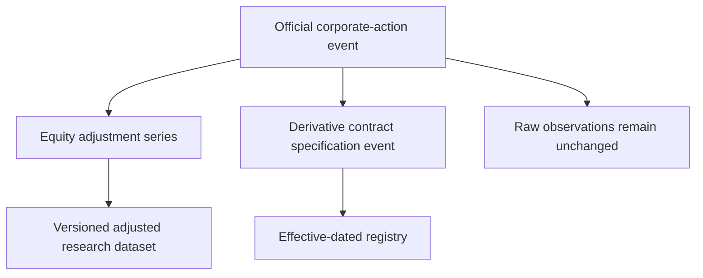

# Corporate actions and derivative contract adjustments

> **Track:** `indian-markets` · **Lesson:** 5 · **Target:** independent reasoning (4/5)  
> **Prerequisite:** read the track index and complete prior diagnostic questions.  
> **Outcome:** Distinguish raw historical facts, adjusted derived series and actual contract-term changes.

## Socratic opening — answer before reading

1. Why must raw prices remain available?
2. Can a cash dividend be handled identically to a stock split?
3. What is the minimum information needed to replay a contract adjustment at a historical timestamp?

**Tutor protocol:** ask one question at a time in a live session. The tutor should not reveal the worked solution until the learner has attempted the problem and been probed on the reasoning. These questions are a study bank, not evidence of mastery.

## Core reasoning

Splits, bonuses, dividends, symbol changes and other corporate actions have different data consequences. Preserve original source observations and corporate-action notices; derive adjusted series separately with versioned factors. Derivative adjustments are contract-specific exchange actions; do not assume multiplying option prices by an equity split factor yields a correct historical option contract.

## Mathematical or engineering model

A 2-for-1 split, in an idealized no-other-change setting, implies ex-split price approximately $P_{new}=P_{old}/2$ and twice the shares; market value is unchanged before other effects. A derived pre-split price series may divide earlier prices by 2, but actual historical transactions remain unadjusted in raw observations.

## Worked example (read after attempting)

A stock recorded at ₹800 before an illustrative 2-for-1 split and ₹400 just after the split should not be treated as a 50% economic loss; adjusted data can remove the mechanical discontinuity. However, contracts on that stock may require exchange-specific strike or lot adjustments.

## Visual model

## Failure modes and misconceptions

Identify the assumptions and find a counterexample before adopting the model. In MOSAIC, keep raw observations distinct from modelling assumptions.

## Build or paper exercise

Design an event table with ex-date, announcement date, record date, source and affected instruments. Explain how a backtest avoids using an action before its announcement was known.

## Verification and cross-connections

Verify dimensional units, edge cases, reproducibility and whether each input was actually observable at decision time.

## Evidence and references

[NSE Clearing resources](https://www.nseclearing.in/udiff)

## Mastery gate

To claim **4/5**, solve two independent variants, including one without hints after a delay. To claim **5/5**, explain a counterexample, show an edge case and teach the model clearly. Record evidence in `docs/learning-material/MASTERY-TRACKER.md`.
