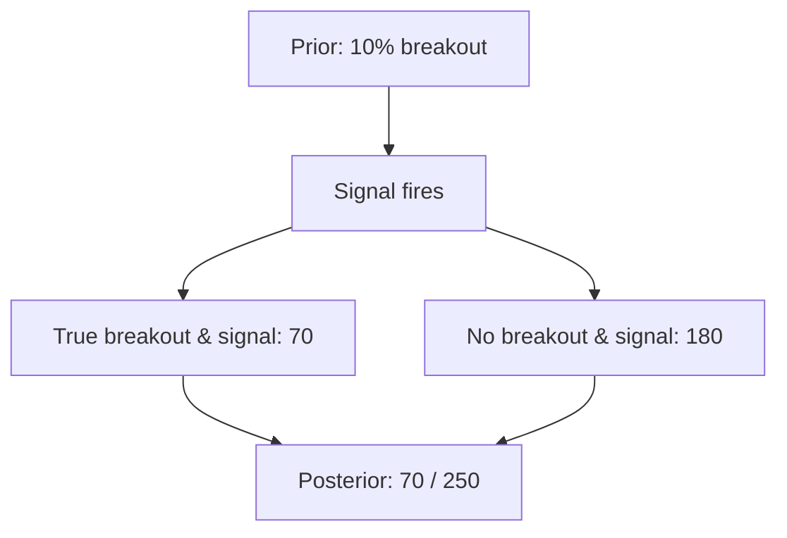

# Bayesian updates and base rates

> **Track:** `quant-foundations` · **Lesson:** 2 · **Target:** independent reasoning (4/5)  
> **Prerequisite:** read the track index and complete prior diagnostic questions.  
> **Outcome:** Compute a posterior probability and defend it against base-rate neglect.

## Socratic opening — answer before reading

1. If an indicator has 90% sensitivity, can its alert still be mostly false?
2. Which probability is the numerator in Bayes rule?
3. How could changing market regimes invalidate an estimated base rate?

**Tutor protocol:** ask one question at a time in a live session. The tutor should not reveal the worked solution until the learner has attempted the problem and been probed on the reasoning. These questions are a study bank, not evidence of mastery.

## Core reasoning

Conditional probability changes when new evidence arrives. In trading, an indicator can look highly accurate during a rare regime while having a low overall positive predictive value. Always identify the population, prior and whether the signal sensitivity/specificity came from out-of-sample data.

## Mathematical or engineering model

Bayes' rule: $$P(H\mid S)=\frac{P(S\mid H)P(H)}{P(S\mid H)P(H)+P(S\mid\neg H)P(\neg H)}.$$ Odds update: posterior odds = prior odds × likelihood ratio.

## Worked example (read after attempting)

Only 10% of periods have a genuine breakout. A signal fires in 70% of true breakout periods and in 20% of others. Among 1,000 periods: 70 true positives and 180 false positives, so $P(\text{breakout}\mid\text{signal})=70/250=28\%$. A 70% sensitivity does **not** imply a 70% chance of breakout after a signal.

## Visual model

## Failure modes and misconceptions

**Misconception:** confusing $P(S\mid H)$ with $P(H\mid S)$; confusing historical signal precision with a stable future probability.

## Build or paper exercise

Recalculate the posterior if the false-positive rate falls to 5%; then simulate 1,000 observations and compare empirical to analytic posterior. Explain when independence assumptions fail.

## Verification and cross-connections

Verify dimensional units, edge cases, reproducibility and whether each input was actually observable at decision time.

## Evidence and references

[Jane Street Probability & Markets Guide](https://www.janestreet.com/probability-markets/)

## Mastery gate

To claim **4/5**, solve two independent variants, including one without hints after a delay. To claim **5/5**, explain a counterexample, show an edge case and teach the model clearly. Record evidence in `docs/learning-material/MASTERY-TRACKER.md`.
