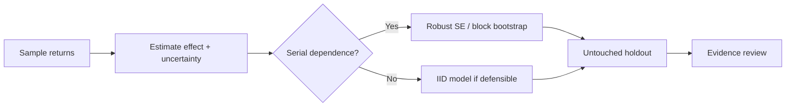

# Sampling uncertainty, confidence intervals and multiple testing

> **Track:** `quant-foundations` · **Lesson:** 3 · **Target:** independent reasoning (4/5)  
> **Prerequisite:** read the track index and complete prior diagnostic questions.  
> **Outcome:** Quantify the uncertainty of an observed mean and describe why strategy mining inflates false discoveries.

## Socratic opening — answer before reading

1. Why does a wider confidence interval not mean the strategy is objectively less profitable?
2. What happens to standard error if truly independent sample size quadruples?
3. How does choosing the best of 500 strategies affect inference?

**Tutor protocol:** ask one question at a time in a live session. The tutor should not reveal the worked solution until the learner has attempted the problem and been probed on the reasoning. These questions are a study bank, not evidence of mastery.

## Core reasoning

Sample statistics estimate unknown population quantities. A high sample Sharpe can result from luck, selection bias or non-stationarity. IID confidence intervals are often inappropriate for serially correlated strategy returns; use defensible dependence-aware procedures and stress assumptions. Running hundreds of strategies and showing the best result selects favorable noise.

## Mathematical or engineering model

IID standard error of the sample mean: $$SE(\bar X)=s/\sqrt{n}.$$ An approximate interval under suitable assumptions is $\bar X\pm 1.96SE$. If returns are autocorrelated, adjust the variance estimate or use an appropriate resampling method (e.g. block bootstrap). Multiple testing means nominal p-values do not represent post-selection significance.

## Worked example (read after attempting)

100 approximately independent daily P&L observations have mean ₹30 and sample standard deviation ₹200. $SE=₹20$; a rough 95% interval is ₹30 ± ₹39.2, including zero. The observed mean alone is weak evidence. If you examined 500 strategy variants and kept the best, its apparent significance is even less convincing.

## Visual model

## Failure modes and misconceptions

**Misconception:** treating number of candles as number of independent observations or reading confidence intervals as guaranteed bounds on the unknown mean.

## Build or paper exercise

Write a one-page critique of a strategy claiming a 3.0 Sharpe with 30 trades, after 200 hyperparameter trials. Suggest a defensible experiment design.

## Verification and cross-connections

Verify dimensional units, edge cases, reproducibility and whether each input was actually observable at decision time.

## Evidence and references

[CFA Institute refresher readings](https://www.cfainstitute.org/insights/professional-learning/refresher-readings)

## Mastery gate

To claim **4/5**, solve two independent variants, including one without hints after a delay. To claim **5/5**, explain a counterexample, show an edge case and teach the model clearly. Record evidence in `docs/learning-material/MASTERY-TRACKER.md`.
