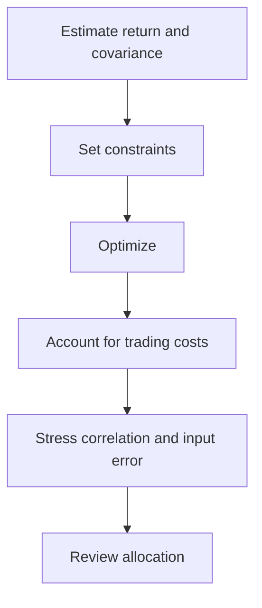

# Vectors, covariance and constrained optimization

> **Track:** `quant-foundations` · **Lesson:** 4 · **Target:** independent reasoning (4/5)  
> **Prerequisite:** read the track index and complete prior diagnostic questions.  
> **Outcome:** Translate multi-instrument exposure into matrix risk and constrained portfolio choices.

## Socratic opening — answer before reading

1. Can a perfectly correlated second instrument diversify risk?
2. What happens if an estimated covariance matrix is not positive semi-definite?
3. Why can a mean-variance optimizer produce unstable large weights?

**Tutor protocol:** ask one question at a time in a live session. The tutor should not reveal the worked solution until the learner has attempted the problem and been probed on the reasoning. These questions are a study bank, not evidence of mastery.

## Core reasoning

Portfolio weights form a vector. A covariance matrix expresses pairwise co-movement. Optimization solutions depend heavily on uncertain inputs, turnover, transaction costs and constraints. Covariance is not identical to correlation, and historical estimates change in stressed markets.

## Mathematical or engineering model

For weight vector $w$ and covariance matrix $\Sigma$, $$\sigma_p^2=w^T\Sigma w.$$ For expected returns vector $\mu$, $E[r_p]=w^T\mu$. A constrained optimizer may minimize $w^T\Sigma w + \lambda\|w-w_{prev}\|_1$ subject to budget, leverage and concentration constraints.

## Worked example (read after attempting)

Two instruments with 10% volatility each, equal weights, and correlation 0: portfolio volatility is $\sqrt{0.5^2(0.1)^2+0.5^2(0.1)^2}≈7.07\%$. If correlation rises to 1, the volatility becomes 10%. Diversification depends on correlation, not number of symbols alone.

## Visual model

## Failure modes and misconceptions

Identify the assumptions and find a counterexample before adopting the model. In MOSAIC, keep raw observations distinct from modelling assumptions.

## Build or paper exercise

Calculate portfolio volatility for two assets at correlations -0.5, 0, 0.5 and 1. Plot the curve; add a 10% concentration limit and reason about feasibility.

## Verification and cross-connections

Verify dimensional units, edge cases, reproducibility and whether each input was actually observable at decision time.

## Evidence and references

[PyPortfolioOpt documentation](https://pyportfolioopt.readthedocs.io/)

## Mastery gate

To claim **4/5**, solve two independent variants, including one without hints after a delay. To claim **5/5**, explain a counterexample, show an edge case and teach the model clearly. Record evidence in `docs/learning-material/MASTERY-TRACKER.md`.
