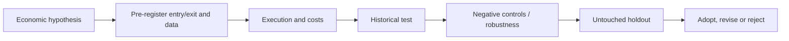

# From economic hypothesis to falsifiable strategy

> **Track:** `strategy-research` · **Lesson:** 1 · **Target:** independent reasoning (4/5)  
> **Prerequisite:** read the track index and complete prior diagnostic questions.  
> **Outcome:** Write a causal mechanism and measurable rejection criteria before tuning parameters.

## Socratic opening — answer before reading

1. What observation would falsify your hypothesis?
2. Why isn't a chart pattern itself a causal explanation?
3. What are the earliest realistically tradeable prices after a signal arrives?

**Tutor protocol:** ask one question at a time in a live session. The tutor should not reveal the worked solution until the learner has attempted the problem and been probed on the reasoning. These questions are a study bank, not evidence of mastery.

## Core reasoning

A strategy starts with an economic or structural hypothesis, not a profitable-looking chart. Specify who might supply the edge, why it should exist, execution feasibility, capacity, horizon, data requirements and conditions under which it should fail. Separate hypothesis generation from evaluation on an untouched holdout.

## Mathematical or engineering model

Expected net return = estimated gross signal return − commissions − spread crossing − slippage − market impact − taxes/financing where applicable. The entire expression is conditional on the actual execution policy and fills; it cannot be inferred from signal direction accuracy alone.

## Worked example (read after attempting)

Hypothesis: overnight index gap mean-reverts under certain liquidity conditions. Specify opening auction availability and actual tradeable first price. A backtest entering at yesterday's close after observing today's opening gap leaks information.

## Visual model

## Failure modes and misconceptions

Identify the assumptions and find a counterexample before adopting the model. In MOSAIC, keep raw observations distinct from modelling assumptions.

## Build or paper exercise

Write a one-page strategy card containing mechanism, universe, data availability, entry/exit, cost model, failure cases and decision criteria before collecting results.

## Verification and cross-connections

Verify dimensional units, edge cases, reproducibility and whether each input was actually observable at decision time.

## Evidence and references

[MOSAIC backtesting architecture](../../architecture/08-backtesting-validation.md)

## Mastery gate

To claim **4/5**, solve two independent variants, including one without hints after a delay. To claim **5/5**, explain a counterexample, show an edge case and teach the model clearly. Record evidence in `docs/learning-material/MASTERY-TRACKER.md`.
