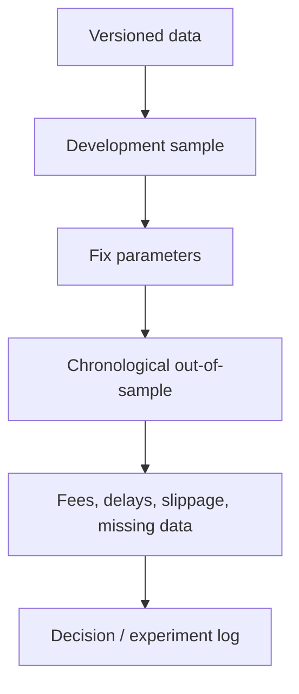

# Backtesting, walk-forward tests and false discoveries

> **Track:** `strategy-research` · **Lesson:** 2 · **Target:** independent reasoning (4/5)  
> **Prerequisite:** read the track index and complete prior diagnostic questions.  
> **Outcome:** Design out-of-sample tests that limit leakage and parameter mining.

## Socratic opening — answer before reading

1. Why do random train/test splits often mislead on time series?
2. What is a good negative control for a strategy?
3. How can a strategy have a high win rate but negative expectancy?

**Tutor protocol:** ask one question at a time in a live session. The tutor should not reveal the worked solution until the learner has attempted the problem and been probed on the reasoning. These questions are a study bank, not evidence of mastery.

## Core reasoning

Backtests are experiments with historical data and execution assumptions, not estimates of guaranteed profits. Use chronological splits, untouched holdouts, realistic corporate actions and delistings. Where labels overlap, consider purging/embargoes. Include a null model and negative controls; maintain an experiment ledger including failed attempts.

## Mathematical or engineering model

For equity curve $V_t$, drawdown $DD_t=V_t/\max_{s\le t}V_s-1$. Profit factor $=\sum positive\ trades/|\sum negative\ trades|$ if denominators meaningful. Annualized Sharpe $≈\sqrt{N}\bar r/s_r$ under specific sampling assumptions; costs and dependence can change interpretation.

## Worked example (read after attempting)

An apparent strategy wins only when tested on finalized end-of-day candles but generates decisions 5 minutes before close. This may be lookahead; recreate the information set at the actual decision timestamp.

## Visual model

## Failure modes and misconceptions

Identify the assumptions and find a counterexample before adopting the model. In MOSAIC, keep raw observations distinct from modelling assumptions.

## Build or paper exercise

Design a 5-year chronological split with a 12-month untouched holdout. Describe one possible leakage route and one execution realism correction.

## Verification and cross-connections

Verify dimensional units, edge cases, reproducibility and whether each input was actually observable at decision time.

## Evidence and references

[MOSAIC backtesting chapter](../../architecture/08-backtesting-validation.md)

## Mastery gate

To claim **4/5**, solve two independent variants, including one without hints after a delay. To claim **5/5**, explain a counterexample, show an edge case and teach the model clearly. Record evidence in `docs/learning-material/MASTERY-TRACKER.md`.
