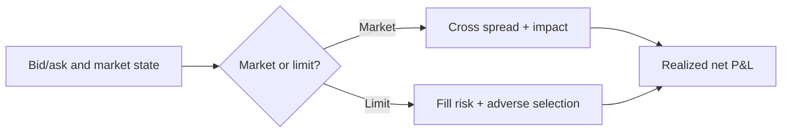

# Market microstructure, spread and slippage

> **Track:** `strategy-research` · **Lesson:** 3 · **Target:** independent reasoning (4/5)  
> **Prerequisite:** read the track index and complete prior diagnostic questions.  
> **Outcome:** Estimate execution-conditioned returns rather than assuming midpoint fills.

## Socratic opening — answer before reading

1. Why can a maker order with better nominal price produce worse selection bias?
2. Why can't 5-level snapshots reconstruct every order cancellation?
3. How does trade size interact with liquidity?

**Tutor protocol:** ask one question at a time in a live session. The tutor should not reveal the worked solution until the learner has attempted the problem and been probed on the reasoning. These questions are a study bank, not evidence of mastery.

## Core reasoning

Quoted bid/ask is a snapshot of displayed liquidity, not a guaranteed fill. A buy market order usually crosses the ask (subject to depth), while a limit order might not execute and can face adverse selection. Execution cost depends on order size, book depth, volatility and delays. L2 market-by-price data is not L3 individual-order data.

## Mathematical or engineering model

Midprice $m=(bid+ask)/2$; quoted spread $s=ask-bid$; relative spread $s/m$. Implementation shortfall compares decision-price benchmark to realized execution value including fees. A simple estimated cost model might be $C(q)=fees+half\_spread+impact(q)$, but empirical fill data is essential for credible calibration.

## Worked example (read after attempting)

Bid ₹99.9, ask ₹100.1 ⇒ mid ₹100 and spread ₹0.2. Buying at ₹100.1 immediately costs ₹0.1 relative to the midpoint even before brokerage and impact. Quoting at ₹99.9 avoids crossing but could remain unfilled.

## Visual model

## Failure modes and misconceptions

Identify the assumptions and find a counterexample before adopting the model. In MOSAIC, keep raw observations distinct from modelling assumptions.

## Build or paper exercise

Create a hand-calculated two-level order book. Execute an order larger than the best ask size and compute its volume-weighted fill and midpoint shortfall.

## Verification and cross-connections

Verify dimensional units, edge cases, reproducibility and whether each input was actually observable at decision time.

## Evidence and references

[Jane Street Probability & Markets Guide](https://www.janestreet.com/probability-markets/)

## Mastery gate

To claim **4/5**, solve two independent variants, including one without hints after a delay. To claim **5/5**, explain a counterexample, show an edge case and teach the model clearly. Record evidence in `docs/learning-material/MASTERY-TRACKER.md`.
