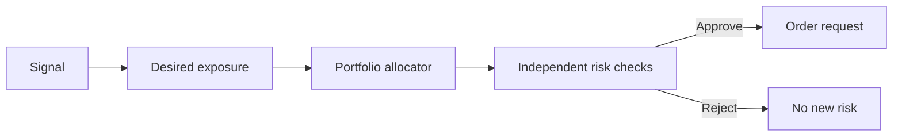

# Position sizing, concentration and risk budgets

> **Track:** `strategy-research` · **Lesson:** 4 · **Target:** independent reasoning (4/5)  
> **Prerequisite:** read the track index and complete prior diagnostic questions.  
> **Outcome:** Translate signal conviction into bounded capital exposure while separating target from authorization.

## Socratic opening — answer before reading

1. Why is posted margin different from economic exposure?
2. Can two individually small trades create large correlated risk?
3. Who must have final authority to reject a proposed order?

**Tutor protocol:** ask one question at a time in a live session. The tutor should not reveal the worked solution until the learner has attempted the problem and been probed on the reasoning. These questions are a study bank, not evidence of mastery.

## Core reasoning

Signal confidence is not a risk budget. Portfolio sizing depends on volatility, liquidity, instrument multiplier, leverage/margin, concentration and correlated exposures. Strategies propose targets; independent risk control authorizes permitted orders. A mathematical optimizer cannot override hard account or regulatory limits.

## Mathematical or engineering model

For position quantity $q$ and price $P$, approximate notional $N=qP$ for cash equities; derivatives require contract multiplier and exposure conventions. Risk contributions depend on joint covariance, not just standalone volatilities. Expected loss under a stop-loss is not a guaranteed maximum loss during gaps.

## Worked example (read after attempting)

An illustrative capital budget ₹100,000 with 2% single-position notional cap permits ₹2,000 of cash-equity notional, not automatically ₹2,000 of futures margin. Futures notional and margin are different quantities.

## Visual model

## Failure modes and misconceptions

Identify the assumptions and find a counterexample before adopting the model. In MOSAIC, keep raw observations distinct from modelling assumptions.

## Build or paper exercise

Define hypothetical hard constraints for gross exposure, per-instrument concentration and max daily drawdown. Explain why estimates cannot bypass hard limits.

## Verification and cross-connections

Verify dimensional units, edge cases, reproducibility and whether each input was actually observable at decision time.

## Evidence and references

[MOSAIC portfolio architecture](../../architecture/09-portfolio-capital-accounting.md) · [risk authority](../../architecture/10-independent-risk-authority.md)

## Mastery gate

To claim **4/5**, solve two independent variants, including one without hints after a delay. To claim **5/5**, explain a counterexample, show an edge case and teach the model clearly. Record evidence in `docs/learning-material/MASTERY-TRACKER.md`.
