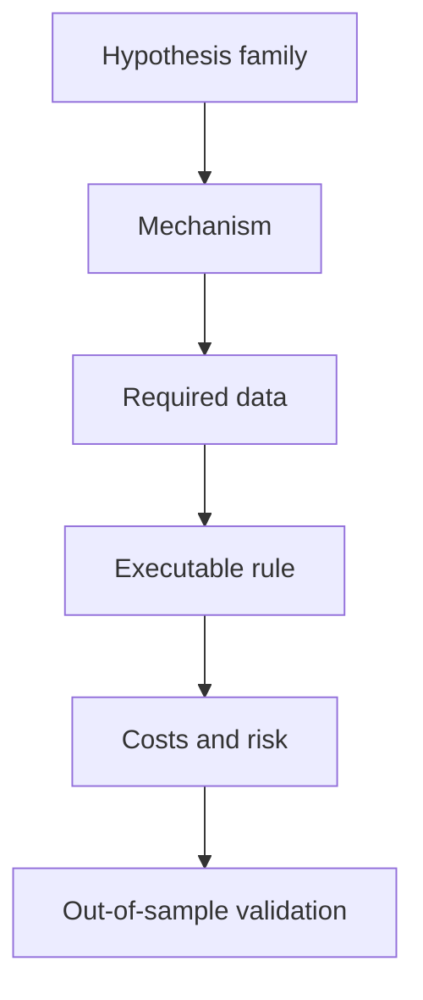

# Strategy taxonomy and research readiness

> **Track:** `strategy-research` · **Lesson:** 5 · **Target:** independent reasoning (4/5)  
> **Prerequisite:** read the track index and complete prior diagnostic questions.  
> **Outcome:** Compare momentum, mean reversion, carry, volatility and event-driven approaches without asserting an edge.

## Socratic opening — answer before reading

1. Why is a strategy label not a sufficient explanation of edge?
2. Which family might be harmed by persistent trend regime changes?
3. Why should strategy families be diversified by risk sources, not only by names?

**Tutor protocol:** ask one question at a time in a live session. The tutor should not reveal the worked solution until the learner has attempted the problem and been probed on the reasoning. These questions are a study bank, not evidence of mastery.

## Core reasoning

Strategy families describe mechanisms, not plug-and-play profitable systems. Momentum assumes some continuation; mean reversion assumes temporary deviations; carry earns compensation for holding certain exposures; volatility strategies express realized-versus-implied volatility expectations; event strategies trade around information arrival. Their viability depends on venue-specific mechanics, transaction costs, horizons and changing regimes.

## Mathematical or engineering model

A generic signal score can be standardized $z_t=(x_t-\mu_{past})/\sigma_{past}$ where mean and variance use only eligible past observations. A threshold strategy $1[z_t>c]$ is a hypothesis candidate, not evidence of predictive power. Guard against dividing by near-zero variance and lookahead in rolling estimates.

## Worked example (read after attempting)

A naive five-day reversal strategy buys the worst performers. It can appear profitable on closing prices yet fail when shorting constraints, opening gaps and costs are included. Recast the strategy as a testable claim about liquidity-driven reversals with predeclared execution points.

## Visual model

## Failure modes and misconceptions

Identify the assumptions and find a counterexample before adopting the model. In MOSAIC, keep raw observations distinct from modelling assumptions.

## Build or paper exercise

Prepare a five-row table: family, possible mechanism, minimum data, biggest bias, execution bottleneck. Choose one for a non-trading research project.

## Verification and cross-connections

Verify dimensional units, edge cases, reproducibility and whether each input was actually observable at decision time.

## Evidence and references

[MOSAIC strategy runtime](../../architecture/07-strategy-runtime-signals.md)

## Mastery gate

To claim **4/5**, solve two independent variants, including one without hints after a delay. To claim **5/5**, explain a counterexample, show an edge case and teach the model clearly. Record evidence in `docs/learning-material/MASTERY-TRACKER.md`.
