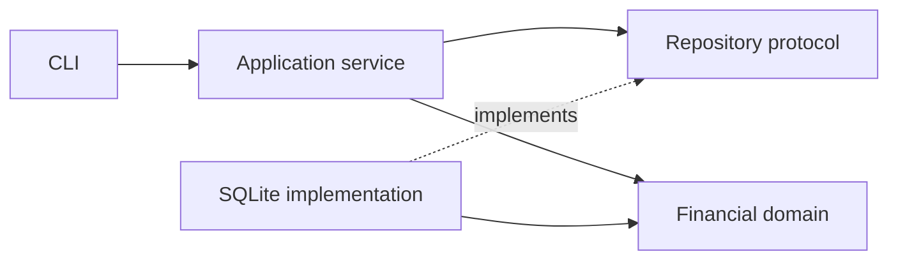

# Python domain models, type systems and dependency inversion

> **Track:** `systems-engineering` · **Lesson:** 1 · **Target:** independent reasoning (4/5)  
> **Prerequisite:** read the track index and complete prior diagnostic questions.  
> **Outcome:** Write independently testable financial models without storage or provider dependencies.

## Socratic opening — answer before reading

1. Which layer decides whether an option without expiry is invalid?
2. Why shouldn't a domain class import `sqlite3`?
3. When does using `Decimal` everywhere become counterproductive?

**Tutor protocol:** ask one question at a time in a live session. The tutor should not reveal the worked solution until the learner has attempted the problem and been probed on the reasoning. These questions are a study bank, not evidence of mastery.

## Core reasoning

Treat `InstrumentId`, `Expiry`, `Strike` and other domain concepts as explicit validated values. A frozen dataclass or typed model can enforce immutability of a record, but immutability does not guarantee correctness. Use `Decimal` for exact monetary values or contract attributes where required, and floating point arrays for numerical research when suitable. Put provider-specific decoding outside the domain.

## Mathematical or engineering model

A critical invariant might be `option.expiry is not None`, `strike > 0` and `right in {CALL, PUT}`. The identity tuple must include appropriate venue and instrument-class distinctions, while lot-size history is effective-dated metadata rather than an assumed permanent key.

## Worked example (read after attempting)

A test constructs an option with missing expiry and expects a domain validation error without opening SQLite. A separate adapter test checks an NSE source row maps into a valid option model. Keeping these separate makes failures diagnosable.

## Visual model

## Failure modes and misconceptions

Identify the assumptions and find a counterexample before adopting the model. In MOSAIC, keep raw observations distinct from modelling assumptions.

## Build or paper exercise

Define an immutable `InstrumentId` and three invariants, then list unit tests. Do not implement real exchange symbols until reference format is verified.

## Verification and cross-connections

Verify dimensional units, edge cases, reproducibility and whether each input was actually observable at decision time.

## Evidence and references

[Python dataclasses](https://docs.python.org/3/library/dataclasses.html)

## Mastery gate

To claim **4/5**, solve two independent variants, including one without hints after a delay. To claim **5/5**, explain a counterexample, show an edge case and teach the model clearly. Record evidence in `docs/learning-material/MASTERY-TRACKER.md`.
