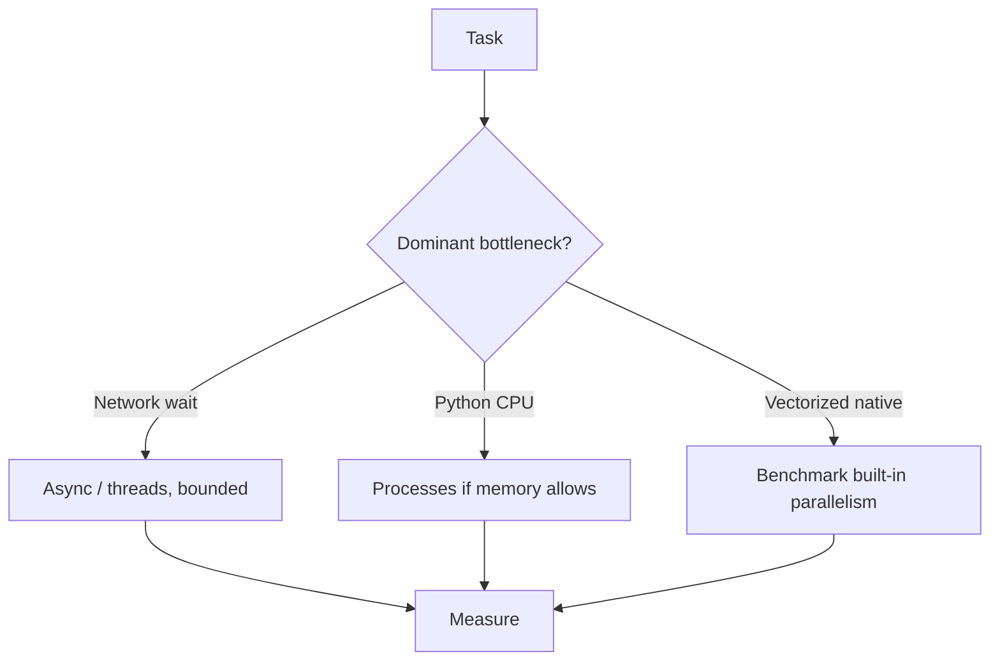

# Sequential, async, threads and processes

> **Track:** `systems-engineering` · **Lesson:** 2 · **Target:** independent reasoning (4/5)  
> **Prerequisite:** read the track index and complete prior diagnostic questions.  
> **Outcome:** Select concurrency from workload bottlenecks and correctness constraints.

## Socratic opening — answer before reading

1. Why might asyncio be slower if parsing blocks the event loop?
2. Why could four processes be worse than one on an 8GB laptop?
3. What evidence would justify adding a queue?

**Tutor protocol:** ask one question at a time in a live session. The tutor should not reveal the worked solution until the learner has attempted the problem and been probed on the reasoning. These questions are a study bank, not evidence of mastery.

## Core reasoning

Concurrency overlaps tasks; parallelism executes on multiple cores. `asyncio` works when operations cooperate and do not block the loop. Threads suit much blocking I/O; processes can isolate CPU-heavy Python work but consume extra memory. Use bounded concurrency, source-specific rate limits and backpressure. Begin sequentially until recovery and idempotency are proven.

## Mathematical or engineering model

If average task service time is $W$ and arrival rate $\lambda$, Little's law gives $L=\lambda W$ in a stable system with appropriate definitions. For 8GB laptop operations, measure peak resident memory and throughput, not only average task latency. Batch size × peak per-record memory can dominate.

## Worked example (read after attempting)

Ten downloads each wait 1 second on a remote source: sequential time may approach 10s plus overhead, bounded concurrency can reduce elapsed waiting if permitted. Parsing ten enormous CSVs simultaneously may instead exhaust RAM and slow down due to swapping.

## Visual model

## Failure modes and misconceptions

Identify the assumptions and find a counterexample before adopting the model. In MOSAIC, keep raw observations distinct from modelling assumptions.

## Build or paper exercise

Measure sequential import and two-worker import on synthetic chunks. Record wall time, peak RSS, disk IO and correctness; recommend a worker count based on measurements.

## Verification and cross-connections

Verify dimensional units, edge cases, reproducibility and whether each input was actually observable at decision time.

## Evidence and references

[Python asyncio](https://docs.python.org/3/library/asyncio.html) · [concurrent.futures](https://docs.python.org/3/library/concurrent.futures.html)

## Mastery gate

To claim **4/5**, solve two independent variants, including one without hints after a delay. To claim **5/5**, explain a counterexample, show an edge case and teach the model clearly. Record evidence in `docs/learning-material/MASTERY-TRACKER.md`.
